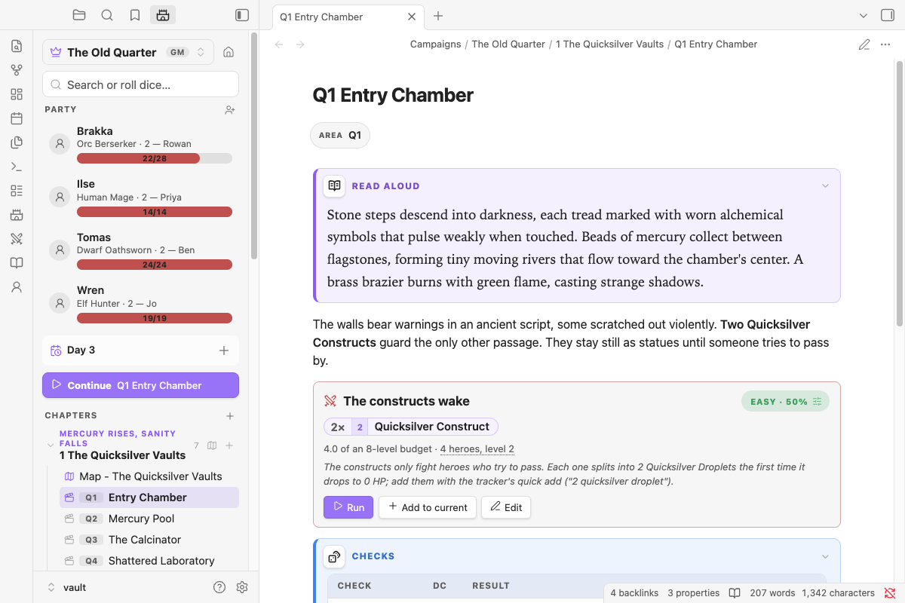
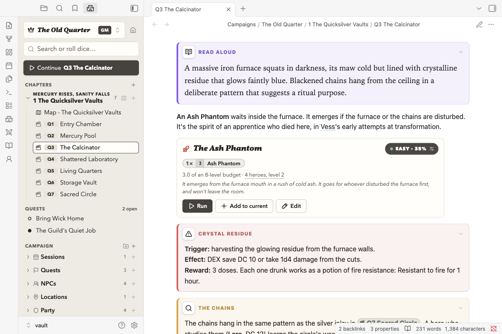
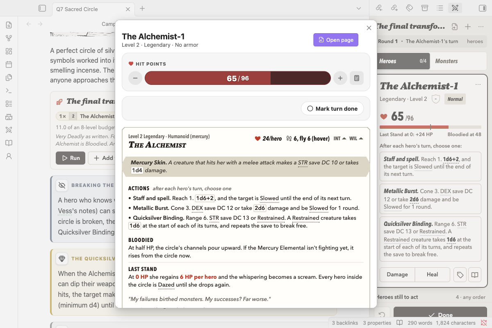
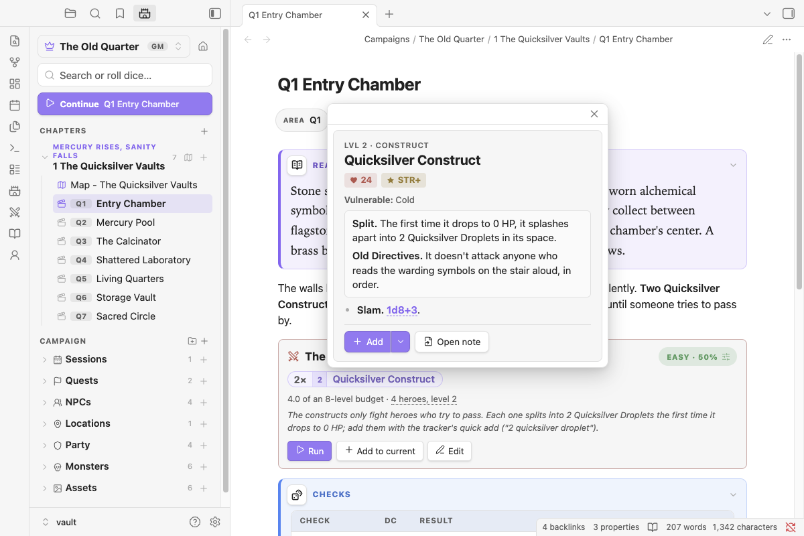
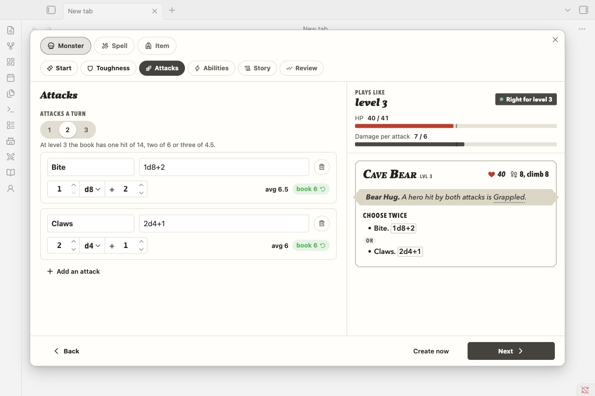
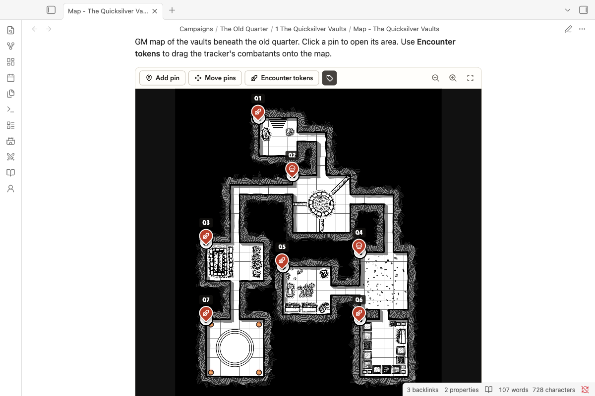
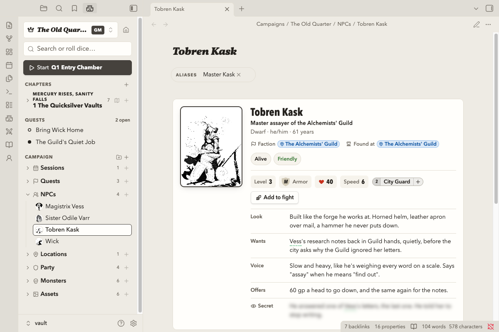
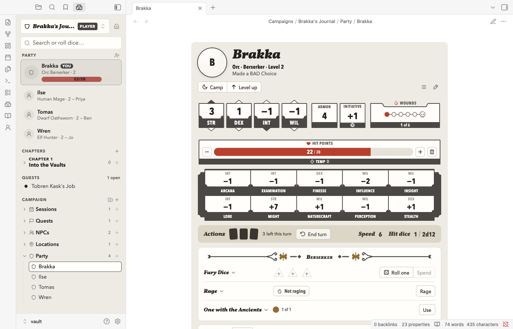

# Ember Vault

A companion for the [Nimble TTRPG](https://nimbleRPG.com) (3.3 rules), built into Obsidian, for both sides of the table. GMs prep and run their game from their own notes: a campaign manager, a searchable compendium of everything in Nimble (525 monsters, every spell, item, class feature and class), a builder for your own monsters, spells and items, quest notes, encounter blocks rated against your party, a combat tracker, GM maps with pins, NPC portrait cards, styled read-aloud boxes and 3D dice. Players get an interactive Nimble character sheet, a party roster, and session notes on the people, places and fights they've met.

If you run one game and play in another, keep both in one vault: every campaign is either one you run or one you play in, and the plugin switches over when you do. It isn't a virtual tabletop.

**Website:** <https://puddinglord.github.io/obsidian-ttrpg-encounter-manager/>

> Ember Vault is an independent product published under the Nimble 3rd Party Creator License. Nimble TTRPG © Nimble Co. Nimble text is included with permission. This tool is free to use for anyone who already owns the content, is trying the system out, or can't afford it right now. If you enjoy Nimble and are able, please support the game by buying the official books at [nimbleRPG.com](https://nimbleRPG.com).

## What it does

**Encounters that know your party.** Type `/encounter 4 quicksilver hound` and you get a block that rates the fight (Easy to Very Deadly) against your heroes, warns you about Nimble's guidelines, and suggests edits to hit the difficulty you want. **Run** sends it to the tracker.

**A tracker that does Nimble's math.** Whoever is acting is on a big card, with everyone else in a queue below it. Heroes go first, in any order: tap whoever speaks up. Then the monsters go one after another, and a legendary monster acts after each hero. Tap anyone's HP for a keypad that applies crits, armor, Vulnerable and minion overkill, and shows the sum before you apply it. Bloodied and Last Stand appear under the card when they happen. See [the tracker](docs/tracker.md).

**No page jumps.** Click a monster pill, an NPC, or anyone in the tracker and their sheet opens in a quick look over what you're doing: the full Nimble stat block (or the NPC's note), with HP, turn, actions and Wounds when they're in the fight. **Open page** is there when you do want the note.

**525 monsters, ready to drop in.** Every monster from the Nimble GM Guide and Monsters & More is bundled and searchable. Hover any `` `nimble:Goblin` `` reference for its stat block, or write your own monsters as notes.

**Make your own monsters on the book's numbers.** Run **New monster…**, pick a role and a level, and press **Create now** for a stat block with the GM Guide's HP and damage for that level. Or type your own numbers and the level check says what they play like. Spells and items work the same way, and homebrew spells and items join the compendium. See [the builder](docs/builder.md).

**Quests that keep score.** Every job gets a note in the campaign's Quests folder: the hook, objectives, the truth behind it and the reward. Link one anywhere with `/quest`; finished quests get a tick and sink below the open ones. See [Quests](docs/quests.md).

**Maps with pins.** Put a pin on every room, linked to its note. Drag the tracker's combatants onto the map as tokens.

**NPCs with faces.** Give an NPC a portrait and they get a character card, with a blurred secret you can reveal when your screen isn't shared. Their name is linked wherever you mention it.

**Play, too.** Make a campaign you play in and your character lives in a note: an interactive version of the official sheet where you tap a stat to roll a save, tap HP to take a hit, and add gear and spells from every Nimble class book. Monsters show what your hero could know instead of their stat blocks, and encounter blocks become battle notes. See [Playing in a campaign](docs/players.md) and [Character sheets](docs/character-sheets.md).

**And more:**
- campaigns, chapters and scenes in a sidebar panel
- links to quests, places and heroes that show as pills with their icon
- Omnisearch (Cmd/Ctrl+K) to find anything, roll dice and add monsters
- help with stat blocks you write, with fixes for lines it can't read
- read-aloud, trap, treasure and clue boxes
- clickable dice and 3D dice
- slash commands for everything
- a full phone and iPad layout

## Install

In Obsidian, open **Settings → Community plugins → Browse**, search for **Ember Vault**, then **Install** and **Enable**.

## Try the sample adventure

**[The Quicksilver Vaults](docs/sample-adventure.md)** is a ready-made vault: a seven-room dungeon with a map, NPCs, custom monsters, a legendary boss and a party already set up. Download **[Ember-Vault-Sample-Adventure.zip](https://puddinglord.github.io/obsidian-ttrpg-encounter-manager/Ember-Vault-Sample-Adventure.zip)**, unzip it, open the folder as a vault, and follow its **Start Here** note.

## Quick start in your own vault

1. Open **Settings → Ember Vault** and add your party (name, class, level, HP, Defense).
2. Type `/` in a note: `/encounter 3 goblin, 2 wolf` writes an encounter block rated against your party.
3. Click **Run** on the block. The tracker opens with the monsters and your heroes.
4. Click **Heroes go first**. Tap whoever speaks up to put them on the card, and **Done** when their turn is over. When every hero has gone, the monsters take their turns: **Next** names who's up, and after the last one it's **Round 2**.

## User guide

The full guide is in **[docs/](docs/README.md)**:
- [Getting started](docs/getting-started.md)
- [Campaigns](docs/campaigns.md)
- [NPCs and portraits](docs/npcs.md)
- [Quests](docs/quests.md)
- [Boxes](docs/boxes.md)
- [The compendium](docs/compendium.md)
- [Bestiary and stat blocks](docs/bestiary.md)
- [The builder](docs/builder.md)
- [Encounters](docs/encounters.md)
- [GM maps](docs/maps.md)
- [Combat tracker](docs/tracker.md)
- [Dice](docs/dice.md)
- [Omnisearch](docs/omnisearch.md)
- [Slash commands](docs/slash-commands.md)
- [Phone and iPad](docs/mobile.md)
- [Settings](docs/settings.md)
- [FAQ](docs/faq.md)

What changed in each release: [CHANGELOG.md](CHANGELOG.md), or the [changelog on the site](https://puddinglord.github.io/obsidian-ttrpg-encounter-manager/changelog/).

## Privacy

- **No network use.** The plugin makes no network requests and sends no data anywhere. There are three exceptions, all things you ask for: an NPC portrait you set to an `https://` image URL loads from that address, **Import link** in the 3D dice settings downloads the dice set at the link you paste, and **Fetch from…** in Import… asks the site of a link you paste (Nimble Nexus, Open5e) for that page's data.
- **Clipboard.** It writes to the clipboard only when you click a **Copy** button (encounter summaries, roll results, encounter blocks).
- **Your files.** Everything it writes is plain Markdown in your vault, plus its own settings file.

## License and credits

The plugin's code is [MIT-licensed](LICENSE). Bundled Nimble content and the third-party libraries it uses are listed in [NOTICE.md](NOTICE.md).

## Development

See [CLAUDE_CODE_GUIDE.md](CLAUDE_CODE_GUIDE.md). Releasing and the landing page (`site/`) are covered in [RELEASING.md](RELEASING.md).

| Command | Does |
|---|---|
| `npm test` | Unit tests |
| `npm run lint` | Obsidian's review rules: ESLint for the code, stylelint for `styles.css` (also run in CI on every PR) |
| `npm run test:e2e` | Drives a real Obsidian |
| `npm run screenshots` | Regenerates `docs/images/` from the sample vault |

The bestiary comes from `scripts/bestiary/` (`python3 -I scripts/bestiary/merge.py`).
