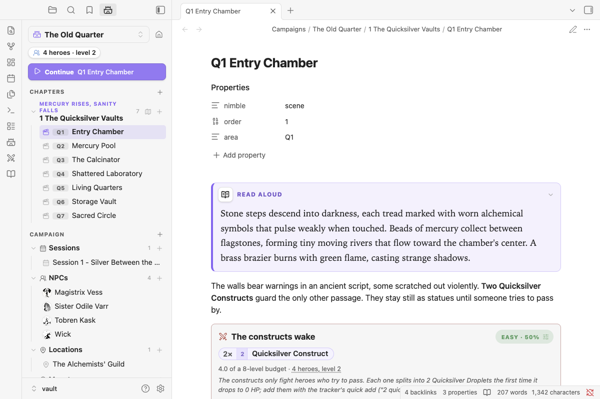
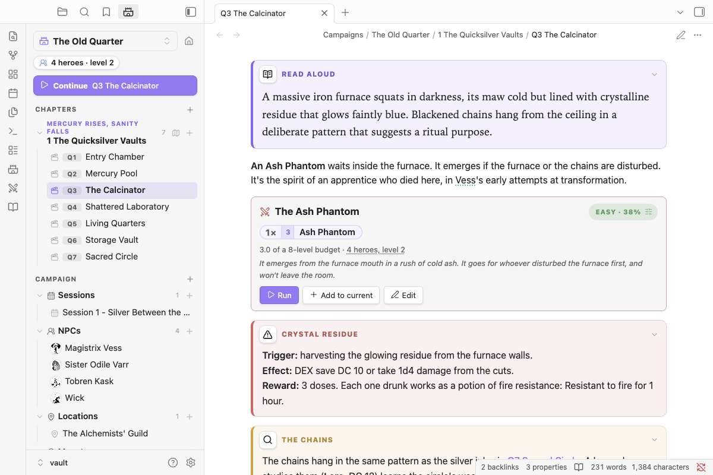
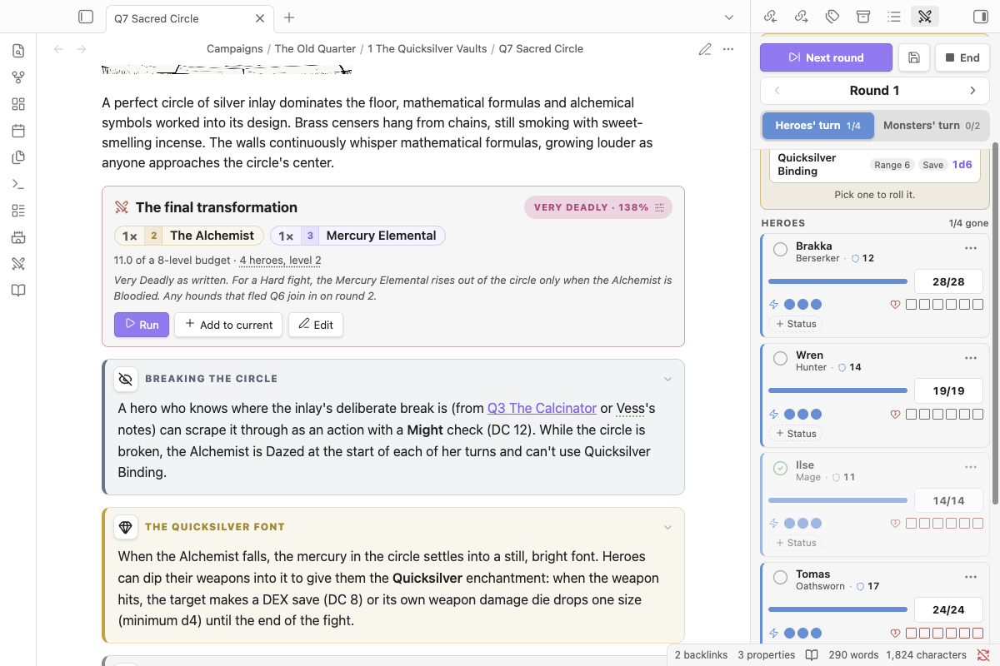
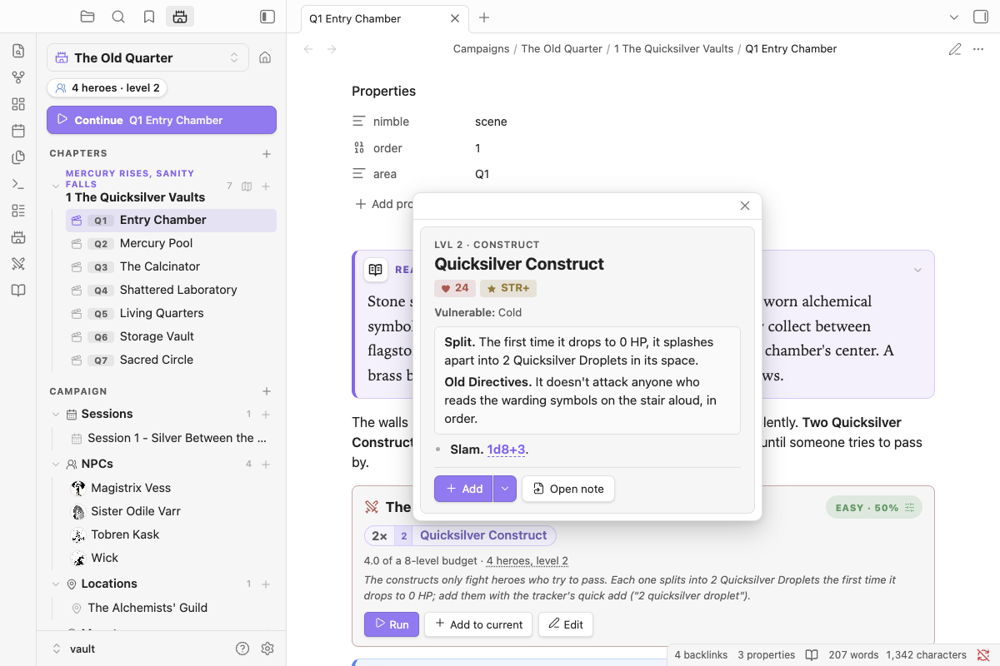
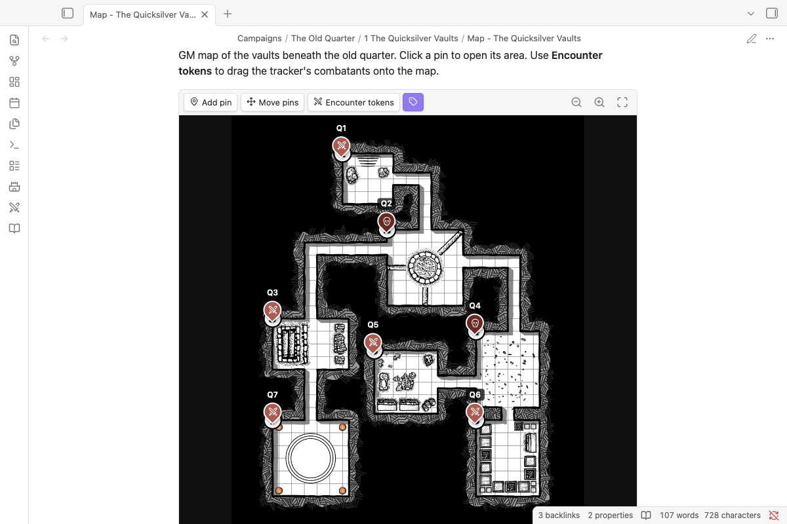
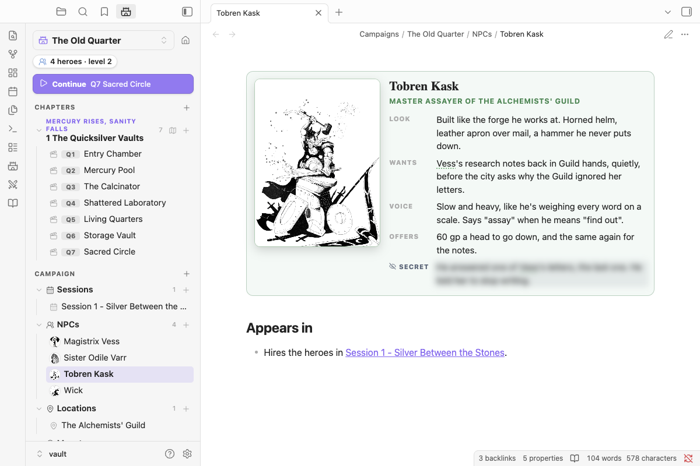

# Ember Vault

A GM companion for the [Nimble TTRPG](https://nimbleRPG.com) (3.2 rules), built into Obsidian. Prep and run your game from your own notes. It includes a campaign manager, a bundled bestiary of 525 monsters, encounter blocks rated against your party, a combat tracker, GM maps with pins, NPC portrait cards, styled read-aloud boxes and 3D dice.

It isn't a virtual tabletop. Everything here is for the GM.

**Website:** <https://puddinglord.github.io/obsidian-ttrpg-encounter-manager/>

> Ember Vault is an independent product published under the Nimble 3rd Party Creator License. Nimble TTRPG © Nimble Co. Nimble text is included with permission. This tool is free to use for anyone who already owns the content, is trying the system out, or can't afford it right now. If you enjoy Nimble and are able, please support the game by buying the official books at [nimbleRPG.com](https://nimbleRPG.com).

## What it does

**Encounters that know your party.** Type `/encounter 4 quicksilver hound` and you get a block that rates the fight (Easy to Very Deadly) against your heroes, warns you about Nimble's guidelines, and suggests edits to hit the difficulty you want. **Run** sends it to the tracker.

**A tracker that does Nimble's math.** Heroes go first, then monsters. Tap a monster's HP for a damage calculator that applies crits, armor, vulnerabilities and minion overkill, and shows the math before you commit. Bloodied and Last Stand appear as prompts.

**No page jumps.** Click a monster pill, an NPC, or anyone in the tracker and their sheet opens in a quick look over what you're doing: the full Nimble stat block (or the NPC's note), with HP, turn, actions and Wounds when they're in the fight. **Open page** is there when you do want the note.

**525 monsters, ready to drop in.** Every monster from the Nimble GM Guide and Monsters & More is bundled and searchable. Hover any `` `nimble:Goblin` `` reference for its stat block, or write your own monsters as notes.

**Maps with pins.** Put a pin on every room, linked to its note. Drag the tracker's combatants onto the map as tokens.

**NPCs with faces.** Give an NPC a portrait and they get a character card, with a blurred secret you can reveal when your screen isn't shared. Their name is linked wherever you mention it.

**And more:**
- campaigns, chapters and scenes in a sidebar panel
- read-aloud, trap, treasure and clue boxes
- clickable dice and 3D dice
- slash commands for everything
- a full phone and iPad layout

## Install

In Obsidian, open **Settings → Community plugins → Browse**, search for **Ember Vault**, then **Install** and **Enable**.

## Try the sample adventure

**[The Quicksilver Vaults](docs/sample-adventure.md)** is a ready-made vault: a seven-room dungeon with a map, NPCs, custom monsters, a legendary boss and a party already set up. Download **[Ember-Vault-Sample-Adventure.zip](https://puddinglord.github.io/obsidian-ttrpg-encounter-manager/Ember-Vault-Sample-Adventure.zip)**, unzip it, open the folder as a vault, and follow its **Start Here** note.

## Quick start in your own vault

1. Open **Settings → Ember Vault** and add your party (name, class, level, HP, Defense).
2. Type `/` in a note: `/encounter 3 goblin, 2 wolf` writes an encounter block rated against your party.
3. Click **Run** on the block. The tracker opens with the monsters and your heroes.
4. Click **Start combat**. Heroes go first; tick each one off as they act, then the monsters go. Click **Next round**.

## User guide

The full guide is in **[docs/](docs/README.md)**:
- [Getting started](docs/getting-started.md)
- [Campaigns](docs/campaigns.md)
- [NPCs and portraits](docs/npcs.md)
- [Boxes](docs/boxes.md)
- [Bestiary and stat blocks](docs/bestiary.md)
- [Encounters](docs/encounters.md)
- [GM maps](docs/maps.md)
- [Combat tracker](docs/tracker.md)
- [Dice](docs/dice.md)
- [Spotlight](docs/spotlight.md)
- [Slash commands](docs/slash-commands.md)
- [Phone and iPad](docs/mobile.md)
- [Settings](docs/settings.md)
- [FAQ](docs/faq.md)

## Privacy

- **No network use.** The plugin makes no network requests and sends no data anywhere. There are two exceptions, both things you ask for: an NPC portrait you set to an `https://` image URL loads from that address, and **Import link** in the 3D dice settings downloads the dice set at the link you paste.
- **Clipboard.** It writes to the clipboard only when you click a **Copy** button (encounter summaries, roll results, encounter blocks).
- **Your files.** Everything it writes is plain Markdown in your vault, plus its own settings file.

## License and credits

The plugin's code is [MIT-licensed](LICENSE). Bundled Nimble content and the third-party libraries it uses are listed in [NOTICE.md](NOTICE.md).

## Development

See [CLAUDE_CODE_GUIDE.md](CLAUDE_CODE_GUIDE.md). Releasing and the landing page (`site/`) are covered in [RELEASING.md](RELEASING.md).

| Command | Does |
|---|---|
| `npm test` | Unit tests |
| `npm run lint` | Obsidian's review rules |
| `npm run test:e2e` | Drives a real Obsidian |
| `npm run screenshots` | Regenerates `docs/images/` from the sample vault |

The bestiary comes from `scripts/bestiary/` (`python3 -I scripts/bestiary/merge.py`).
