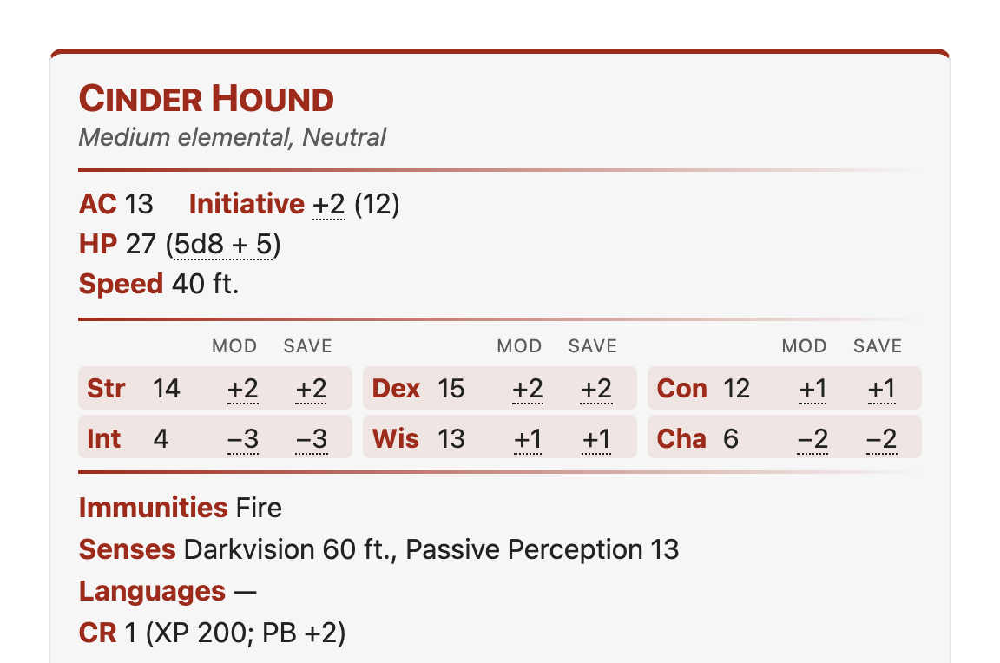
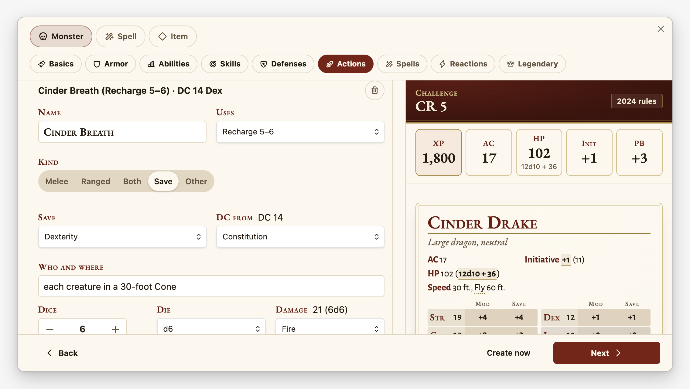
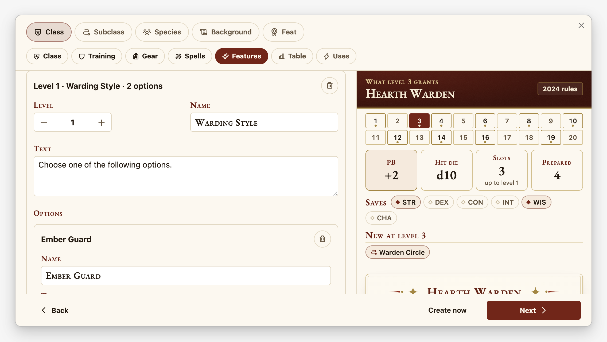
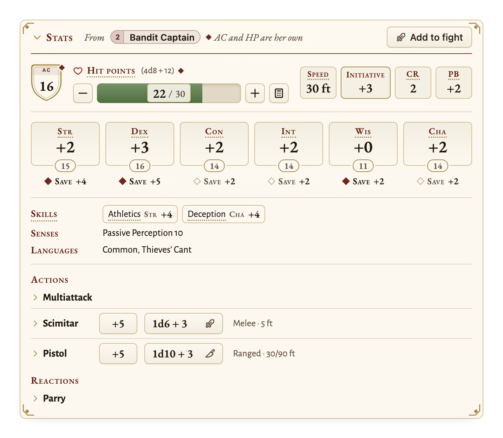
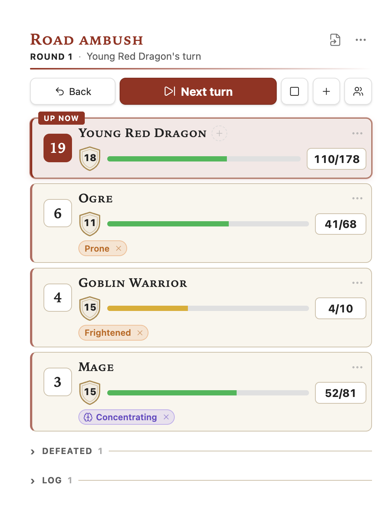
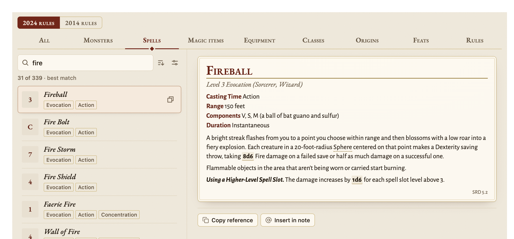
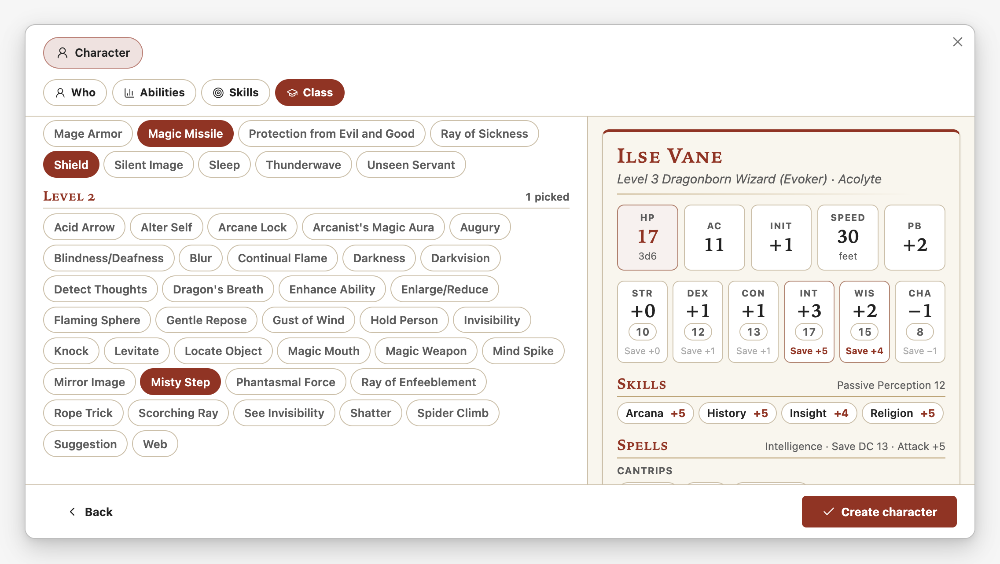
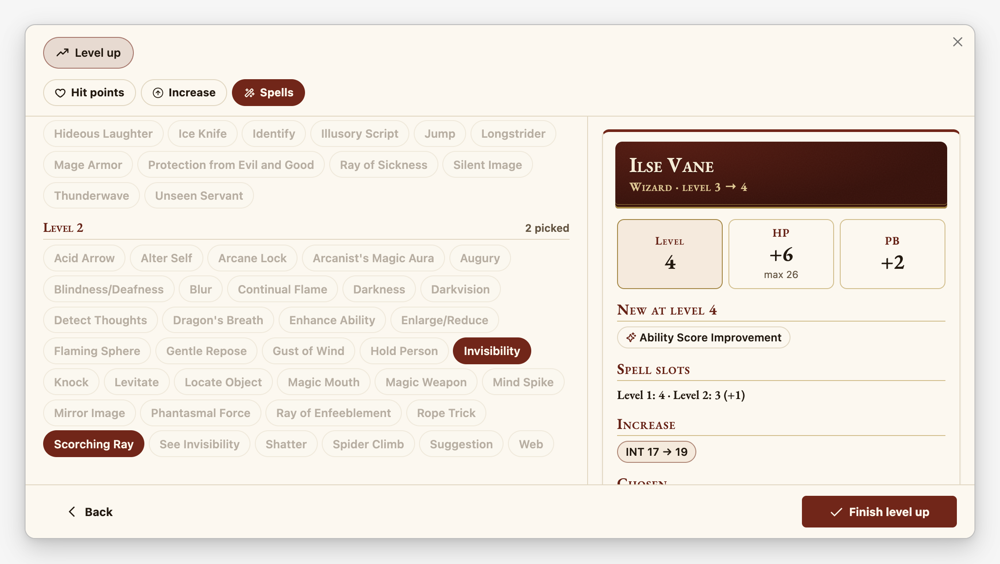

# Playing 5e

Ember Vault runs 5e campaigns as well as Nimble ones, with either version of the rules: the **2024 rules** (SRD 5.2) or the **2014 rules** (SRD 5.1). Campaigns, chapters, scenes, NPCs, quests, maps and boxes work the same in every campaign. What follows is what changes in a 5e one.

## Start a 5e campaign

In **New campaign**, pick **5e, 2024 rules (SRD 5.2)** or **5e, 2014 rules (SRD 5.1)** under **Game system**. The campaign's home note gets `system: 5e` and `edition: 2024` (or `2014`). To switch an existing campaign, use **Campaign settings…**; notes you already wrote stay as they are.

A note uses its campaign's system. A note outside any campaign uses the active campaign's.

## Monsters

Both SRD bestiaries ship with the plugin: 341 monsters from SRD 5.2 and 334 from SRD 5.1. A 2024 campaign looks up 2024 monsters first and falls back to the 2014 ones, so an old favourite like the Goblin still works.

**Write a reference** with `5e:` in backticks: `` `5e:Goblin Warrior` ``. It shows the monster's CR. Hover for its stat block; click for a quick look over whatever you're doing. Typing `` `5e: `` suggests monsters as you type.

**Add a monster to the fight** from anywhere you see it: **Add to fight** on its hover card or quick look, Enter in the compendium, or in [Spotlight](spotlight.md): Cmd/Ctrl+Enter adds the monster and keeps Spotlight open, and `3 goblin warrior` adds three.

**Write your own** in a ```` ```5e ```` block. Field names are forgiving (`Armor Class` or `ac`, `Hit Points` or `hp`, `Challenge` or `cr`), and you can paste a stat block's lines almost as the book prints them:

````
```5e
name: Ash Wight
size: Medium
type: Undead
alignment: Neutral Evil
ac: 14 (studded leather)
hp: 45 (6d8 + 18)
speed: 30 ft.
str: 15
dex: 14
con: 16
int: 10
wis: 13
cha: 15
saves: Con +5
skills: Perception +3
senses: darkvision 60 ft., passive Perception 13
languages: Common
cr: 3
traits:
- Sunlight Sensitivity: While in sunlight, the wight has disadvantage on attack rolls.
actions:
- Multiattack: The wight makes two Claw attacks.
- Claw: Melee Attack Roll: +4, reach 5 ft. Hit: 6 (1d8 + 2) Slashing damage.
legendary actions:
The wight can take 3 legendary actions.
- Grasp: The wight makes one Claw attack.
```
````

Lists (`traits:`, `actions:`, `bonus actions:`, `reactions:`, `legendary actions:`) take `- Name: text` or `- **Name.** text`. Add `edition: 2014` to lay a block out the 2014 way; otherwise it follows the campaign.



Stat blocks are laid out the way their rules print them. 2024 blocks are a warm card with a double gold hairline: AC and Initiative together, and each ability with its Mod and Save. 2014 blocks are an amber page between ochre bars: Armor Class, Hit Points, a row of six abilities, and Challenge with XP. Every number rolls when you click it: attack bonuses, saves, checks, skills and damage dice.

**Copy to vault** on a book monster makes it your own: a note in the campaign's Monsters folder that replaces the book version in that campaign.

### Rules words

Rules words in a stat block open a card with their rule: AC, HP, Speed and the other labels, Str to Cha, skills, senses like Darkvision and Passive Perception, languages like Common and Giant, conditions, and rules in a monster's actions (Prone, Advantage, Dim Light). Words in the text have a dotted underline; labels and headings stay plain until you point at them. Click one, or press Enter on it, for the card. The card's own rules words open in the same card, with a back arrow, and **Open in compendium** goes to the full page.

The same words are clickable on compendium pages and character sheets. A 2024 campaign shows SRD 5.2's Rules Glossary; a 2014 campaign shows SRD 5.1's rules.

## Encounters

The same ```` ```nimble-encounter ```` block works in a 5e campaign (see [Encounters](encounters.md)). Monsters can be written as names, `[[links]]` or `` `5e:Name` `` references. So can the campaign's [NPCs](#npcs) with stats: `- [[Marta Vey]]` shows Marta under her own name with her own AC, HP and XP. The block shows each group's XP and the fight's difficulty against your party, by your campaign's rules:

- **2024:** the XP budget per character, rated **Low**, **Moderate** or **High**.
- **2014:** XP thresholds, with the encounter multiplier for the number of monsters, rated **Easy**, **Medium**, **Hard** or **Deadly**.

Each group shows its CR, AC, HP and XP, and a bar shows the fight's XP against your party's Low, Moderate and High (2024) or Easy to Deadly (2014). Hover the rating for the numbers. **Run** starts a new fight with the block's monsters (and the party, with `party: true`); **Add to fight** adds them to the current one.

## Make your own

**New monster…**, **New spell…** and **New item…** (or `/new-monster`, `/new-spell`, `/new-item` in a note) open 5e's builder in a 5e campaign. Fill in what you know and the rest follows from the rules, worded the way your edition prints it. The preview is the stat block or card itself, with the challenge rating, XP, AC, HP and proficiency bonus on the banner above it.



### Classes, subclasses, species, backgrounds and feats

**+** on the compendium's Classes, Origins and Feats tabs opens their builders. A class takes its hit die, saves, proficiencies and skills, starting equipment, spellcasting (full, half, third or pact slots, worked out for every level), features with options to choose from, its subclass levels and increases, and limited uses; a subclass lays its features out at its class's subclass levels and can list spells it always has prepared. Species, backgrounds and feats ask what the edition's book gives them. What you build works in New character, Level up and the sheet like the SRD's. See [5e builders](homebrew.md#5e-builders).



New character and Level up also offer your own spells: a ```` ```5e-spell ```` block that names a class in `classes` is in that class's picks.

### Building a monster

- **Basics:** name, size, type and tags, alignment and challenge rating (its proficiency bonus and XP beside it). In 2024, whether it has a lair: the next rating's XP when you fight it there, and one more legendary action.
- **Armor:** the armor it wears and a shield (AC follows, with Dex as the armor allows), or natural armor and its AC. Hit dice: the hit points follow from them and Constitution, or type your own. Walking, flying (and hovering), climbing, swimming and burrowing speeds.
- **Abilities:** the six scores and the saving throws it's proficient in, each with its bonus. In 2024, initiative with proficiency or expertise.
- **Skills:** skills and expertise, darkvision, blindsight, tremorsense and truesight, and languages. Passive Perception is worked out.
- **Defenses:** resistances, immunities, vulnerabilities and condition immunities, and anything else as text ("bludgeoning from nonmagical attacks"). In 2024, its gear; armor and a shield go in it for you.
- **Actions:** traits, then actions. An action is a melee, ranged, or melee or ranged attack (to hit and damage from the ability you pick, and extra damage such as "plus 7 (2d6) Fire damage"), a saving throw (its DC from an ability, who saves, the damage and half on a success, and what a failure does), or text of your own. Any action or trait can have uses: Recharge 5–6, 3/Day.
- **Spells:** a spellcasting ability and spells at will and per day. The save DC and attack bonus are worked out.
- **Reactions** and bonus actions, and **Legendary** actions with how many it takes a round.

Built this way, a Goblin, an Ogre or an Adult Red Dragon comes out with the SRD's numbers and wording. Start from an SRD monster and its attacks and breath weapons open as fields you can change.

### Building a spell

Level, school and classes; casting time (with a reaction's trigger), ritual, range and area, components with the material, duration and concentration. Then pick a spell attack or a saving throw and its damage: the builder adds the SRD's sentence for it to your text ("Each creature in a 15-foot Cone makes a Dexterity saving throw, taking 3d6 Fire damage on a failed save or half as much damage on a successful one.") and writes the higher-level or cantrip damage too, unless you write your own.

### Building an item

- **Magic items:** type, rarity, attunement and who by, charges and how many come back at dawn. A weapon, armor or ammunition can have a +1, +2 or +3, with the book's rarity for it beside the rarity.
- **Weapons, armor and gear:** damage, properties, range, two-handed damage and (2024) mastery; armor's AC, Strength and Stealth; cost and weight.

### How they're written

Monsters are written as ```` ```5e ```` blocks. Spells and items are written as ```` ```5e-spell ```` and ```` ```5e-item ```` blocks: properties first, one per line, then the text:

```text
```5e-spell
name: Ember Lash
level: 2
school: Evocation
casting time: Action
range: 60 feet
components: V, S, M (a pinch of ash)
duration: Concentration, up to 1 minute
classes: Sorcerer, Wizard

A whip of fire lashes out. Make a ranged spell attack against the target. On a hit, the target takes 3d8 Fire damage.

Using a Higher-Level Spell Slot: The damage increases by 1d8 for each spell slot level above 2.
```
```

A weapon, armor or gear has a category instead of a rarity:

```text
```5e-item
name: Ember Pike
category: Martial Melee Weapon
damage: 1d10 piercing
properties: Heavy, Reach, Two-Handed
mastery: Cleave
cost: 20 gp
weight: 18 lb.
```
```

Your spells and items work everywhere the SRD's do: `` `5e:spell:Ember Lash` `` references, autocomplete, `/spell`, Spotlight and the compendium (tagged **Homebrew**). One with the same name as an SRD entry replaces it. Character sheets use them too: your weapon attacks with its damage, and a magic weapon or armor with a type like "Weapon (Longsword)" fights as a longsword with its bonus. The pencil on any of these blocks reopens it in the builder.

## Content packs

Add monsters, spells, subclasses and more that aren't in the SRD with a [content pack](content-packs.md): a JSON file in your vault. **Import content…** adds one and says what it left out and why.

Or make them yourself: **+** on the compendium's Classes, Origins or Feats tab opens a builder for a class, subclass, species, background or feat, and writes a ```` ```5e-class ````, ```` ```5e-subclass ````, ```` ```5e-species ````, ```` ```5e-background ```` or ```` ```5e-feat ```` block. See [Your own content](homebrew.md#5e-builders).

## NPCs



NPC notes in a 5e campaign get four more properties: `ac`, `hp`, `cr` and `statblock`. Fill in what you need, and the NPC card shows the GM a small character sheet under it. Players never see it.

- `statblock` names a monster whose stats the NPC uses, like `Bandit Captain` or `[[Mage]]`. The sheet says where its numbers come from ("From Bandit Captain · AC and HP are her own"), with the stat block's hover card.
- `hp` can be `30`, `30 (4d8 + 12)` or just `4d8 + 12`.
- **The sheet:** AC in its shield; an HP bar with − and + and the keypad, which keeps what's left in `hp_now`; speed, initiative (tap to roll), CR and proficiency bonus; the six abilities with their saves; skills, senses and languages; and actions with their to-hit or DC and damage, each a roll. **Stats** folds it to one line.
- **Add to fight** puts the NPC in the 5e tracker under their own name, on the HP they have left. Their stat block's actions come along, with the NPC's own AC and HP on top. With no stat block, AC and HP are enough.
- **In an encounter block,** list the NPC like a monster: `- [[Marta Vey]]` or `- Marta Vey`. The block counts their XP, and **Run** brings them in the same way, on the HP they have left. A block only finds NPCs in its own campaign.
- **No stats yet?** The card offers **From a stat block** (pick a monster) or **Type them in** (starter numbers to edit).

To give an NPC stats of their own without a stat block, type them into the note. None of these are written into new notes; add the ones you want:

```yaml
ac: 13
hp: 19 (3d8 + 6)
cr: 1/2
str: 15
dex: 12
con: 14
int: 9
wis: 11
cha: 10
saves: [con]                        # proficient saves, or "Con +5, Wis +2"
skills: { athletics: 4, perception: 2 }
speed: 25 ft
senses: darkvision 60 ft
languages: Common, Dwarvish
actions:
  - "Bell hammer: Melee Attack Roll: +4, reach 5 ft. Hit: 6 (1d8 + 2) Bludgeoning damage."
```

`bonus_actions:` and `reactions:` work like `actions:`. With a stat block, anything you type here replaces the block's.

## The 5e combat tracker



**Open encounter tracker** (or the swords icon) in a 5e campaign opens the 5e tracker, in the book's oxblood and gold. Whoever is acting is on a big card: their initiative in a gem, their name and type, AC in a gold-rimmed shield, HP and its bar, conditions, then **Damage** | **Heal**, **Add a condition** and a book button for the stat block or sheet. Everyone else is in a queue under it, in initiative order.

- **Before the fight:** the **Party** list is for what your players roll (tap someone's box to type it, or roll it); **Roll all** rolls for the monsters. Identical monsters share one roll. **Start combat** rolls for anyone still missing (it says how many: **Start combat · 2 to roll**). Ties go to the higher modifier; once the fight starts, drag to settle the rest. In **Encounter settings…** you can turn off rolling for heroes or for monsters.
- **Turns:** the button at the bottom names who's next (**Next: Ogre**), and starts **Round 2** after the last. **Back** beside it undoes a turn. The queue splits into **Still to act** and **Acted this round**, grey and ticked; defeated monsters fold into **Defeated** at the bottom.
- **Out of turn:** tap anyone in the queue and they act now. Nobody else moves: **Next** goes back to the first creature in order who hasn't acted.
- **Groups:** identical monsters with one initiative share one row ("Goblin Warriors"), and the card steps through them one at a time, with a button for each member.
- **Order:** once the fight is running, drag a row to move someone (on a phone or tablet, drag the grip on its left edge). They take the initiative of whoever is now above them and stay where you dropped them. **Move up** and **Move down** are in the row's **⋯** menu, and Alt+↑ or Alt+↓ moves the row you're on. Escape cancels a drag.
- **Keys:** the same as Nimble's tracker: ↑ ↓ move through the card and the queue, Enter puts someone on the card, Space presses the main button and Z goes back.
- **HP:** tap the numbers, or **Damage** or **Heal**, for the HP keypad: Damage, Heal, Set or Temp, with Crit, **Vulnerable ×2** and **Resisted ½**. It shows where HP lands before you apply it, and the big number and the button say the damage after doubling or halving (**Deal 18 damage** for 9 vulnerable). You can type there too: `7` is damage, `7!` a crit, `7v` vulnerable (doubled), `7r` resisted (halved), `+7` healing, `t7` temporary HP, `=7` sets HP. Temporary HP soak damage first.
- **Concentration:** **Concentrating** is the first choice in the condition list (or the row's **⋯** menu). When they take damage, the tracker tells you the Constitution save's DC. At 0 HP it ends.
- **Death saves:** a hero at 0 HP shows their saves on the card; **Roll** rolls a d20 for them, or tap the pips yourself. Damage at 0 is a failure (two for a crit), a 1 counts twice, and a 20 brings them back with 1 HP.
- **Legendary actions and Legendary Resistance:** rows of pips on the card. Tap a filled pip to spend one and an empty one to get one back; legendary actions come back at the start of the creature's turn. After another creature's turn, a quiet strip asks whether the boss takes a legendary action, with a button for each.
- **Pips** work the same everywhere, in both games: a filled pip takes one away, an empty one adds one, one at a time.
- **Conditions:** **Add a condition** on the card opens the list. Each says what it does in a line. Pick how long under the list (until removed, or 1, 2, 3 or 10 rounds), then the condition. A chip shows the rounds left and a small mark when the condition does something each turn. Tap a chip for its rules, its timing and **Remove**, or its **×** to remove it. See [Timed conditions](#timed-conditions) below.
- **Each row's ⋯ menu** (or long-press, or right-click): act now, the stat block, the note or sheet, roll initiative, move up or down, add a condition, concentrating, add another, remove. The tracker's own **⋯** has adding the party and monsters, rolling initiative, the compendium, **Encounter settings…**, **End combat** and **Clear the fight**.

### Timed conditions

A condition can last a number of rounds, end when a save succeeds, and do something at the start or end of its creature's turn: deal damage, call for a save, or remind you of something.

- **Rounds:** a condition counts down once a round, at the end of its creature's turn (or the start, if you choose), and falls off at 0. It can count on another creature's turn instead, such as the caster's, for "until the end of the caster's next turn". Put on during the turn it counts on, it lasts through that creature's next turn. If the caster leaves the fight, it counts on its own creature's turn.
- **Burning** (2024 rules) comes ready: 1d4 Fire damage at the start of each of its turns, until you remove it.
- **Your own:** type a name nobody has in the condition list and tap **New: …**. Choose how long it lasts, and add what it does each turn:
  - **Damage:** dice and a type, such as `1d4` Fire.
  - **Save:** the ability and DC, and whether a success ends it.
  - **Reminder:** a line of text, such as "Can't take reactions".

  **Keep in my conditions** saves it, so it's in the list next time, in every campaign.
- **Changing one:** tap its chip. Changes apply as you make them. Long-press (or right-click) a condition in the list to set its timing before you put it on.
- **At each turn:** when the turn passes to a creature whose condition does something, a dialog asks: "Ogre is Burning: 1d4 Fire damage" with **Roll 1d4 and apply** or **Skip**, or "Mage, Hold Person: Wisdom save DC 13" with **Roll the save** (monsters, from their stat block, with its bonus), **Passed** and **Failed**. A success ends the condition if it says so. Damage follows the stat block's resistances, immunities and vulnerabilities. Reminders show as a notice.
- **Back** puts back what the last turn did to conditions (a count, or a condition that ran out) without asking about damage or saves again.

For example, Hold Person: type `Hold Person` in the condition list, tap **New: Hold Person**, pick **Until saved**, set the save to Wisdom, DC 13, at the end of its turn, and tap **Add**.

## The 5e compendium

**Open compendium** in a 5e campaign opens the 5e compendium. It has monsters, spells, magic items, equipment, classes (with subclasses and the level table), species or races, backgrounds, feats, rules and conditions. The 2024 rules are SRD 5.2's Rules Glossary, and both editions list the six abilities, the skills and the languages. Switch between the 2024 and 2014 rules at the top.



Entries read like the book: each is set in its edition's dress (2024's card with a gold hairline, 2014's amber page), with the book's red labels and italic lines, and class pages carry the class's scrollwork. In the list, a monster's CR sits in a gold frame. Your own spells and items say **Homebrew** at the foot of their page.

It searches the same way as Nimble's compendium. Type a name, or filters that turn into chips as you type:

- **Monsters:** `cr:1/4`, `cr:5-10`, `type:undead`, `size:large`, `resist:fire`, `is:legendary`, `is:swarm`, `sort:-cr`
- **Spells:** `level:3`, `level:cantrip`, `school:evocation`, `class:wizard`, `casting:reaction`, `is:concentration`, `is:ritual`
- **Magic items:** `rarity:rare`, `type:wondrous`, `is:attunement`
- **Equipment:** `weapon:martial`, `range:melee`, `prop:finesse`, `damage:slashing`, `mastery:vex`, `armor:heavy`, `price:<10`

Put `-` in front of a filter to leave those out (`-level:0`). The filter button lists the common ones for each tab. Press Enter on a monster to add it to the fight, or on anything else to put its reference in the note you were editing. `/spell`, `/monster` and the other slash commands take the same filters.

Reference any of them with its kind: `` `5e:spell:Fireball` ``, `` `5e:item:Bag of Holding` ``, `` `5e:equipment:Longsword` ``, `` `5e:class:Wizard` ``, `` `5e:species:Elf` `` (or `race:`), `` `5e:feat:Alert` ``. A bare `` `5e:Prone` `` that isn't a monster finds the compendium entry of that name. Typing `` `5e:spell: `` suggests only spells. [Spotlight](spotlight.md) searches them too.

## Character sheets

**New character** in a 5e campaign walks you through it, with the sheet's numbers beside you as you choose:

1. **Who:** name, class, level, species (race and subrace in 2014, lineage or ancestry in 2024) and background. A 2014 dragonborn picks their draconic ancestry here.
2. **Abilities:** a card per ability. The standard array set out for your class, point buy (with the points left), a roll (4d6, the lowest dropped, six times) or your own scores. To move the array or your rolls around, pick another ability's score on a card and the two swap. In 2024 your background gives +2 and +1 (to its best abilities for your class unless you pick them) or +1 to all three; in 2014 your race's and subrace's bonuses are added, and a half-elf picks two more. Each card shows the bonus, the final score and the modifier.
3. **Skills:** your class's picks (it stops at the number your class allows), your species' (a half-elf's two, a 2024 human's one, a 2024 elf's Keen Senses) and expertise when your class has it by your level. Your background's and your species' own are already ticked.
4. **Tools:** the tools your class, species or background let you choose (a bard's three instruments, a dwarf's artisan's tools, a soldier's gaming set), and languages: Common and two standard languages in 2024, your race's and the ones it and your background let you choose in 2014.
5. **Class:** your subclass if your level has one (a 2014 cleric, sorcerer or warlock picks at level 1), your class's own choices (2014's Fighting Style, Metamagic, invocations and Pact Boon; 2024's Fighting Style feat and Weapon Mastery), a 2024 human's origin feat, Magic Initiate's spells from a 2024 background, and your cantrips and spells: as many as your class knows or prepares at your level, or a wizard's spellbook.
6. **Increases**, when you start at level 4 or higher: each level's Ability Score Improvement, as +2 to one score, +1 to two, or a feat.
7. **Equipment:** your class's and your background's starting equipment, option by option, with anything you pick from a list (a martial weapon, a holy symbol); in 2024 the gold instead. Armor, a shield and weapons go on equipped.

Beside every step is the character in brief: HP, AC, initiative, speed and proficiency, the six abilities with their saves, skills, spells, features, tools, languages and equipment.



The character is a note in the Party folder with a ```` ```5e-sheet ```` block. The sheet reads the note's properties, so you can also edit them by hand.


The sheet is set like the book and takes the page: the note's title and properties step aside (the list button at the top shows the properties again).

- **The banner:** the portrait (from `portrait:`), the name, level, species, class and background, **Short rest**, **Long rest** and **Level up**, then AC on its shield, and initiative, speed and proficiency.
- **Hit points:** a bar with **−** and **+** (taps add up, then save as one change) and the HP keypad. Temporary HP show at the end of the bar. Hit dice are pips; at 0 HP, death saves take their place. Passive Perception, your size and Heroic Inspiration sit beside them.
- **Conditions:** chips that open the rule, **×** to remove, **+ Add** from your edition's list. Exhaustion has its levels as pips, and a long rest takes one away.
- **Abilities:** six plaques, each with the modifier (tap it to roll a check), the score, the saving throw and that ability's skills. Tap a skill's mark to go from not proficient to proficient to expertise.
- **Tabs**, under your class's scrollwork: **Actions** (grouped as the book groups them: Actions, Bonus Actions, Reactions and Limited use; each damage roll shows its dice and an icon for its type), **Spells** (by level, with that level's slots as pips; **Cast** spends a slot), **Features** (by where they come from; tap one for its rules; then your proficiencies: armor and weapons, tools, languages and weapon masteries) and **Inventory** (equipped, quantity, gold).
- **Limited use:** features like Rage, Channel Divinity and Arcane Recovery have a pip for each use, and rests bring them back.

The sheet works out:

- **Modifiers, saves and skills:** your class's saving throws, and skills you tap to cycle through proficient, expertise and not proficient.
- **Passive Perception, initiative and AC:** AC comes from the armor you've equipped, Dex as it allows, and a shield. Barbarians and Monks get Unarmored Defense. Set `ac:` to override.
- **Attacks:** from equipped weapons, using Dex for ranged weapons and the better of Str and Dex for finesse ones.
- **Spellcasting:** save DC, attack bonus and spell slots from your class's table.
- **Features and traits:** your class and subclass features up to your level, plus your species' traits. Where your class offers options (a Fighting Style, invocations), only the ones you chose show; they're listed under `choices:`.

Everything with a number rolls. Tap slot pips to spend and restore them.

- **Short rest** spends a hit die and heals, and brings back what a short rest restores.
- **Long rest** brings back HP, slots and every feature's uses, plus all your hit dice in 2024, or half your level in 2014.
- **Level up** walks you through the new level: hit points (the average, a roll, or what you rolled at the table; a higher Constitution adds a point for every level), your subclass when it's time, an Ability Score Improvement or a feat (with the feat's own +1 where it has one, and an Epic Boon at 19 in 2024), expertise and your class's new choices and weapon masteries, then your new cantrips and spells, each as many as the level brings. A class that swaps spells as it levels (2014's Bard, Ranger, Sorcerer and Warlock; 2024's Bard, Sorcerer and Warlock) can also replace one spell it knows with another of a level it has slots for. Beside it is what the level brings: new features (your subclass's too), spell slots and your proficiency bonus.



Level up adds a level of your one class: multiclassing isn't supported yet.

**Add spell** offers your class's list first. **Add item** offers equipment and magic items, yours too; weapons and armor go on equipped.

In a campaign you run, the encounter party comes from these sheets: level, max HP and AC.

## What's included

Only what Wizards of the Coast published in the SRD 5.1 and 5.2 under Creative Commons (CC-BY-4.0) ships with the plugin. That's one subclass per class, the SRD's backgrounds, species and feats, and the SRD monsters. Everything else from the books you can write yourself in your notes.

*This work includes material from the System Reference Document 5.1 and 5.2 by Wizards of the Coast LLC, available at <https://www.dndbeyond.com/srd>, licensed under the [Creative Commons Attribution 4.0 International License](https://creativecommons.org/licenses/by/4.0/legalcode). Ember Vault is not affiliated with or endorsed by Wizards of the Coast.*
