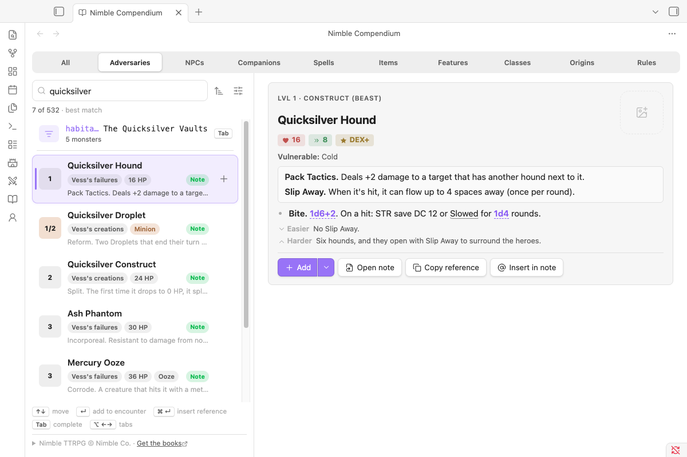
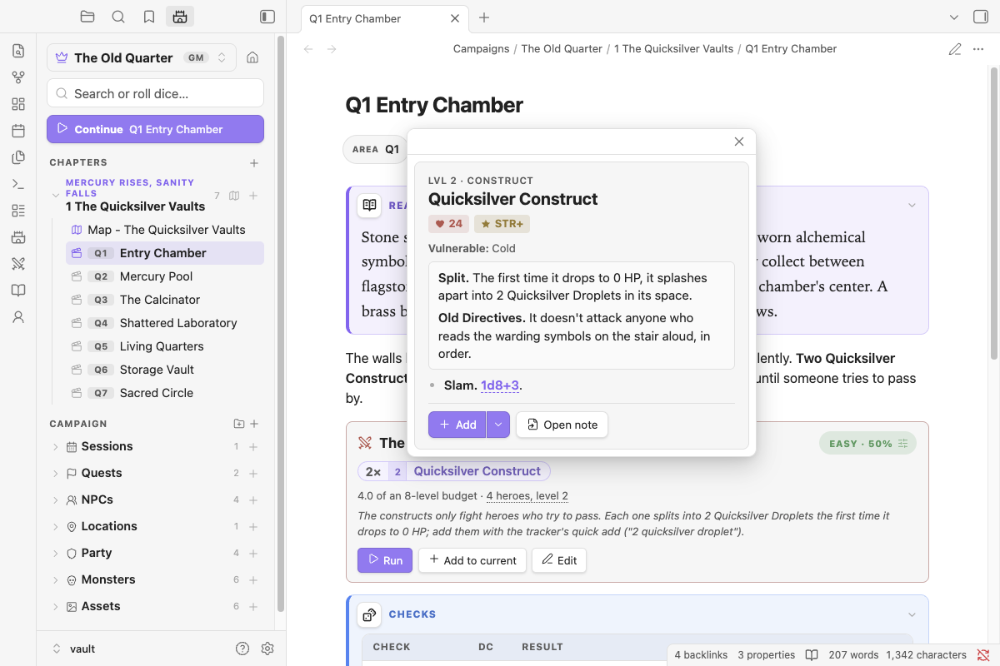
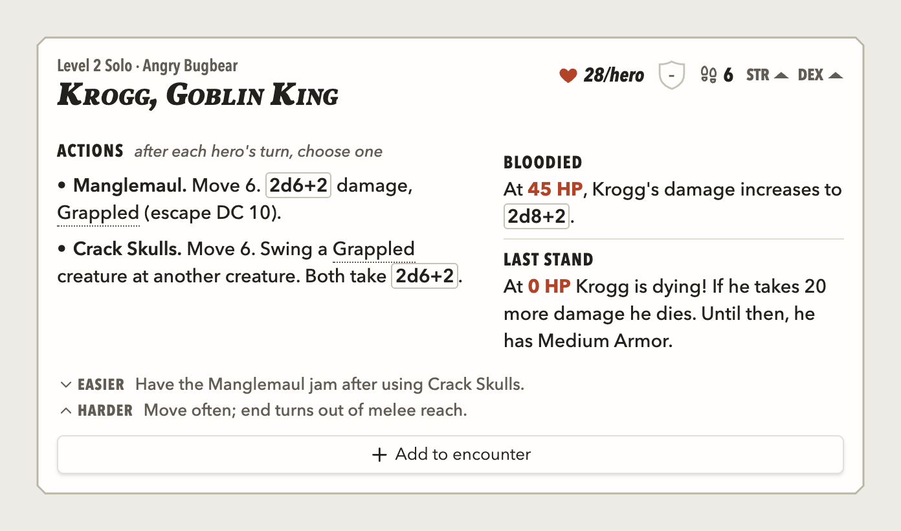
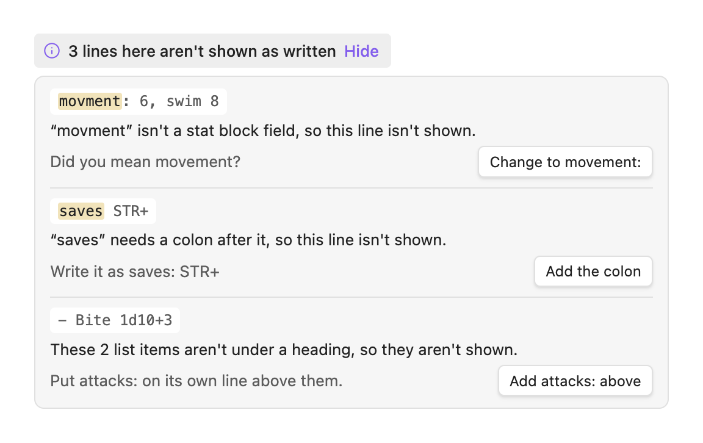

# Bestiary and stat blocks



The bestiary now lives in the [compendium](compendium.md), as its Adversaries tab.

## The bundled bestiary

The plugin ships with every monster from the Nimble GM Guide and the Monsters & More draft. That's 525 stat blocks, including 51 legendary/solo monsters and 20 minion types.

- **Open it:** use the book icon in the ribbon, or the **Open compendium** command. Search names, abilities, families and habitats, filter with `type:`, `level:`, `role:`, `armor:` and more, and sort by level, type, role or habitat. See [the compendium](compendium.md).
- **Use them anywhere:** `` `nimble:Krogg, Goblin King` `` in any note shows a reference you can hover for the full stat block.
- **Customise one:** use **Copy to vault** to make an editable note. A note with the same name replaces the bundled monster everywhere.
- **Duplicates:** monsters in both books keep the Monsters & More name, and the GM Guide version is called "Name (GM Guide)".

Turn the bundled bestiary off in settings if you only want your own monsters.

## Monster references



Write `` `nimble:Goblin` `` (inline code) anywhere in a note. It shows as a reference chip. Hover it for the stat block, or click it for a quick look: the full stat block in a window over your note, with **Add to fight** and **Open page** (**Open in compendium** for a book monster). Cmd/Ctrl-click goes straight to the page. The chip's **+** button puts the monster in the tracker. `/monster` opens the compendium and inserts one for you; `/monster goblin` picks from the menu.

- **Hover previews** stay open while you move into them. Click inside to pin one; drag its top bar to move it. Its **Add** button adds one (Shift-click for two), and the arrow beside it has **Add several…**, **Add tougher (+1 level)** and **Add weaker (−1 level)**. Easier/Harder notes appear in full stat blocks and the bestiary, not the hover card. Escape closes the preview.

## How a stat block looks

Stat blocks are drawn the way the GM's Guide draws them, in notes, the compendium, hover cards and the tracker's quick look:

- the name in heavy italic small caps, with the level, size and type beside it (above it for a solo or legendary monster)
- HP in a red heart, the armor shield with its letter (M or H, a dash for no armor), speed (to leave out no armor and speed 6, as the books do, turn off **Always show armor and speed** in [settings](settings.md#nimble)), and saves as their stat with ▲ or ▼
- passives on a khaki ribbon, and "Choose 1" with an "or" between choices
- a solo's actions beside **Bloodied** and **Last Stand**, with the HP they happen at in red
- an icon for each damage type in resistances and vulnerabilities

Dice roll when you click them, and conditions and rules words open their rule.

## Writing a stat block

The easiest way is the [builder](builder.md): **New monster…** in the command palette fills in the GM Guide's numbers for the level, and writes the block for you. To write one by hand:

````markdown
```nimble
name: Krogg, Goblin King
level: 2
role: solo              # regular, minion, legendary or solo
size: Medium
type: Angry Bugbear
hp: 28/hero             # or a flat number
armor: none             # none, medium (M) or heavy (H)
movement: 6             # e.g. 8, fly 10
saves: STR+ DEX+
actionText: After each hero's turn, choose one:
attacks:
- **Manglemaul.** Move 6. 2d6+2 damage, Grappled (escape DC 10).
- **Crack Skulls.** Move 6. Swing a Grappled creature at another creature. Both take 2d6+2.
bloodied: At 45 HP, Krogg's damage increases to 2d8+2.
lastStand: At 0 HP Krogg is dying! If he takes 20 more damage he dies. Until then, he has Medium Armor.
easier: Have the Manglemaul jam after using Crack Skulls.
harder: Move often; end turns out of melee reach.
```
````



Each line is a field, a colon, then its value. Lists (attacks, abilities) are a heading on its own line with one item per line under it, each starting with a dash.

| Field | What goes in it | Example |
|---|---|---|
| `name:` | The only field you need. | `name: Cave Bear` |
| `level:` | A number, or a fraction for weaklings. | `level: 1/2` |
| `role:` | `regular` (the default), `minion`, `solo` or `legendary`. | `role: solo` |
| `size:`, `type:` | Shown beside the name (above it for a solo). | `size: Large` |
| `hp:` | A number, or HP per hero for a solo. | `hp: 28/hero` |
| `armor:` | `none`, `medium` (M) or `heavy` (H). | `armor: M` |
| `movement:` | Speed 6 if you leave it out. | `movement: 8, climb 6` |
| `saves:` | Advantaged and disadvantaged saves. | `saves: STR+ WIL-` |
| `attacks:` | A heading, then one attack per line. | `- **Bite.** 2d6+2.` |
| `abilities:` | A heading, then one ability per line, name then colon. | `- Keen Nose: Can't be surprised.` |
| `actionText:` | A solo's line above its attacks. | `actionText: After each hero's turn, choose one:` |
| `bloodied:`, `lastStand:` | What a solo does at half HP and at 0 HP. | `bloodied: Its bite deals 2d8.` |
| `easier:`, `harder:` | Tactics to tune the fight. | `harder: Focus the weakest hero.` |
| `description:` | A line of flavour. | `description: It smells honey for miles.` |
| `resistances:`, `immunities:`, `vulnerabilities:` | A list, or on one line. | `resistances: fire, cold` |
| `minion die:` | A minion's damage die. | `minion die: d6` |
| `source:`, `group:`, `habitat:` | Where it's from, its family, where it lives. | `group: Bears` |

- Each attack or ability is one line in your note. Long ones can wrap on screen; just don't press Enter in the middle.
- Field names don't mind capitals, spaces or bold: `Last Stand:`, `**Bloodied:**` and `lastStand:` all work.
- Lists can be headed the way books write them: `Legendary actions:` or `Traits:` work as well as `attacks:` and `abilities:`, and a second `attacks:` heading adds to the list. A `Choose one:` line over the attacks introduces them, like `actionText:`.
- A sentence that wraps onto the next line in your note is joined back up.
- A ` # comment` after a short value, as in the example above, is ignored. Sentences (`description:`, `bloodied:`, `lastStand:` and the like) and the name are kept whole.
- Notes in the older format (`monsterType: solo`, `str: +`, `dex: ++`, `will: -`) still work.

### When a line isn't shown



If something in a stat block you wrote can't be shown as written, a quiet line appears under it: **2 lines here aren't shown as written**. Click it to see which lines, what's wrong in plain words, and what to change. When the fix is obvious, such as a misspelled field name or a missing colon, a button makes the change for you. Turn this off in **Settings → Bestiary → Help with stat blocks you write**.
