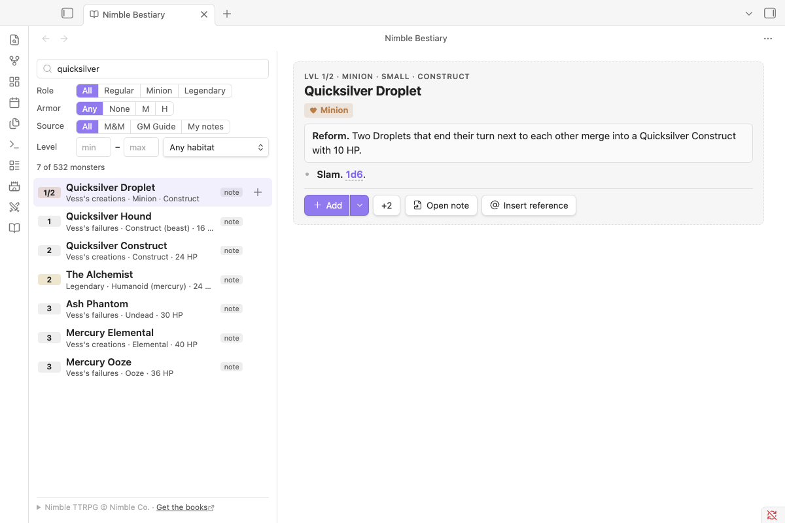

# Bestiary and stat blocks



## The bundled bestiary

The plugin ships with every monster from the Nimble GM Guide and the Monsters & More draft. That's 525 stat blocks, including 51 legendary/solo monsters and 20 minion types.

- **Open it:** use the book icon in the ribbon, or the **Open bestiary** command. You can search names, abilities, groups and habitats, and filter by role, armor, source and level.
- **Use them anywhere:** `` `nimble:Krogg, Goblin King` `` in any note shows a reference you can hover for the full stat block.
- **Customise one:** use **Copy to vault** to make an editable note. A note with the same name replaces the bundled monster everywhere.
- **Duplicates:** monsters in both books keep the Monsters & More name, and the GM Guide version is called "Name (GM Guide)".

Turn the bundled bestiary off in settings if you only want your own monsters.

## Monster references

Write `` `nimble:Goblin` `` (inline code) anywhere in a note. It shows as a reference chip. Hover it for the stat block, or click it for a quick look: the full stat block in a window over your note, with **Add to fight** and **Open page**. Cmd/Ctrl-click goes straight to the page. The chip's **+** button puts the monster in the tracker. `/monster goblin` inserts one for you, with autocomplete.

- **Hover previews** stay open while you move into them. Click inside to pin one; drag its top bar to move it. Its **Add** button has a menu with Add 2, Add tougher (+1 level) and Add weaker (−1 level). Easier/Harder notes appear in full stat blocks and the bestiary, not the hover card. Escape closes the preview.

## Writing a stat block

````markdown
```nimble
name: Krogg, Goblin King
level: 2
role: solo              # regular, minion, legendary or solo
size: Medium
type: Angry Bugbear
hp: 28/hero             # or a flat number
armor: none             # none, medium (M) or heavy (H)
movement: 6             # e.g. 8, fly 10
saves: STR+ DEX+
actionText: After each hero's turn, choose one:
attacks:
- **Manglemaul.** Move 6. 2d6+2 damage, Grappled (escape DC 10).
- **Crack Skulls.** Move 6. Swing a Grappled creature at another creature. Both take 2d6+2.
bloodied: At 45 HP, Krogg's damage increases to 2d8+2.
lastStand: At 0 HP Krogg is dying! If he takes 20 more damage he dies. Until then, he has Medium Armor.
easier: Have the Manglemaul jam after using Crack Skulls.
harder: Move often; end turns out of melee reach.
```
````

- Other fields: `abilities:`, `resistances:`, `vulnerabilities:` and `immunities:` lists, plus `minion die: d8`, `description:`, `source:`, `group:`.
- Notes in the older format (`monsterType: solo`, `str: +`, `dex: ++`, `will: -`) still work.
