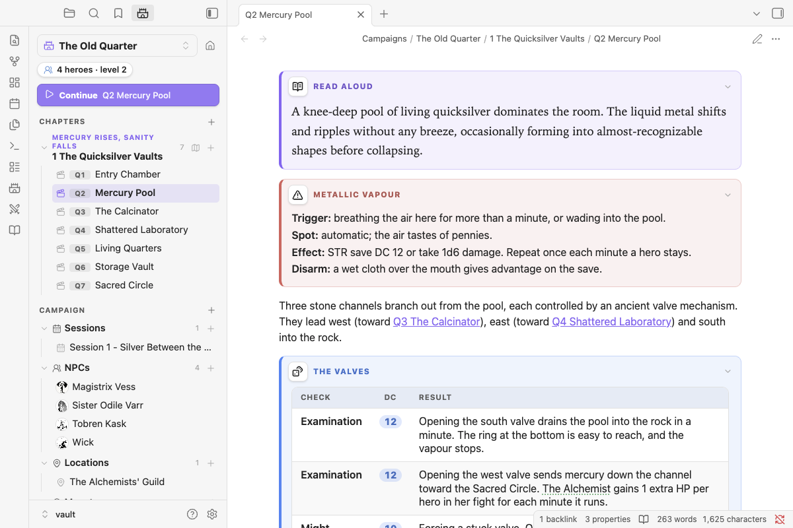

# Boxes



Styled boxes for adventure notes: read-aloud text, what's in a room, treasure, traps, clues, handouts and more. Type the slash command and start writing inside the box.

| Command | Box |
|---|---|
| `/read-aloud` (`/read`) | Read-aloud text, in a serif face so it's the first thing your eye finds |
| `/look` | What's here |
| `/treasure` (`/loot`) | Treasure and rewards |
| `/trap` (`/hazard`) | A trap or hazard, with Trigger / Spot / Effect / Disarm lines |
| `/secret`, `/clue`, `/checks`, `/exits` | GM-only notes, clues, a check table, exits |
| `/handout`, `/lore`, `/rumor`, `/quest` | A handout (old paper), lore, rumors, a quest or hook |
| `/box` | Any of the above, searchable |

**Restyling a box:** click its icon. A small panel opens with three tabs (Type, Icon, Look); the title is edited at the top. You can pick:
- a type
- a title
- an icon from the library (or any Lucide icon by name)
- a colour, or any custom colour
- a style: card, banner, old note, letter, stone or minimal
- a font: sans, serif, hand or mono
- bold, italic, or start folded

Changes preview live and are saved when you click away. Click a box's title to fold it.

**Tables** in boxes, and in notes (setting: *Styled tables*), get rounded corners, a tinted header and zebra rows. A **DC** column shows its numbers as pills.

The look lives on the fence line, so you can also type it:

````markdown
```box treasure title="Wyrm's hoard" icon=crown color=gold style=parchment
- 300 gp in old coin
- A **+1 shield**
```
````
