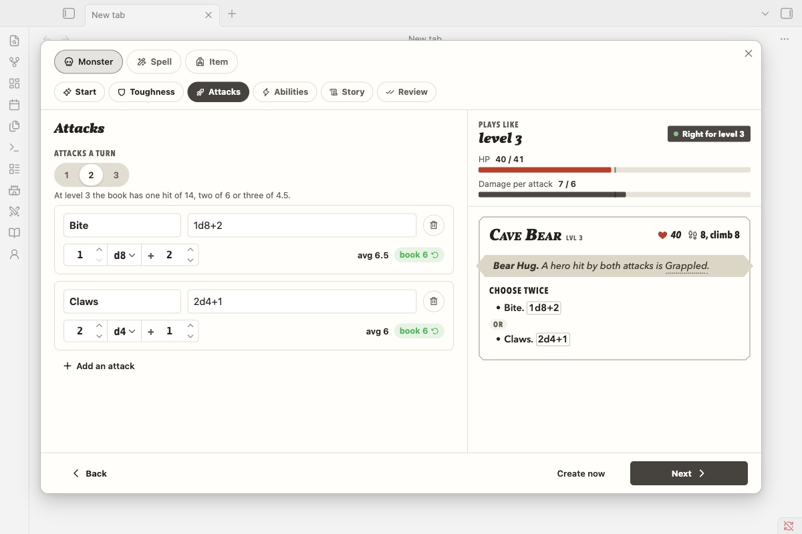
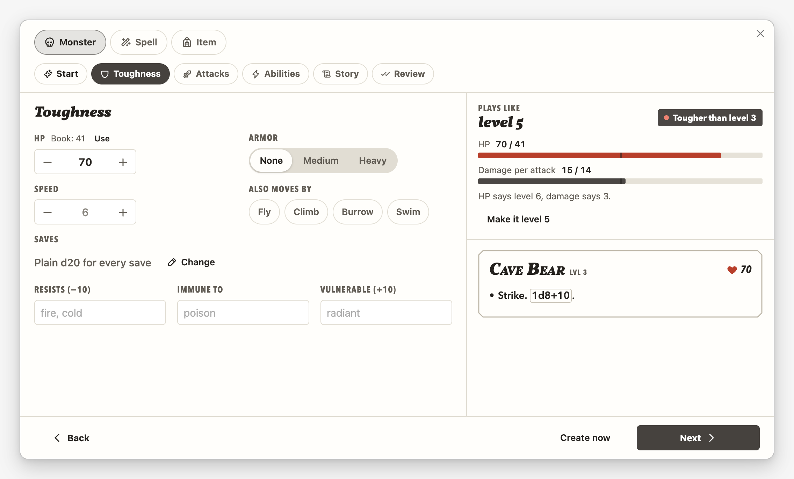
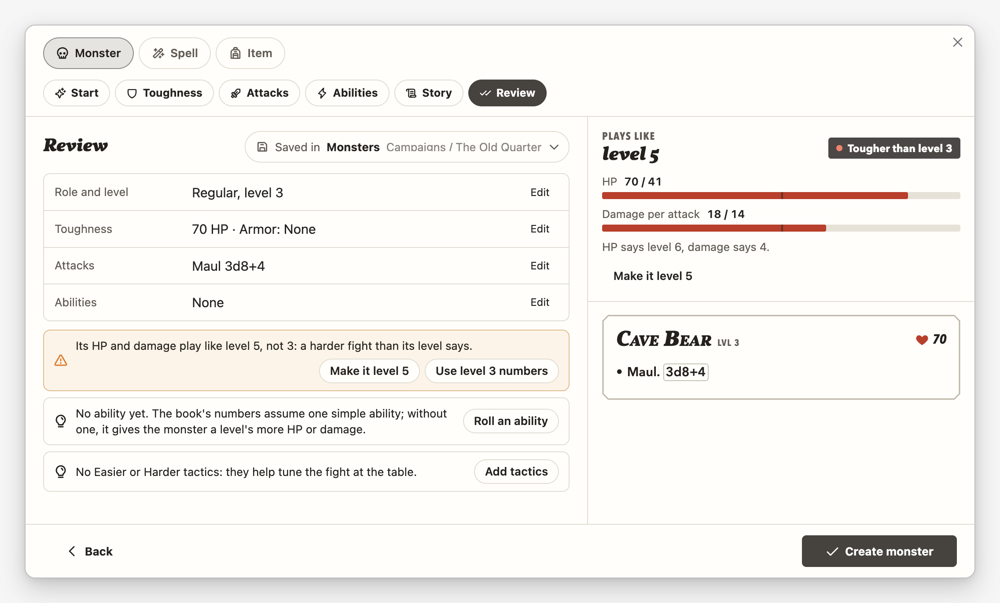
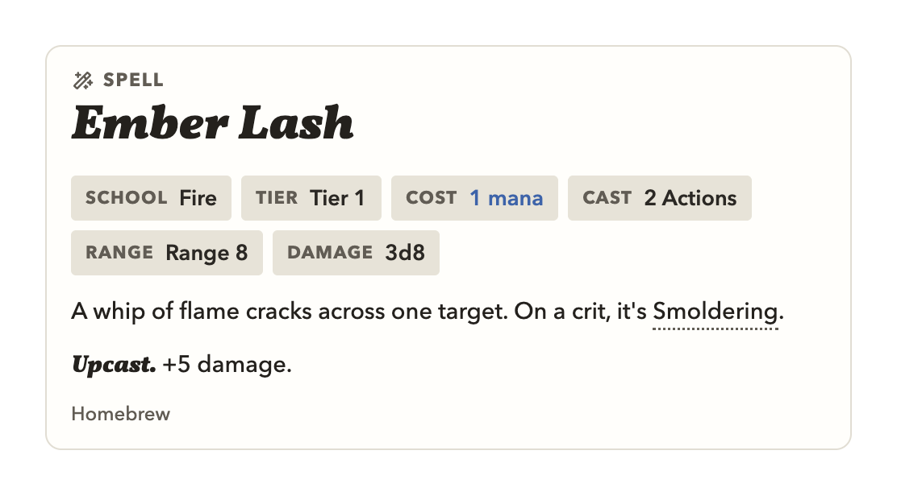

# The builder: monsters, spells and items

Make your own monsters, spells and items without learning a format. The builder knows the books' numbers: tell it a level and it fills in the rest, or type your own numbers and it tells you what level they play like.

In Nimble, the same builder makes a hero's content too: classes, subclasses, a class's options, ancestries, backgrounds and boons. See [Nimble's builders](homebrew.md#nimbles-builders).



## Your first monster

Your party is level 3 and you need a bear for tonight.

1. Run **New monster…** (or type `/new-monster` in the scene note).
2. Name it **Cave Bear**, leave the role on **Regular** and the level on **3**.
3. Press **Create now** (**Insert now** if you started from `/new-monster`).

That's it. The builder looks up the GM Guide's numbers for a level 3 monster and writes this block into your Monsters folder (or where you typed the slash):

````markdown
```nimble
name: Cave Bear
level: 3
size: Large
type: Beast
hp: 41
abilities:
- Keen Nose: Can't be surprised.
attacks:
- **Maul.** 1d10+9.
```
````

This one also has a size, a type, a d10 die (the GM Guide's die for beasts) and a Keen Nose ability typed in on the way. Leave those blank and the book's defaults are used.

Now say you'd rather write the numbers yourself: **hp 70** and a Maul of **2d10+8**. The level check beside the form reads **Plays like level 5**: HP like level 6, damage like level 5, a harder fight than level 3 says. The review step offers two fixes, **Make it level 5** (keep your numbers, change the level) or **Use level 3 numbers** (keep the level, go back to the book's numbers). Or save it as it is.

A **Solo** at the same level gets the Legendary Monster Builder's numbers, HP per hero, a small and a big attack, and a Bloodied and Last Stand the tracker can apply:

````markdown
```nimble
name: Mother of Mercury
level: 3
role: solo
type: Elemental
hp: 40/hero
actionText: After each hero's turn, choose one:
bloodied: Its damage dice grow a size: d8s become d10s.
lastStand: Regains 10 HP per hero and fights on.
attacks:
- **Lunge.** Move 6. 1d8+4.
- **Crush.** 1d8+10.
```
````

## Opening it

- **New monster…**, **New spell…** or **New item…** in the command palette or [Omnisearch](omnisearch.md).
- The **+** button in the [compendium](compendium.md)'s search bar opens it on the tab you're on: Spells makes a spell, Items an item.
- On a monster's page in the compendium, **Use as a template** starts a new monster from that one. Spells and items have it too, and every builder's first step has **Start from** to search for one to copy.
- `/new-monster`, `/new-spell` or `/new-item` in a note builds it right there: the block goes where you typed the slash.
- Point at a monster, spell or item block in your notes (in either game) and click the **pencil** to edit it in the builder; on a phone it's always there. Save writes the block back in place, keeping what the builder has no control for (senses, languages, a spell's class, a wand's charges). If the block has lines it can't read, Save asks first, because those lines won't be in the rewritten block.

The builder wears your campaign's look, and fills the screen on a phone. The switch at the top changes what you're making. Each kind keeps what you've typed, so you can look at a spell and come back to your monster. Closing the builder (Cancel, the ×, Escape) asks before throwing away anything you've filled in.

## Quick or full, without being asked

The first step holds everything a quick build needs. Pick a role and a level and press **Create now**: you get a monster ready to run, with the GM Guide's HP, damage and dice for that level. **Create now** works from every step, and anything you haven't filled in follows the book.

Or press **Next** and go through the rest. Every step shows the stat block as it will look on the right (the eye button on phones), with the level check above it: what it plays like, and a tag saying whether that's right for its level.

## Level first, or stats first



- **Level first.** Set the level and every field you haven't touched follows the GM Guide's numbers for it: HP for its armor, damage per attack for how many attacks it makes, the book's sample dice in your monster's die size.
- **Stats first.** Type your own HP or dice and the **level check** says what it plays like: "Plays like level 4", with a bar each for HP and damage against the book. HP and damage can disagree (a glass cannon has level 3 HP and level 7 damage), and the check tells you both. **Make it level 4** moves the level to match, keeping your numbers.
- **Auto** beside the level follows the stats you type as you type them.

Numbers you type are never overwritten. A **Book: 52 · Use** tag beside a changed field puts the book's number back.

**Type**, **Group** and **Habitat** suggest the compendium's own words as you type (`und` finds Undead); ↑ ↓ and Enter pick one, or keep typing your own.

## Monsters

- **Regular** monsters use the GM Guide's Monster Builder table (levels 1/3 to 20, and past 20). Armor lowers HP (armored monsters aren't meant to be harder, just different), and the builder warns when armor comes earlier than the book recommends: Medium from level 3, Heavy from 8.
- **Solo** monsters use the Legendary Monster Builder: HP per hero, a small attack that moves or sets up and a big one, Bloodied at half HP and a Last Stand. The suggested Last Stand reads "Regains N HP per hero", which the [tracker](tracker.md) applies when it hits 0 HP.
- **Minions** take the party's level and the book's minion die for it.
- **Attacks** start at the book's damage. Each attack's dice sit in one field, `1 d8 + 6`: type the numbers or step them with the arrows, and pick the die from its menu. Beside it is the average against the book; when you've changed the dice, click the book's figure to put its dice back. Each attack has its own die (d8 unless you pick another from its menu, which lists the GM Guide's themes: d4 for undead, d6 goblins, d8 humans, d10 beasts, d12 giants, d20 the mightiest). Removing an attack or ability asks first.
- **Abilities**: the book assumes every monster has one simple ability. **Roll an ability** picks one from the GM Guide's table of flavourful abilities. Bloodied is a solo's phase in the GM Guide; a regular monster can have one too (**Add a Bloodied phase**), as a few tough Monsters & More monsters do.
- **From a template**: start from any monster, a Goblin or one of your own. Move the level and its HP and attacks move with it along the book's tables, so a fragile hard-hitter stays one. Going down, armor the book holds back at that level drops a step.

## Review



The last step sums the build up and checks it against the books: stats that play like another level (with **Make it level 5** or **Use level 4 numbers**), attacks far from the book's damage, armor earlier than the book uses it, a monster with no ability, a solo without saves or a Last Stand the tracker can't apply, a spell that hits harder than its tier, a magic item without a catch. Each comes with a button that fixes it, or you can save as it is.

The **Saved in** pill shows where it goes. Click it to pick another folder, or type a new one. New monsters go in the active campaign's **Monsters** folder (or **Bestiary** with no campaign), as an ordinary ```` ```nimble ```` stat block you can edit by hand.

## Spells

- Damage follows the Creator's Kit average for the tier: cantrip 6, then 14, 23, 33, 44, 56, 69, 83, 98 and 114 for tiers 1 to 9. Area spells deal about 60% of that. The check says what tier the damage hits like: more than the tier wants a drawback, less wants a benefit.
- Cantrips take 1 action and tiered spells 2; area spells at range take 3. Range 8 is the default, just past one move.
- Tiered spells get an upcast line ("+5 damage." per extra mana), cantrips a "every 5 levels" line.
- **Utility** spells skip the damage check.

## Items

- **Weapons** are priced along Core's weapon table by their damage, and pick up the low end of their rarity's price when magical.
- **Rarity** shows where it's usually found and what it costs: uncommon at levels 2 to 6 for 50 to 500 gp, up to legendary at 15 to 20.
- The check lists book items to compare with: weapons of about the same damage, armor of the same kind, items of the same rarity.
- **The catch**: the GM Guide says the memorable items have a trade-off. Write it on its own line and it's shown in bold.

## Homebrew spells and items in your notes



Spells and items are saved as blocks too, and any you write by hand work the same:

````markdown
```nimble-spell
name: Ember Lash
school: Fire
tier: 1
actions: 2
range: Range 8
damage: 3d8
upcast: +5 damage.
text: A whip of flame cracks across one target. On a crit, it's Smoldering.
```

```nimble-item
name: Lantern of Echoes
category: magic
rarity: rare
charges: 3
cost: 500 gp
text: Replays the last minute of sound in the room. **Catch:** it replays your whispers too.
```
````

- The block shows as the compendium's card, framed in the note, and the spell or item joins the compendium, marked Homebrew: search, `nimble:spell:Ember Lash` references, and the character sheet's **Add spell** and **Add item**.
- `text:` comes last and can run over several lines.
- Spell fields: `school`, `tier` (or `cantrip`), `utility: yes`, `actions`, `range`, `aoe`, `concentration`, `damage`, `upcast`, `scaling` (a cantrip's higher levels).
- Item fields: `category` (weapon, armor, shield, consumable, magic, gear), `rarity`, `damage`, `stat`, `damage type`, `properties` (a list on one line), `armor` (the Defense it gives, like `2+DEX`), `strength`, `charges`, `cost`.
- A note with the same name as a book spell or item replaces it in the compendium, for every campaign in the vault. If two notes use the same name, the first by path wins.
