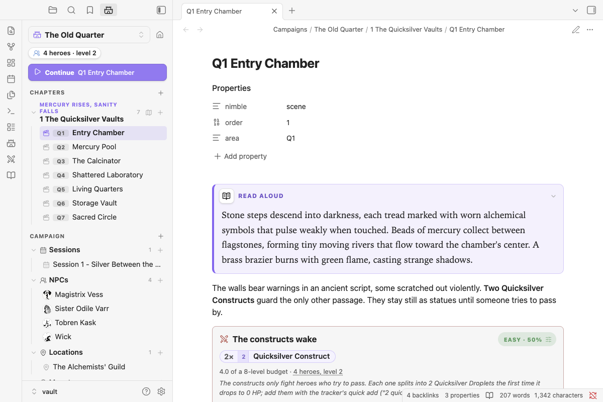

# Campaigns

Run several campaigns from one vault. Each has its own chapters, scenes, NPCs, session logs and party.



## Start one

Use **New campaign**, from the castle icon in the ribbon or the command palette. You give it a name, a starting level and the number of heroes. It creates a folder with a home note, a first chapter and an opening scene.

## The Campaign panel

The panel in the left sidebar is home base. From it you can:

- switch campaigns
- see and edit the party
- **Continue** where you left off
- browse chapters and their scenes (map buttons sit on each chapter)
- browse Sessions, NPCs, Locations and Monsters. NPCs with a [portrait](npcs.md#portraits) show it as their icon.
- create any of these with the **+** buttons

**Each campaign has its own party.** Opening a note inside a campaign makes that campaign active, so encounter blocks in it are rated against that table's heroes. Until you add heroes, the campaign's `level:` and `heroes:` properties are used.

**Moving through scenes:** the **Next scene** and **Previous scene** commands step through scenes in order, across chapters. Bind them to hotkeys under Settings → Hotkeys.

## How it's laid out

It's plain folders and a little frontmatter, so you can also build it by hand or convert an existing vault:

```
Campaigns/
  The Old Quarter/
    The Old Quarter.md                 nimble: campaign   (level: 2, heroes: 4)
    1 The Quicksilver Vaults/
      1 The Quicksilver Vaults.md      nimble: chapter    (order: 1, label: "Mercury Rises, Sanity Falls")
      Q1 Entry Chamber.md              nimble: scene      (order: 1, area: Q1)   ← any note here is a scene
      Q2 Mercury Pool.md
      Map - The Quicksilver Vaults.md  nimble: map
    NPCs/  Sessions/  Locations/  Monsters/  Assets/   ← any other folder is a section
```

- A **campaign** is any folder holding a note with `nimble: campaign`.
- A **chapter** is any folder inside it holding a note with `nimble: chapter`.
- Every other note in a chapter folder is a **scene**, even without frontmatter.
- `order:` sorts notes. Without it, names sort naturally (Q2 before Q10).
- `area:` is the short tag shown before a scene's title in the panel (Q1, Q2…). It's handy for matching map keys.
- Any other folder in the campaign is a **section** (NPCs, Locations, Sessions, Monsters, Handouts or anything you like).

A ```` ```nimble-campaign ```` block on the home note shows the same outline inside the note.

## Campaign properties

| Property | On | Meaning |
|---|---|---|
| `nimble: campaign` | home note | Marks the folder as a campaign |
| `level:` / `heroes:` | home note | Party level and size, used until you add real heroes |
| `nimble: chapter` | chapter note | Marks the folder as a chapter |
| `label:` | chapter note | Shown above the chapter name, e.g. "Chapter 1" or "Prelude" |
| `nimble: scene` | scene | Optional; any note in a chapter is a scene |
| `order:` | any | Sort order |
| `area:` | scene | Area key shown in the panel |
| `nimble: npc` / `location` / `session` / `map` | section notes | What kind of note it is |
