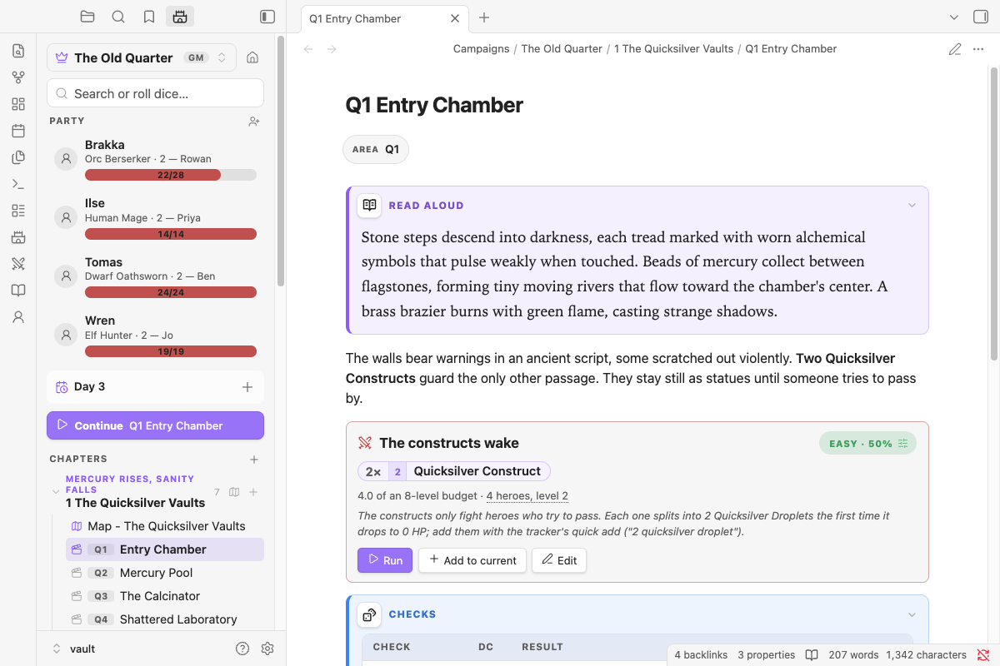
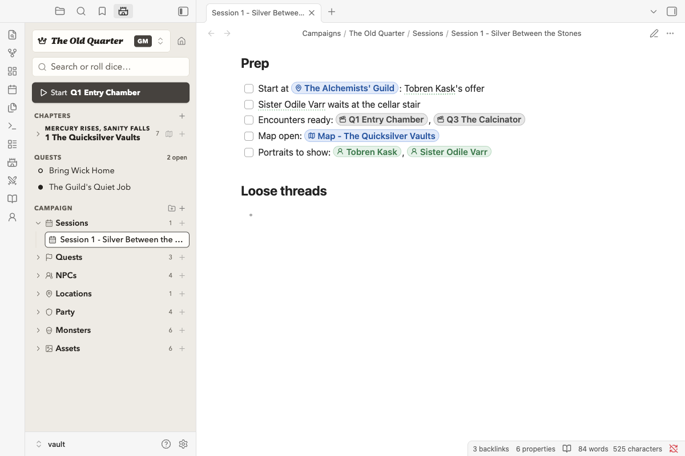

# Campaigns

Run several campaigns from one vault. Each has its own chapters, scenes, NPCs, session logs and party.



## Start one

Use **New campaign**, from the castle icon in the ribbon or the command palette. First pick whether you **run it** or **[play in it](players.md)**. For a game you run, give it a name, a starting level and the number of heroes; it creates a folder with a home note, a first chapter and an opening scene. For a game you play in, name it and your character.

## The Campaign panel

The panel in the left sidebar is home base. From it you can:

- switch campaigns, and with them between GM and [player](players.md) view; **Campaign settings…** in the same menu changes the name, side and level
- open [Spotlight](spotlight.md) from the search bar under the campaign name, to find adversaries, NPCs and notes or roll dice
- see the party: a card for each hero's character sheet, with their HP
- **Continue** where you left off
- browse chapters and their scenes (map buttons sit on each chapter)
- browse every folder in the campaign: Sessions, Quests, NPCs, Locations, Monsters, Assets, and any you make yourself, like Factions. Empty folders show too. NPCs with a [portrait](npcs.md#portraits) show it as their icon.
- see the files in a folder, not just notes: Assets lists its images and PDFs, and clicking one opens it
- add to any chapter or folder with its **+** button
- reorganize by dragging, or from the right-click menu

### Adding notes and folders

**+** on a chapter or folder opens **New**. Pick what you're making, name it, and press Enter:

| Starter | What you get |
|---|---|
| Note | A blank note |
| Scene | Read-aloud box, what's here, encounter and exits (chapters only) |
| NPC | An NPC with a [character card](npcs.md) |
| Location | Description and connections |
| Quest | The hook, objectives, stakes, the truth behind it, clues, complications and rewards ([more](quests.md)) |
| Session log | Prep checklist, recap and loose threads, dated today |
| Map | A map block; pick its image from the campaign's files, or set it later |
| Monster | A stat block the bestiary picks up |
| Handout | Player-facing text and GM notes |

The folder decides what's picked first: NPC in NPCs, Quest in Quests, Scene in a chapter, Session log in Sessions, a blank Note in a folder of your own. In a folder of your own, any starter is saved right there.

A chapter holds its scenes, maps and notes. An NPC, location, quest, monster or handout you make from a chapter's **+** is saved in the campaign's folder for it (**NPCs**, **Locations**, **Quests**, **Monsters**, **Handouts**), so it's listed with the rest and not among the chapter's scenes. The dialog says where it's going before you create it. If you've renamed one of those folders, say NPCs to Characters, that folder is used.

On a folder of files like **Assets**, **+** adds files from your computer or phone instead. Every New dialog also has an **Add files from this device instead** link.

**+** on the **Campaign** heading makes a session log, NPC, location, quest, chapter or **New folder**. The folder icon next to it makes a folder straight away.

### Quests

New campaigns come with a **Quests** folder. Make a quest with its **+**, **New quest** on the **Campaign** heading's **+**, or the **New quest…** command. A quest note holds the hook, a checklist of objectives, the stakes, the truth behind it, clues and rewards, with its status, giver and reward as properties. The folder lists open quests first; set `status: completed` and the quest gets a green tick and moves below them. `/quest` links one in any note.

See [Quests](quests.md) for the full note, every property and examples.

### Links to campaign notes



A link to a campaign note shows what it links to. `[[Bring Wick Home]]` is an orange pill with a flag, in reading view and Live Preview:

| Linked note | Icon | Colour |
|---|---|---|
| Quest | Flag (a tick once `completed`, a cross once `failed`) | Orange |
| Location, map | Map pin, map | Blue |
| Party member (character sheet) | Shield | Purple |
| Monster, creature, saved fight | Skull, paw, swords | Red |
| Handout | Scroll | Yellow |
| Session, scene, chapter, campaign | Calendar, clapperboard, book, castle | Grey |
| NPC | Person | Green ([NPC chips](npcs.md)) |

It's the `nimble:` property on the linked note that counts, so a link to a plain note stays a plain link. Clicking a pill opens the note as usual.

### Moving things around

- **Drag** a note or file onto a chapter or folder to move it there. Drop it on the **Campaign** heading to move it to the top of the campaign.
- **Drag from Obsidian's file explorer** to bring existing notes, or whole folders, into a campaign. This is the quickest way to move an older campaign over.
- A scene or plain note moved into a chapter becomes that chapter's last scene. An NPC, handout or map moved there is kept with the chapter but isn't numbered as a scene.
- Files you add to a chapter, or drop on the **Campaign** heading, are listed there too.
- Links to moved notes are updated the way Obsidian always updates them (Settings → Files and links).

**Right-click** a note, file, folder or chapter (or **long-press** it on a phone or tablet) for:

- notes and files: **Open in new tab**, **Move to chapter or folder…**, **Rename…**, **Delete**
- folders: **New note…**, **Add files…**, **Rename folder…**, **Delete folder**
- chapters: **New scene or note…**, **Open chapter note**, **Add files…**, **Rename chapter…** (renames its folder and chapter note together), **Delete chapter**

Obsidian's own items (Bookmark, Reveal in navigation, and items from other plugins) are in the same menus. Deleted notes go wherever Obsidian's **Deleted files** setting sends them.

**Each campaign has its own party.** In a campaign you run, the party is the [character sheets](character-sheets.md) in its Party folder: **+** next to Party makes a new one, and each card opens the hero's sheet. Encounter blocks and the tracker read the party from those sheets (name, level, max HP, armor and max Wounds), so levelling a hero up changes the encounter maths too. Opening a note inside a campaign makes that campaign active, so encounter blocks in it are rated against that table's heroes. Until you add heroes, the campaign's `level:` and `heroes:` properties are used. A party you entered by hand before keeps counting: those heroes show in the Party section after the sheets, with a button to make character sheets for them, until a sheet with the same name replaces each one.

**Pages open ready to read.** Characters, chapters, scenes, NPCs, locations, quests, maps and handouts open in reading view, where cards, sheets and blocks look their best. Use Obsidian's edit button (or its hotkey) to change one; it stays in editing until you move to another page. Session logs, which you write in at the table, and notes you've just made open for editing as usual. Turn this off under Settings → Campaigns → **Open campaign pages in reading view**. In reading view, a campaign note's properties show as a row of tags (Ancestry Human, Status alive…) rather than the Properties form; switch to editing to change them, or turn off **Properties as tags**.

**Moving through scenes:** the **Next scene** and **Previous scene** commands step through scenes in order, across chapters. Bind them to hotkeys under Settings → Hotkeys.

## How it's laid out

It's plain folders and a little frontmatter, so you can also build it by hand or convert an existing vault:

```
Campaigns/
  The Old Quarter/
    The Old Quarter.md                 nimble: campaign   (level: 2, heroes: 4)
    1 The Quicksilver Vaults/
      1 The Quicksilver Vaults.md      nimble: chapter    (order: 1, label: "Mercury Rises, Sanity Falls")
      Q1 Entry Chamber.md              nimble: scene      (order: 1, area: Q1)   ← any note here is a scene
      Q2 Mercury Pool.md
      Map - The Quicksilver Vaults.md  nimble: map
    NPCs/  Quests/  Sessions/  Locations/  Monsters/  Assets/   ← any other folder is a section
```

- A **campaign** is any folder holding a note with `nimble: campaign`.
- A **chapter** is any folder inside it holding a note with `nimble: chapter`. It can sit straight in the campaign folder or deeper, such as `Chapters/Act 1`.
- Every other note in a chapter folder is a **scene**, even without frontmatter.
- `order:` sorts notes. Without it, names sort naturally (Q2 before Q10).
- `area:` is the short tag shown before a scene's title in the panel (Q1, Q2…). It's handy for matching map keys.
- `title:` is the name shown in the panel when it differs from the file name. File names can't hold characters like `:` `?` and `"`, so a campaign you call "Vecna: Eve of Ruin" is saved as `Vecna- Eve of Ruin` with `title: "Vecna: Eve of Ruin"`, and the panel and NPC cards show the name you typed.
- Any other folder in the campaign is a **section** (NPCs, Locations, Quests, Sessions, Monsters, Handouts or anything you like). Sections list their notes and any other files in them, and show up even while empty.

A ```` ```nimble-campaign ```` block on the home note shows the same outline inside the note.

## Campaign properties

| Property | On | Meaning |
|---|---|---|
| `nimble: campaign` | home note | Marks the folder as a campaign |
| `role: player` | home note | A campaign you [play in](players.md) rather than run |
| `level:` / `heroes:` | home note | Party level and size, used until you add real heroes |
| `nimble: chapter` | chapter note | Marks the folder as a chapter |
| `label:` | chapter note | Shown above the chapter name, e.g. "Chapter 1" or "Prelude" |
| `nimble: scene` | scene | Optional; any note in a chapter is a scene |
| `order:` | any | Sort order |
| `area:` | scene | Area key shown in the panel |
| `nimble: npc` / `location` / `quest` / `session` / `map` / `monster` / `handout` | any note | What kind of note it is (sets its icon) |
| `status:` | quest | Where it stands; `completed` and `failed` quests move to the bottom of the folder ([quests](quests.md#open-finished-and-failed)) |
