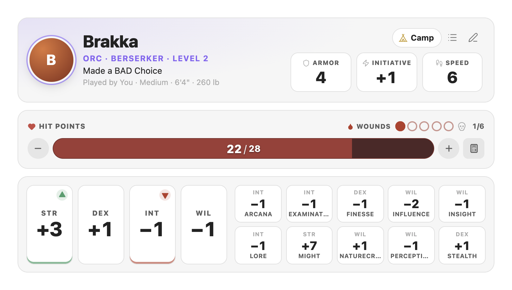
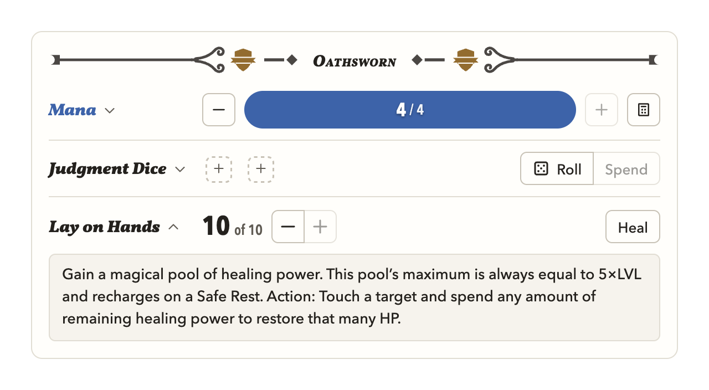
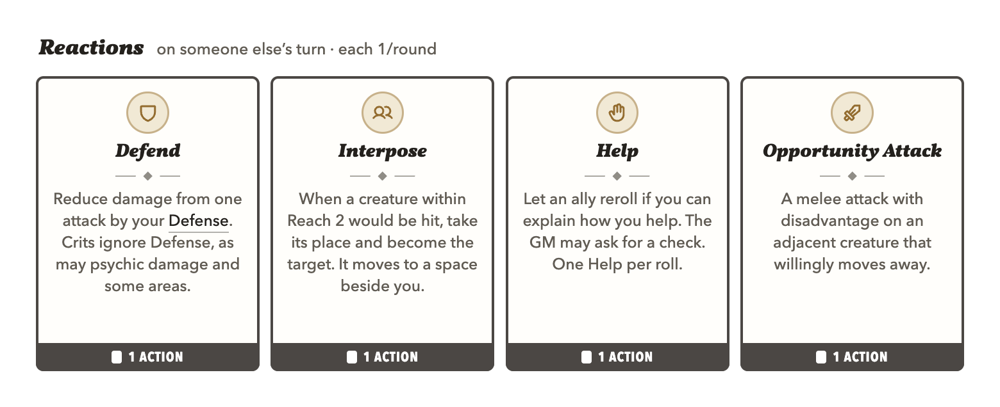
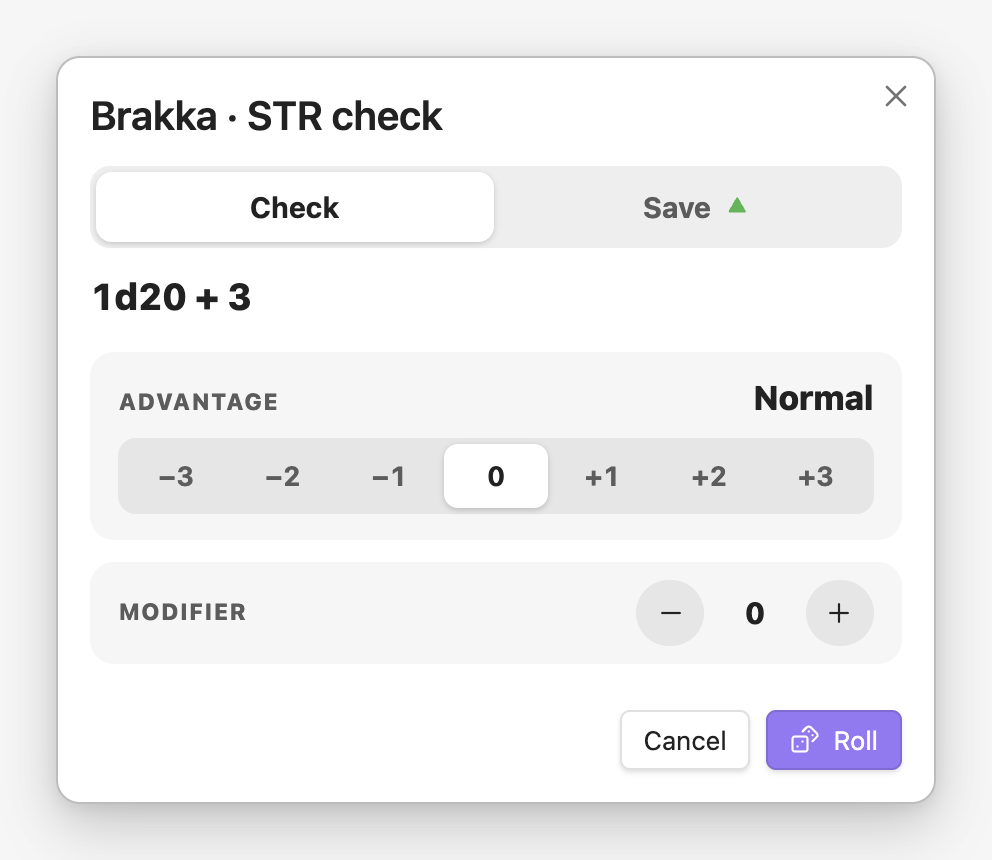
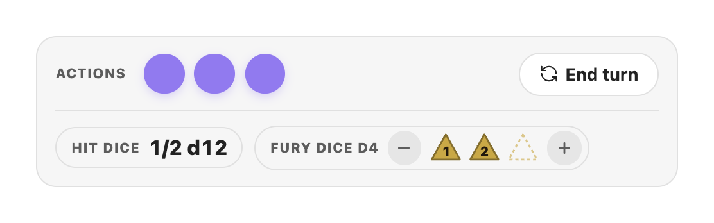
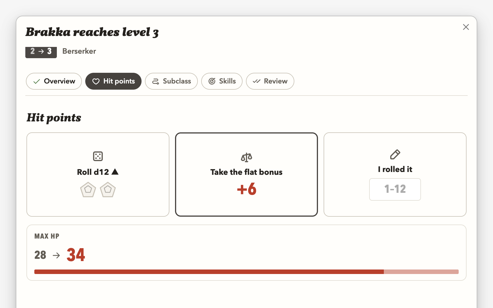
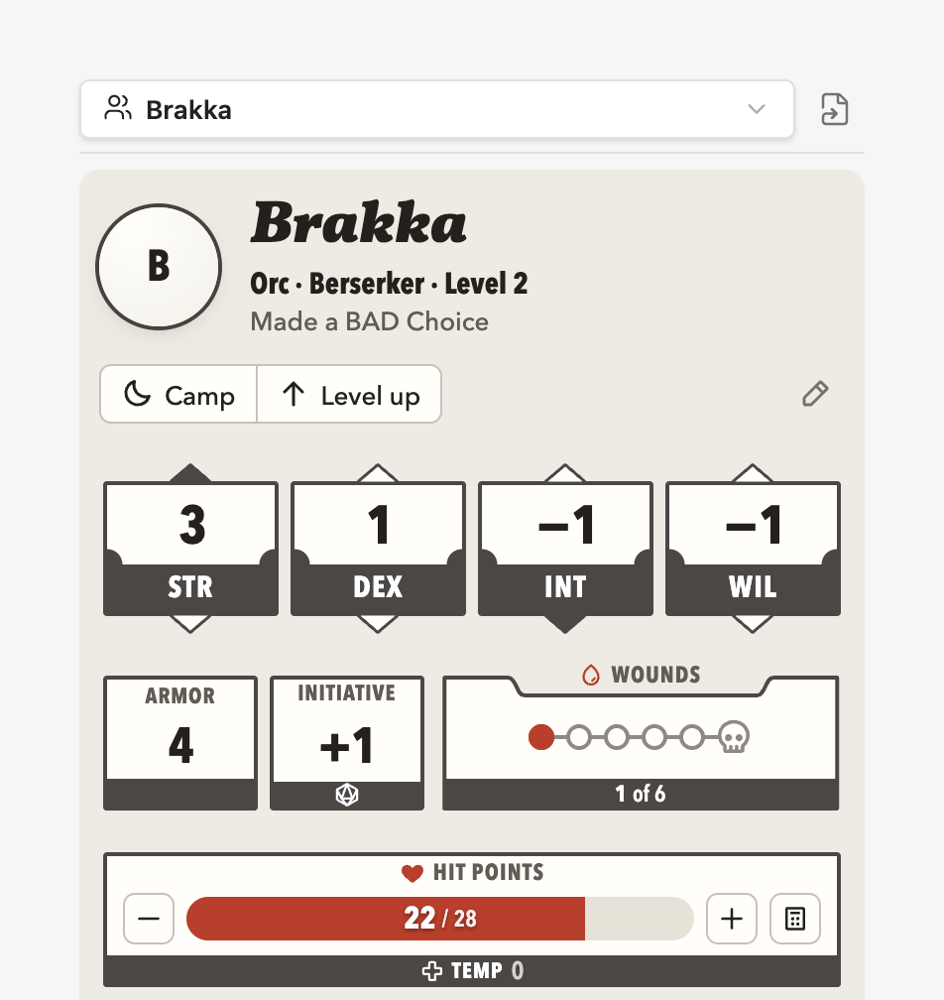

# Character sheets

A Nimble character is an ordinary note. Its properties hold the numbers, a ```` ```nimble-sheet ```` block draws the sheet from them, and everything else in the note (backstory, notes, whatever you like) is yours. Tap a number to roll it, tap HP to take a hit, and the note updates as you play.


## Making a character

- **New character** (command palette, or **Add your character** in a [player campaign](players.md)'s party) asks for a name, ancestry, class, stat array, background and level. It assigns the array to the class's key stats, and fills in HP, Hit Dice, saves and starting gear from the class. Above level 1, HP goes up by the Hit Die's flat bonus (d12: +6) for each level; pick your class options on the sheet afterwards.
- In a player campaign, the hero you make is marked as yours (`mine: true`) and goes in the Party folder. **+** next to Party makes a party member instead.
- A **Character** starter in the New note dialog, or any note with `nimble: character` and an empty ```` ```nimble-sheet ```` block, works too. Fill it in from the sheet's pencil.

## The sheet



The sheet follows Nimble's official character sheet. From the top:

| Part | What it does |
|---|---|
| **Header** | Portrait, name, ancestry, class and level, then subclass and background. **Camp** opens Field rest, Safe rest and Level up; **Level up** goes straight to it. The list button shows the note's properties, and the pencil edits the details and stats (or long-press the name on a touch screen) |
| **Stats** (STR, DEX, INT, WIL) | Tap one to roll a check or a save: the roll dialog opens on **Check**, with **Save** beside it. The triangles on a box's edges are your saves: filled above the box for your advantaged save, below it for the disadvantaged one |
| **Armor** and **Initiative** | Worked out from your stats, gear, class and ancestry. Tap Initiative to roll it |
| **Wounds** | A chain of circles ending in a skull, with how many you have under it ("1 of 6"). Tap an empty circle to add a Wound and a filled one to heal one. Ancestry and background bonuses that always apply (a Dwarf's extra Wounds, say) are counted, and extra Wounds show as dashed circles; situational ones, like "+2 Defense if you moved", are left to you |
| **Hit points** | A wide bar with **−** and **+** either side (tap a few times and they add up, then land as one change). Tap the bar, or the keypad button, for the HP keypad: damage, heal, set or temp HP. Temp HP is in the bar's foot and takes damage first. Dropping to 0 adds Wounds, as in the tracker, and a strip under the bar says what Dying means |
| **Skills** | All ten in one band: stat, plus your points and your class's Skilled Hero bonuses. Tap one to roll a check |
| **Actions** | Your three action dots and how many are left, **End turn** (three actions and your reactions back), your **Speed**, and your **Hit dice** (tap them for a Field rest) |
| **The class panel** | Everything your class tracks, under the class's scrollwork. See [The class panel](#the-class-panel) |
| **Conditions** | **Add** opens the list; the × on a condition takes it off |

Below that are tabs:

- **Actions**: your [reactions](#reactions) as cards, your weapons with their damage (the icon on the damage button is its type: slashing, fire…), the spells you can cast, then your class's abilities that take an action. Tap the arrow after a weapon's name for its text.
- **Features**: class features up to your level, your subclass, ancestry and background traits, and the options you've picked (Savage Arsenal, Spellshaper…). Tap any of them for the book's text, with its source and page. **Add feature** and **Custom ability** are at the top.
- **Spells** (casters): your spells by school and tier, with mana costs. **Cast** spends the mana and rolls the damage. Only tiers you've unlocked are offered.
- **Inventory**: slots used out of 10 + STR, equip toggles, quantities, and coins.
- **Notes**: your languages, details like size and height, and buttons that jump to the headings in the rest of the note.

Every row of pips and dots works the same way, one step at a time: tapping an empty one adds one and tapping a filled one takes one away, whichever you tap. That goes for actions, Wounds and a feature's uses (and the tracker's actions, Wounds and minions).

The sheet fits a phone too: the band packs into rows, and the skills go five to a row.

## The class panel



Each class's own things sit in one panel under the class's scrollwork. Point at a name for how it's worked out ("Mana: (INT×3)+LVL · back on a Safe Rest"); tap the arrow after it for the book's words.

| On the panel | Looks like | You can |
|---|---|---|
| **Dice you hold** (Fury, Judgment and Combat Dice) | A die of its size for each you hold, and empty slots up to your max | **Roll** or **Roll one**, type in a die you rolled at the table, **Spend**. See [Class dice](#class-dice) |
| **Mana** | A blue bar with − and + | Spend or regain one, or tap the keypad button to spend, regain or set an amount |
| **Lay on Hands** | How many points are left | − and +, or **Heal** to spend some |
| **Uses** (Coordinated Strike, Pilfered Power, and features that say "1/Safe Rest", like One with the Ancients) | A pip for each use | **Use**. A Safe Rest brings them back |
| **Charges** (Thrill of the Hunt, Momentum) | A number | **Gain** and **Spend** |
| **Rage** | Raging or Not raging | **Rage** (you're Raging and roll a Fury Die) and **End rage** (the Fury Dice go too) |
| **Hunter's Mark** | Your quarry's name | **Mark**, then **Move mark** to give it to someone else |

## Reactions



The Actions tab starts with the four heroic reactions as cards, with the Core Rules' words: **Defend**, **Interpose**, **Help** and **Opportunity Attack**. Each can be used once a round, on someone else's turn. Tap a card's **1 action** to use it: the action comes off your dots and the card says **Used** until **End turn**. Opportunity Attack also rolls an attack with your first melee weapon, with disadvantage.

## Rolling



Saves, checks, attacks and spells open the roll dialog first:

- **Check** or **Save**, for a stat: the title follows, and Save starts at your ▲ or ▼.
- **The dice** as they'll be rolled, at the top, with what the roll costs if it takes an action.
- **Advantage**: −3 to +3, with what it means beside the label (Advantage 2, Disadvantage…). The arrow keys step through it. Each step rolls one more die and drops the lowest (advantage) or highest (disadvantage). It starts where the sheet knows it should: advantage on your ▲ save, disadvantage on an Opportunity Attack.
- **Modifier**: − and + for a situational bonus.
- **Dice to spend**, like Judgment or Fury Dice: a tile each, with the faces you hold. Tap a tile to put it in the roll (it gets a tick). Dice you hold go in with the faces they show; any not rolled yet are rolled with the attack, in their own colour if 3D dice are on. A pool you can spend any number of has − and + to choose how many.

Press **Roll** or Enter. The result shows in the corner; see [Dice](dice.md#the-rolls-result). To roll straight away, turn off **Ask before rolling** under Settings → Nimble character sheets.

## Class dice



Dice your class holds show on the sheet as dice of their size (a d4 is a triangle, a d6 a rounded square, a d8 a diamond, a d10 a kite, a d12 a pentagon, a d20 a hexagon), with an empty slot for each one you could still gain.

- **Roll them on the sheet:** **Roll** fills the empty slots, and **Roll one** rolls a single die.
- **Or roll them at the table:** tap an empty slot and tap the face you rolled. Tap a die you hold to change its face, or **Remove** it.
- **Spend** drops one.

| Dice | On the sheet | In a roll |
|---|---|---|
| **Judgment Dice** (Oathsworn) | Slots for the most you can hold (2; Oath of Vengeance adds 1 from level 3, and level 14 adds 1). You gain them when an enemy attacks you. d6s, then d8s at level 3, d10s at 5, d12s at 8 and d20s at 10 | On your next weapon attack or Reach spell (not a ranged one), put in by default, all of them. They add radiant damage, and are spent even on a miss |
| **Fury Dice** (Berserker) | **Rage** rolls one; the slots go up to your key stat | Added to your STR attacks while you're Raging. They stay after the attack, and go when your Rage ends |
| **Combat Dice** (Commander) | Slots up to your STR | One per attack, left out until you tap it in for a Combat Tactic |

Judgment Dice and Fury Dice are gone after a Safe Rest; they don't outlast a fight. Change their colour and 3D finish under Settings → Dice → **Class dice**.

**Camp**, in the header, has **Field rest** (spend Hit Dice to heal), **Safe rest** (shows only what would come back: HP, Hit Dice, mana, Wounds and class resources) and **Level up**.

## Levelling up



**Level up** (under **Camp**) opens a wizard: one decision per screen, with chips along the top to jump between them. Everything you choose is kept as you move back and forth, and nothing is written to the note until you press **Reach level N** on the last screen.

1. **Overview**: what the level brings, with the new features to read.
2. **Hit points**: roll your Hit Die with advantage (both dice roll, the higher is kept), take the flat bonus, or type in what you rolled at the table. The new max HP shows as you choose.
3. **Subclass**, at the level you pick one: swipe through a card for each, with its flavour, complexity, and what it gives at every level (this level's features open), or switch to **Compare** for a table with every subclass side by side, level by level.
4. **Picks** the level grants, one screen each: Savage Arsenal abilities, Spellshaper abilities, Sacred Decrees and the like, with the ones you already know marked.
5. **Stat increases** ("+1 STR or DEX"), and an **Epic Boon** at level 19.
6. **Skill point**, then a **review** of everything. Tap any line to go back and change it.

Anything you leave for later (a subclass, a pick) can be chosen from the sheet afterwards.

## Adding things

**Add item**, **Add spell** and **Add feature** open the [compendium](compendium.md#the-compendium-as-a-dialog) as a dialog, set to what you're adding. Your class's own options and your schools come first, and things already on the sheet are tagged **Added**. Enter adds and closes; Cmd/Ctrl+Enter adds and keeps it open, for packing a whole bag at once. Anything that isn't in the books can be added by name as your own.

[Spotlight](spotlight.md) also finds compendium entries on its own: type "flame dart" or "battleaxe" anywhere and press Enter for the card.

## The Character panel



**Open my character** (the person icon in the ribbon) shows your sheet in the right sidebar, so it sits beside your session notes on a desktop and is one tap away on a phone. It follows the campaign you're in; its menu switches to any other character.

To show a sheet inside another note (say, the party on the campaign home), point a block at it:

````
```nimble-sheet
character: [[Brakka]]
```
````

## The note behind it

Everything the sheet shows comes from the note's properties, and every change is written back to them. A short note still works, because anything missing falls back to the rules' defaults.

```yaml
---
nimble: character
mine: true
player: Dakotah
ancestry: Orc
class: Berserker
subclass: Path of the Red Mist
level: 3
background: Made a BAD Choice
str: 3
dex: 1
int: -1
wil: -1
hp: 22
hp_max: 28
wounds: 1
skills: { might: 1 }      # points on top of the stat
inventory:
  - Battleaxe
  - 3 Javelins
  - { name: Cheap Hides, equipped: true }
  - { name: Healing Potion, qty: 2 }
features: [Death Blow]
resources:
  Fury Dice: { current: 2, rolled: [3, 1] }   # dice you hold keep their faces, rolled or typed in
  One with the Ancients: 0                    # a feature's uses left; missing means all of them
gp: 74
cssclasses: [nimble-sheet-note]
---
```

| Property | Default when missing |
|---|---|
| `save_adv`, `save_dis` | From the class (`none` for no save) |
| `hit_die`, `hit_dice_max` | The class's Hit Die; max is your level (plus ancestry bonuses) |
| `armor`, `initiative`, `speed`, `wounds_max`, `mana_max` | Worked out from your stats, gear, class and ancestry. Set one to override it |
| `skills` | 0 points: each skill equals its stat, plus your class's Skilled Hero bonuses |
| `languages` | Common, your ancestry's language, and one more per point of INT |
| `resources` | Nothing held or spent: no class dice, every use of a feature left |
| `quarry` | No quarry for Hunter's Mark (`quarry: Goblin Taskmaster` once you mark one) |

Because they're properties, Obsidian's Bases and Dataview can query them: a table of the party's HP, say.

`cssclasses: [nimble-sheet-note]` hides the note's Properties box and inline title, so the sheet is the page; the list button at the top of the sheet shows the properties again. New characters get it. Without it, the note shows its title and properties above the sheet.

## What's in the compendium

The Core Rules' ancestries, backgrounds, equipment, magic items and spells, the GM Guide's rewards and boons, and all 11 class books (Berserker, Commander, Hunter, Mage, Oathsworn, Shadowmancer, Shepherd, Songweaver, Stormshifter, The Cheat, Zephyr) with every subclass. The expansion drafts are in it too: the Manawright (Artificer), Hexbinder, Psion and Revenant, marked **Draft**. Turn **Include expansion drafts** off under Settings → Nimble character sheets to hide them.

Nimble TTRPG © Nimble Co., used under the Nimble 3rd Party Creator License. If you enjoy the game, buy the books at [nimbleRPG.com](https://nimbleRPG.com).
