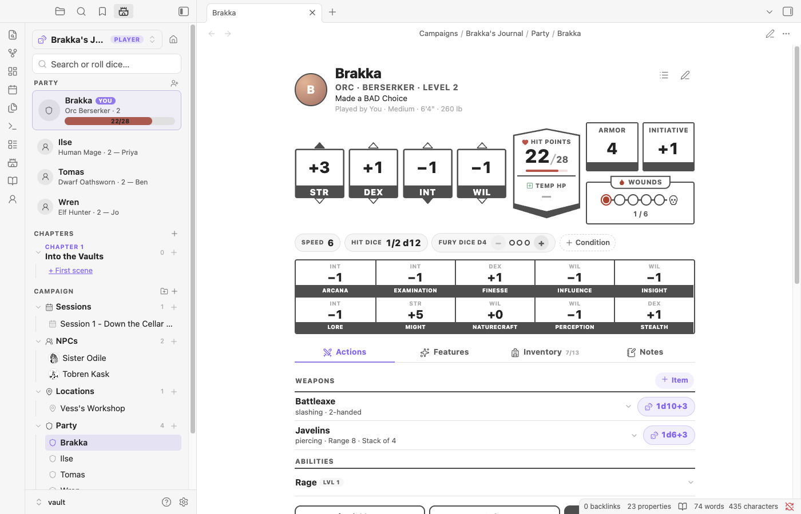

# Character sheets

A Nimble character is an ordinary note. Its properties hold the numbers, a ```` ```nimble-sheet ```` block draws the sheet from them, and everything else in the note (backstory, notes, whatever you like) is yours. Tap a number to roll it, tap HP to take a hit, and the note updates as you play.



## Making a character

- **New character** (command palette, or **Add your character** in a [player campaign](players.md)'s party) asks for a name, ancestry, class, stat array, background and level. It assigns the array to the class's key stats, and fills in HP, Hit Dice, saves and starting gear from the class. Above level 1, HP goes up by the Hit Die's average for each level; pick your class options on the sheet afterwards.
- In a player campaign, the hero you make is marked as yours (`mine: true`) and goes in the Party folder. **+** next to Party makes a party member instead.
- A **Character** starter in the New note dialog, or any note with `nimble: character` and an empty ```` ```nimble-sheet ```` block, works too. Fill it in from the sheet's pencil.

## The sheet

The top of the sheet is four cards, made to tap:

| Part | What it does |
|---|---|
| **Hero** | Portrait, name, ancestry, class and level, with **Armor** (DEX plus worn armor and shield), **Initiative** (tap to roll it) and **Speed** beside them. **Camp** opens Field rest, Safe rest and Level up |
| **Hit points** and **Mana** | Two full-width bars, mana under hit points. − and + take or give one (tap a few times and they add up, then land as one change); tap the bar (or the calculator button) for the keypad: damage, heal, set or temp HP, and spend, regain or set mana. Damage uses temp HP first (the striped part of the bar), and dropping to 0 adds Wounds, as in the tracker. What you lose stays on the bar in amber for a moment, then drains away; what you gain lights up, then the bar fills to it |
| **Wounds** | The pips beside Hit points (under the bar on narrow sheets). Tap an empty pip to add a Wound and a filled one to heal one. Ancestry and background bonuses that always apply (a Dwarf's extra Wounds, say) are counted; situational ones, like "+2 Defense if you moved", are left to you |
| **Stats** (STR, DEX, INT, WIL) | Tap to roll a check or a save: the roll dialog opens on **Check**, with **Save** next to it. A ▲ in a stat's corner marks your advantaged save and ▼ the disadvantaged one; picking Save starts the roll there (checks have no advantage of their own) |
| **Skills** | All ten, with their stat. Tap to roll a check |
| **This turn** | The actions you have left, **End turn**, your **Hit Dice** (tap for a Field rest) and class counters. Counters like Lay on Hands have − and +. Class dice (Judgment Dice, Fury Dice) show as dice of their size; see [Class dice](#class-dice) |
| **Conditions** | A card of their own (tinted while you have any). Add from the list; tap one for its rules |

Below that are tabs:

- **Actions**: the four heroic reactions (Defend shows how much your armor blocks), your weapons with their damage, then your class's actions. Attacks, reactions and spells take their actions off the dots in **This turn** (tap an empty dot to get one back and a filled one to spend one; **End turn** resets to 3).
- **Features**: class features up to your level, your subclass, ancestry and background traits, and the options you've picked (Savage Arsenal, Spellshaper…). Tap any of them for the book's text, with its source and page.
- **Spells** (casters): your spells by school and tier, with mana costs. **Cast** spends the mana and rolls the damage. Only tiers you've unlocked are offered.
- **Inventory**: slots used out of 10 + STR, equip toggles, quantities, and coins.
- **Notes**: a reminder that the rest of the note is yours.

Every row of pips works the same way, one step at a time: tapping an empty pip adds one and tapping a filled pip takes one away, whichever pip you tap. That goes for actions, Wounds and class dice outlines (and the tracker's actions, Wounds and minions).

## Rolling

Saves, checks, attacks and spells open the roll dialog first:

- **Check** or **Save**, for a stat: the title follows, and Save starts at your ▲ or ▼.
- **Advantage**: −3 to +3, from Disadvantage 3 to Advantage 3 (arrow keys step through it). Each step rolls one more die and drops the lowest (advantage) or highest (disadvantage). It starts where the sheet knows it should: advantage on your ▲ save, disadvantage on an Opportunity Attack.
- **Modifier**: + and − for a situational bonus.
- **Class dice** that go into the roll, like Judgment Dice, with how many and a switch. They're rolled with the attack, in their own colour if 3D dice are on.

Press **Roll** or Enter. To roll straight away, turn off **Ask before rolling** under Settings → Character sheets.

## Class dice

Class dice show on the sheet as dice of their size (a d6 is a rounded square, a d8 a diamond, a d10 a kite, a d12 a pentagon, a d20 a hexagon), in gold. Change the colour and the 3D finish under Settings → Character sheets → **Class dice**.

| Dice | On the sheet | In a roll |
|---|---|---|
| **Judgment Dice** (Oathsworn) | Outlines for the most you can hold (2; Oath of Vengeance adds 1 from level 3, and level 14 adds 1), filled in as you gain them: + when an enemy attacks you, − to drop one. d6s, then d8s at level 3, d10s at 5, d12s at 8 and d20s at 10 | On your next weapon attack or Reach spell (not a ranged one), switched on, all of them by default. They're rolled with the attack as radiant damage, and spent even on a miss |
| **Fury Dice** (Berserker) | **+** rolls one when you Rage and keeps its face; tap a die to change it | Added to your attacks while you have the Raging condition. They stay after the attack; − spends one |
| **Combat Dice** (Commander) | How many you have, up to STR | One per attack, rolled with it; switched off until you use a Combat Tactic |
| **Swarm Dice** (Shadowmancer) | **+** rolls one and keeps its face | Any number per attack |

Judgment Dice and Fury Dice are gone after a Safe Rest; they don't outlast a fight.

**Camp**, in the hero card, has **Field rest** (spend Hit Dice to heal), **Safe rest** (shows what comes back: HP, Hit Dice, mana and class resources, one Wound, temp HP gone) and **Level up**.

## Levelling up

**Level up** (under **Camp**) opens a wizard: one decision per screen, with chips along the top to jump between them. Everything you choose is kept as you move back and forth, and nothing is written to the note until you press **Reach level N** on the last screen.

1. **Overview**: what the level brings, with the new features to read.
2. **Hit points**: roll your Hit Die with advantage (both dice roll, the higher is kept), take the average, or type in what you rolled at the table. The new max HP shows as you choose.
3. **Subclass**, at the level you pick one: swipe through a card for each, with its flavour, complexity, and what it gives at every level (this level's features open), or switch to **Compare** for a table with every subclass side by side, level by level.
4. **Picks** the level grants, one screen each: Savage Arsenal abilities, Spellshaper abilities, Sacred Decrees and the like, with the ones you already know marked.
5. **Stat increases** ("+1 STR or DEX"), and an **Epic Boon** at level 19.
6. **Skill point**, then a **review** of everything. Tap any line to go back and change it.

Anything you leave for later (a subclass, a pick) can be chosen from the sheet afterwards.

## Adding things

Every **+** opens [Spotlight](spotlight.md), filtered to what you're adding: items for the inventory, spells for the spellbook, your class's options for features. Chips along the top switch categories. Enter adds and closes; Cmd/Ctrl+Enter adds and keeps it open, for packing a whole bag at once. Anything that isn't in the books can be added by name as your own.

Spotlight also finds compendium entries on its own: type "flame dart" or "battleaxe" anywhere and press Enter for the card.

## The Character panel

**Open my character** (the person icon in the ribbon) shows your sheet in the right sidebar, so it sits beside your session notes on a desktop and is one tap away on a phone. It follows the campaign you're in; its menu switches to any other character.

To show a sheet inside another note (say, the party on the campaign home), point a block at it:

````
```nimble-sheet
character: [[Brakka]]
```
````

## The note behind it

Everything the sheet shows comes from the note's properties, and every change is written back to them. A short note still works, because anything missing falls back to the rules' defaults.

```yaml
---
nimble: character
mine: true
player: Dakotah
ancestry: Orc
class: Berserker
subclass: Path of the Red Mist
level: 3
background: Made a BAD Choice
str: 3
dex: 1
int: -1
wil: -1
hp: 22
hp_max: 28
wounds: 1
skills: { might: 1 }      # points on top of the stat
inventory:
  - Battleaxe
  - 3 Javelins
  - { name: Cheap Hides, equipped: true }
  - { name: Healing Potion, qty: 2 }
features: [Death Blow]
resources:
  Fury Dice: 2
  Judgment Dice: { current: 2, rolled: [4, 6] }   # dice rolled as you gain them keep their faces
gp: 74
cssclasses: [nimble-sheet-note]
---
```

| Property | Default when missing |
|---|---|
| `save_adv`, `save_dis` | From the class (`none` for no save) |
| `hit_die`, `hit_dice_max` | The class's Hit Die; max is your level (plus ancestry bonuses) |
| `armor`, `initiative`, `speed`, `wounds_max`, `mana_max` | Worked out from your stats, gear, class and ancestry. Set one to override it |
| `skills` | 0 points: each skill equals its stat |
| `languages` | Common, your ancestry's language, and one more per point of INT |

Because they're properties, Obsidian's Bases and Dataview can query them: a table of the party's HP, say.

`cssclasses: [nimble-sheet-note]` hides the Properties box on the note (the sheet has a **Show properties** button) and the note's inline title.

## What's in the compendium

The Core Rules' ancestries, backgrounds, equipment, magic items and spells, the GM Guide's rewards and boons, and all 11 class books (Berserker, Commander, Hunter, Mage, Oathsworn, Shadowmancer, Shepherd, Songweaver, Stormshifter, The Cheat, Zephyr) with every subclass. The expansion drafts are in it too: the Manawright (Artificer), Hexbinder, Psion and Revenant, marked **Draft**. Turn **Include expansion drafts** off under Settings → Character sheets to hide them.

Nimble TTRPG © Nimble Co., used under the Nimble 3rd Party Creator License. If you enjoy the game, buy the books at [nimbleRPG.com](https://nimbleRPG.com).
