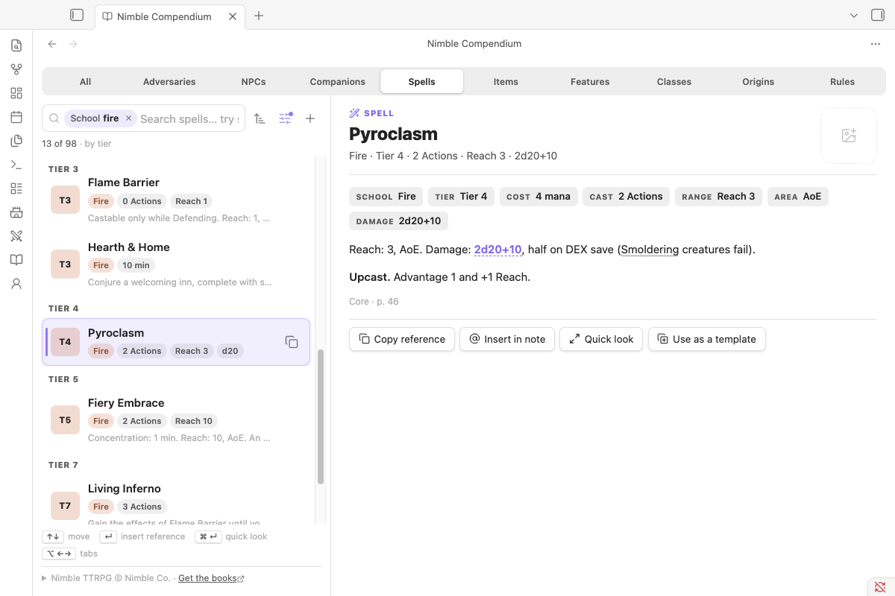
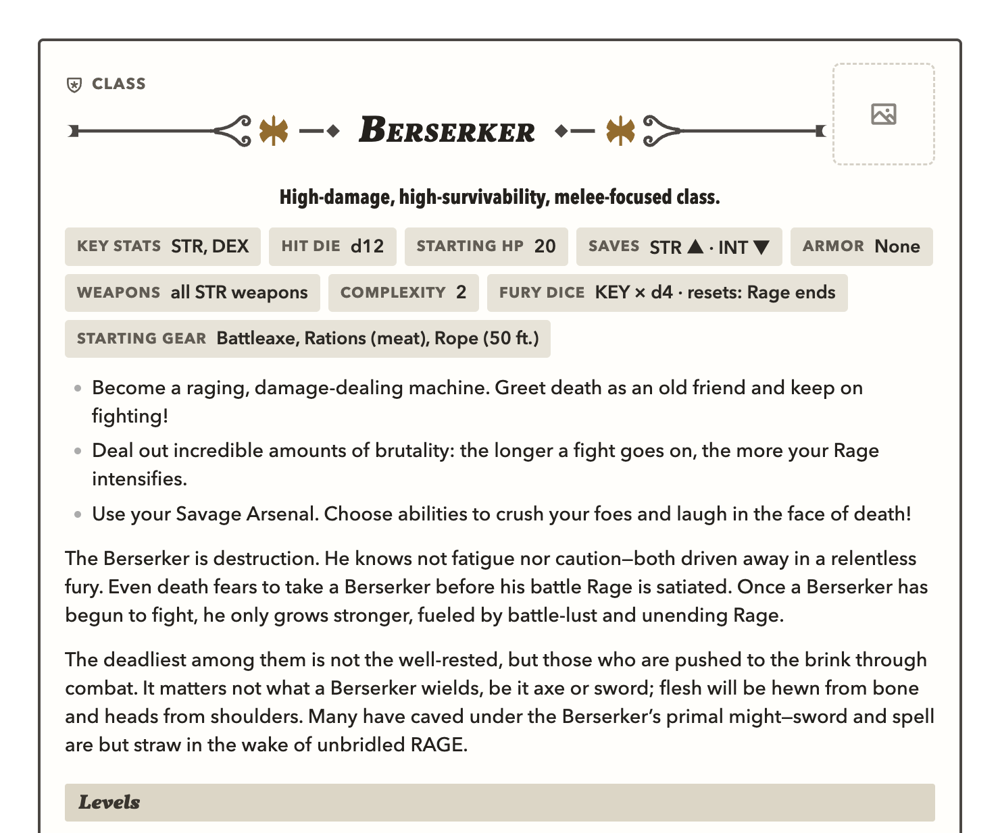

# The compendium



Everything in Nimble, and everything you've written, in one searchable place: adversaries, NPCs, companions, spells, items, class features, classes and subclasses, ancestries and backgrounds, conditions and rules. It replaces the old bestiary tab.

Open it with the book icon in the ribbon, the **Open compendium** command, or `/bestiary` in a note. **Search the compendium…** opens the same thing as a dialog over whatever you're doing. It wears your campaign's look: Nimble's parchment here, or [5e's book](5e.md#the-5e-compendium) in a 5e campaign.

## Tabs

The tabs along the top pick what you're looking at: **All**, **Adversaries** (**Creatures** in a campaign you play in), **NPCs**, **Companions**, **Spells**, **Items**, **Features**, **Classes**, **Origins** (ancestries and backgrounds) and **Rules** (conditions, skills, stats, equipment and magic rules).

From the search box, ⌥/Alt + ← and → step through the tabs, and ⌥/Alt + 1…0 jump straight to one. Typing `in:spells` does the same.

- **Features** lists every class and subclass feature and every class option, so `lay on hands` finds the Oathsworn's Lay on Hands, with its class and level.
- **Classes** shows each class as a full page, its name between the class's scrollwork: key stats, hit die, saves, gear, every level's features, its option groups and every subclass.


- **Companions** has the Beastmaster's companions, the Shepherd's companion abilities, the Adventuring Companions rules from Monsters & More (draft), and any stat block in your vault whose `type:` or `group:` says Companion. The companion stat blocks themselves aren't printed in the current Monsters & More draft yet.

## Reading the list

Each row leads with a square: a monster's level in a box framed like the sheet's stat boxes (filled for a legendary, dashed for a minion), a spell's tier in mana blue, a class's things in ochre, and an icon for everything else. Your own art takes its place when you've given the entry some. Tags come next, dark with white text (the kind on **All**, Legendary, Minion, Draft, the book it's from), then the facts as chips; one that doesn't fit drops out whole. Headings over each group (a tier, a family) stay put as you scroll.

Pages are framed like the sheet: the name in Nimble's heavy italic, the facts as chips, dice boxed to roll and rules words underlined.

## Making your own

The **+** at the end of the search bar opens the [builder](builder.md) for the tab you're on: a monster on Adversaries, a spell on Spells, an item on Items. On an entry's page, **Use as a template** starts a new one from it. Homebrew spells and items you make (or write as ```` ```nimble-spell ```` and ```` ```nimble-item ```` blocks) show up here with the book's, marked Homebrew.

[Content packs](content-packs.md) add classes, subclasses, options, ancestries, backgrounds, spells, items, monsters and rules, each tagged with its pack's name. `source:` filters by pack, and `is:pack` finds everything packs added.

## Searching

Type a name. Search ignores case and punctuation and forgives typos (`pyroclsm` finds Pyroclasm). Names count most, then the detail line, then rules and ability text. Put a phrase in quotes to keep it together: `"lay on hands"`.

### Typed filters

Filters are chips in the search box. Name one (type `type`, then Enter or Tab on the `type:` suggestion, or just type `type:`) and a **Type:** chip waits for its value: what you type next is the value, its values are suggested with counts, and Enter or Tab finishes the chip. Nothing you typed is left in the box.

- `type` → Enter → `und` → Enter gives **Type: Undead**. A space finishes it too when the value is complete (`category:weapon `, `level:3 `); a partial one keeps going (`type:fiendish ` … `tyrants`).
- A plain word that matches a filter is offered as one: `necrotic` offers `school:Necrotic`, and `spell` offers `in:spells`.
- Suggestions sit at the top of the list. While you're naming or filling in a filter, the selection starts on them; for a plain word it starts on the best result (so Enter still opens it), and the first ↓ jumps up to the suggestions.
- **Backspace** in an empty box cancels a chip waiting for its value, or reopens the last chip to edit its value. **Esc** cancels a waiting chip in the Compendium tab.
- Values of one filter are alternatives: with **Type: Undead** applied, `type:` still offers every other type.

Click a chip's × to remove it. Switching tabs drops filters that don't apply to the new tab.

| Filter | Example | Works on |
| --- | --- | --- |
| `type:` | `type:goblin`, `type:undead` | Adversaries (their family: Goblins, Undead, Fiendish Tyrants…) |
| `level:` | `level:3`, `level:>=5`, `level:2-4`, `level:1/2` | Adversaries, features |
| `role:` | `role:minion`, `role:legendary` | Adversaries |
| `size:`, `armor:`, `habitat:`, `hp:` | `habitat:forest`, `hp:>50` | Adversaries |
| `resist:`, `immune:`, `vuln:` | `vuln:radiant` | Adversaries |
| `school:` | `school:fire,ice` | Spells, classes |
| `tier:` | `tier:cantrip`, `tier:8` | Spells |
| `action:` | `action:"2 actions"`, `action:reaction` | Spells, features |
| `class:`, `subclass:`, `group:` | `class:oathsworn`, `group:"savage arsenal"` | Features, spells, subclasses |
| `category:`, `stat:`, `die:`, `damage:`, `prop:`, `price:` | `stat:str die:d8`, `prop:light`, `price:<10` | Items |
| `source:` | `source:gmg` | Everything |
| `is:` | `is:minion`, `is:concentration`, `is:cantrip`, `is:draft`, `is:mine` | Flags |
| `tag:` | `tag:light` | Any value of any filter |

- Two values of the same filter mean either one: `school:fire school:ice` (or `school:fire,ice`).
- A `-` in front excludes: `-role:minion`.
- Values match the start of a word, and plurals don't matter: `type:goblin` finds Goblins.

### Sorting


Each tab has a sensible default (adversaries by level, spells by tier, items by category, features by class) and switches to best match once you type a name. Sorts chain as far as you like: level, then name; or school, then tier from high to low. The sort button next to the search box opens the chain. Pick a key, flip its direction, and add **Then by…** for the next one. You can also type it: `sort:level,name`, `sort:school,-tier`, or several `sort:` filters in a row. The first sort decides the headings: type, school, class and the like put a heading over each group.

The filter button (the sliders) opens a panel with the tab's common filters as pills, for when you'd rather click. Point at a pill for how many entries it has.

## Keys

| Key | What it does |
| --- | --- |
| ↑ ↓, Page Up/Down | Move through suggestions and results |
| Enter | The main action: apply a suggestion; add a monster to the encounter (Shift+Enter for two); insert a reference to anything else |
| ⌘/Ctrl + Enter | The second action: insert a monster's reference; open a quick look of anything else |
| Tab | Take the top suggestion |
| Backspace (empty box) | Edit the last filter chip |
| ⌥/Alt + ← → or 1…0 | Switch tabs |

## The compendium as a dialog


Everywhere the plugin asks you to pick something, it opens the compendium already set to what you need, with the search box focused:

- **Add monster** (the tracker's button and the command): adversaries and companion stat blocks. `3 goblin` adds three, Shift+Enter adds two, ⌘/Ctrl+Enter or a row's + adds and keeps the dialog open, and each row shows how many are already in the fight. **Add several…** on a monster page's Add menu asks how many, and how tough ([several at once](encounters.md#several-at-once)).
- **Slash commands:** `/monster`, `/statblock`, `/spell`, `/item`, `/feature`, `/class`, `/companion` and `/compendium` open it set to that tab. Enter writes the reference where you typed the slash, and the cursor goes back to the note so you can keep typing.
- **Character sheets:** Add item, Add spell and Add feature pick from it. Your class's own options and your schools come first (`is:suggested` shows only those), things already on the sheet are tagged Added, and you can add something that isn't in the books by name.

The dialog shows the selected entry's page beside the list when it's wide enough. Narrower, and on phones, it shows the list alone.

## Your own art

Give any entry a picture or GIF: click the square beside its title (on its page, in the compendium dialog's preview, or in a quick look) and choose **Upload from this device…** or **Choose from vault…**, or drop an image onto the square. It shows there like a portrait and replaces the entry's icon in every list, cropped to fill the rounded square. A creature's art covers all its printings. GIFs keep moving.

Uploaded images are saved in **Ember Vault/Compendium Art** (change the folder in settings), so they sync with the rest of your vault. Rename or move an image and it stays linked; **Remove art** in the same menu takes it off the entry without deleting the file.

## Referencing anything


Every entry's page has **Copy reference**, which copies it to paste into any note, and **Insert in note**, which writes it into the note you were last editing and leaves you in the compendium. With no note open, Insert copies instead. The button at the end of a row copies its reference (on a monster, it adds one to the fight), and Enter on a non-monster row inserts.

Following a link from one page to another (a spell's class, a feature's subclass) works like a browser: the tab's back and forward buttons return you to where you were.

Monsters have always been `` `nimble:Goblin` ``. Everything else works the same way, with its kind in front:

```markdown
`nimble:spell:Flame Dart`
`nimble:feature:Lay on Hands`
`nimble:class:Oathsworn`
`nimble:item:Short Sword`
`nimble:condition:Dazed`
```

Each shows as a chip with the kind's icon, in the game's colours: charcoal in Nimble, with spells in mana blue and items in ochre (5e's are oxblood, with items in gold). Hover it for the card, framed in the look of its game; click it for a quick look, and click a feature's class to open the class page. Two classes can share a feature name; the compendium writes `` `nimble:feature:Blur@Zephyr` `` when it needs to say which. A bare name with no kind (`` `nimble:Flame Dart` ``) finds a monster first, then anything in the compendium with that name.

Typing `` `nimble: `` offers monsters and everything else as you type, and `` `nimble:spell: `` offers only spells.

## Rules words

Conditions, the four stats (STR, DEX, INT, WIL), Concentration and other rules are underlined in stat blocks, the tracker, character sheets and compendium pages, and so are languages on a sheet. Click one, or press Enter on it, for its rule. Words in the card open in the same card, with a back arrow, and **Open in compendium** goes to the page. Conditions you add in settings work the same way.

## In a campaign you play in

Players see creatures as lore: names, families, habitats and descriptions, no levels or stats, one row per creature with a tag for every book it's in, and a Notes tag when you've written notes on it. Enter and the row button insert a reference instead of adding to a fight.
