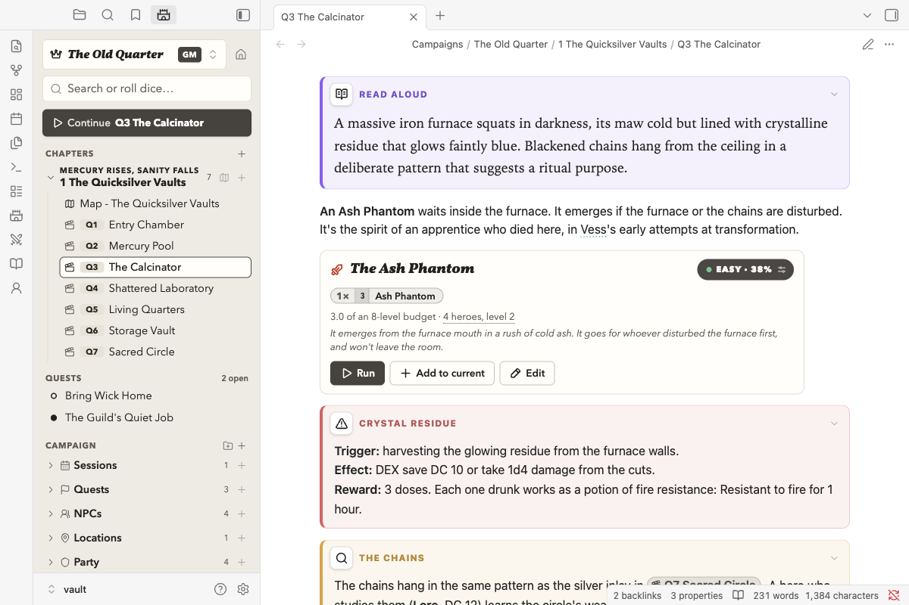
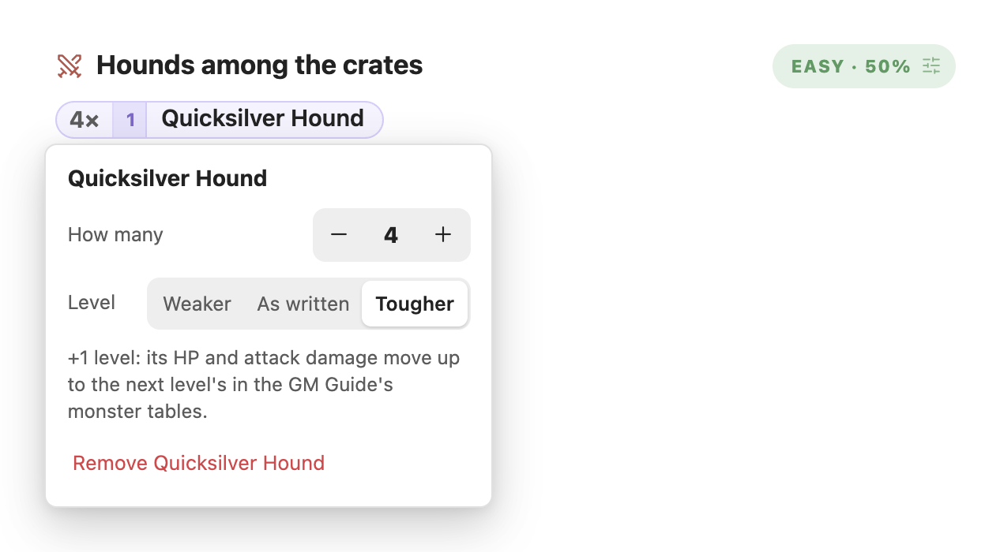
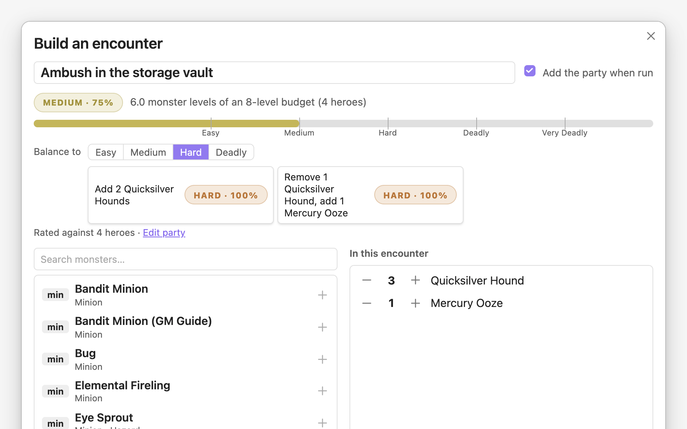
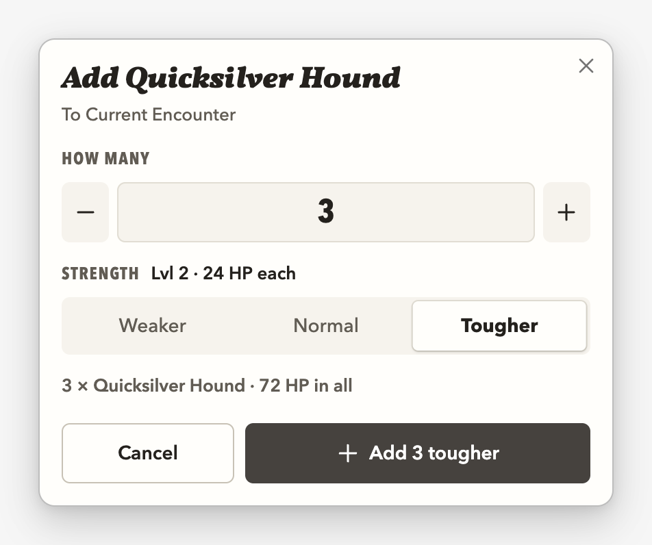

# Encounters



## Encounter blocks

````markdown
```nimble-encounter
name: Goblin Blind
party: true
monsters:
- 2 Goblin
- 3 Goblin Minion
notes: If spotted, one goblin runs to warn the den.
```
````

The block shows its difficulty using the GM Guide budget:

- The budget is the party's total hero levels.
- 50% of the budget is Easy, 75% Medium, 100% Hard, 125% Deadly and 150% Very Deadly.
- Each minion counts as half the party's level.
- A legendary monster counts as its level × the number of heroes.

You also get warnings, for example armor before level 3, or more than 3 monsters per hero. **Scaling and balancing:**
- Click a monster's count (`2×`) to change how many, make them **tougher or weaker** (one level each way), or remove them. The note updates when the editor closes.

  

- A shift is written into the block, e.g. `- 2 Cultist +1`. It counts toward difficulty and carries into the tracker.
- A shift moves the monster's HP and attack dice to the new level's numbers in the GM Guide's monster tables (the legendary table for solos), so a fragile hard-hitter stays one. Armor the book holds back at low levels drops a step. The stat block shows a Tougher or Weaker line so you can see what changed at the table.
- Click the rating (e.g. **Very Deadly · 144%**, a dark tag with a coloured dot) for **Balance**, and slide to a target: Easy, Medium, Hard or Deadly. You get the two or three smallest edits that reach it, for example "Remove all 3 Goblin Minions → Hard 106%". One click applies it. Legendary monsters are kept, and minions from the same family can be suggested.
- The same balancer sits under the meter in the encounter builder.
- The "4 heroes, level 2" line opens the party: the Campaign panel's Party section in a campaign you run, or the party editor outside a campaign.

**Run** loads the encounter into the tracker, **Add to current** adds its monsters to the encounter already running, and **Edit** opens the builder and saves back into the block. After a fight saved to a note, **Resume round N** picks it back up.

The block wears your campaign's look. In a [5e campaign](5e.md#encounters) it rates the fight by your edition's rules instead.

## The encounter builder



`/builder`, or **Build an encounter…** in the command palette, opens the builder:

- **The rating** at the top: the same tag as the encounter block, the fight's monster levels against the party's budget, and a meter with Easy to Very Deadly marked along it. The party it's rated against ("4 heroes, level 2") is a link to the party.
- **Balance to** slides between Easy, Medium, Hard and Deadly, and suggests the smallest edits that get there. One click applies one.
- **Monsters:** search the bestiary and your own monsters. Click a row (or press Enter) to add one, Shift for two; point at it for its stat block.
- **In this encounter:** − and + change how many of each.
- **Add the party when run** puts your heroes in the tracker with the monsters.

**Insert into note** writes an encounter block where your cursor is, and **Run now** sends it straight to the tracker.

## Several at once



**Add several…**, in the menu beside a monster's **Add** button (on its compendium page or hover card), asks how many to add and how tough: **Weaker**, **Normal** or **Tougher**, one level each way. What you'd get shows beside **Strength** ("Lvl 2 · 24 HP each"), with the total under it, and the button says what it'll do: **Add 3 tougher**.

## Quick fights without a block

- `/add 3 goblin` adds three goblins to the tracker without writing anything to the note.
- In the tracker, click **Add monster** and type `3 goblin`.
- **Add** on a monster's hover card or compendium page, **Add to encounter** under a stat block in a note, or the **+** on a `nimble:` reference. Shift-click **Add** for two.
