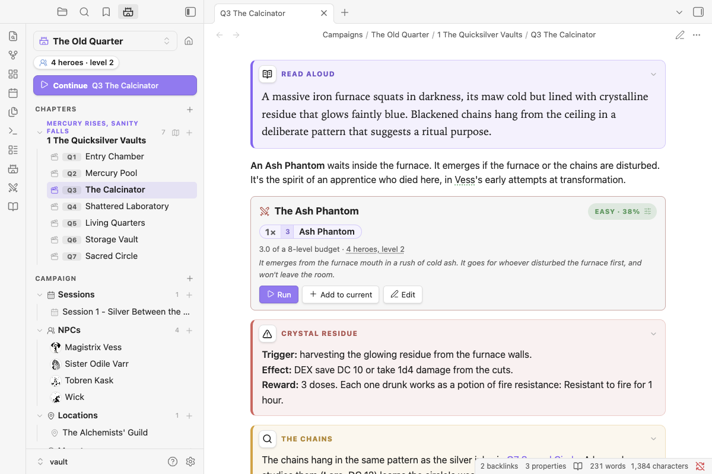

# Encounters



## Encounter blocks

````markdown
```nimble-encounter
name: Goblin Blind
party: true
monsters:
- 2 Goblin
- 3 Goblin Minion
notes: If spotted, one goblin runs to warn the den.
```
````

The block shows its difficulty using the GM Guide budget:

- The budget is the party's total hero levels.
- 50% of the budget is Easy, 75% Medium, 100% Hard, 125% Deadly and 150% Very Deadly.
- Each minion counts as half the party's level.
- A legendary monster counts as its level × the number of heroes.

You also get warnings, for example armor before level 3, or more than 3 monsters per hero. **Scaling and balancing:**
- Click a monster's count (`2×`) to change how many, make them **tougher or weaker** (one level each way), or remove them. The note updates when the editor closes.
- A shift is written into the block, e.g. `- 2 Cultist +1`. It counts toward difficulty and carries into the tracker.
- Per level: about 25% more (or less) HP, and +2 (or −2) damage on every hit. The stat block shows a Tougher or Weaker line so you can see it at the table.
- Click the difficulty chip (e.g. *Very Deadly · 144%*) and pick a target (Easy, Medium, Hard or Deadly). You get the two or three smallest edits that reach it, for example "Remove all 3 Goblin Minions → Hard 106%". One click applies it. Legendary monsters are kept, and minions from the same family can be suggested.
- The same balancer sits under the meter in the encounter builder.
- The "4 heroes, level 2" line opens the party editor.

**Run** loads the encounter into the tracker, **Add to current** adds its monsters to the encounter already running, and **Edit** opens the builder and saves back into the block.

## The encounter builder

`/builder`, or **Build an encounter…** in the command palette, opens the builder. Search the bestiary, add monsters, and watch the budget meter as you go. The balancer under the meter suggests edits to reach the difficulty you want. **Insert into note** writes an encounter block where your cursor is, and **Run now** sends it straight to the tracker.

## Quick fights without a block

- `/add 3 goblin` adds three goblins to the tracker without writing anything to the note.
- In the tracker, click **Add monster** and type `3 goblin`.
- **Add to encounter** on any stat block or reference (Shift-click adds two).
