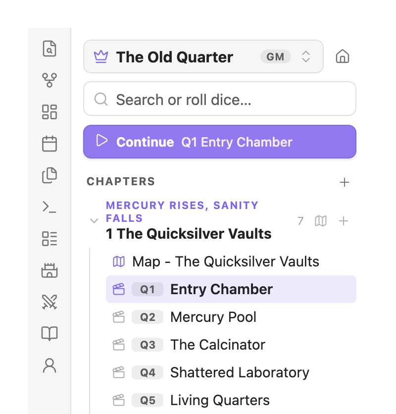
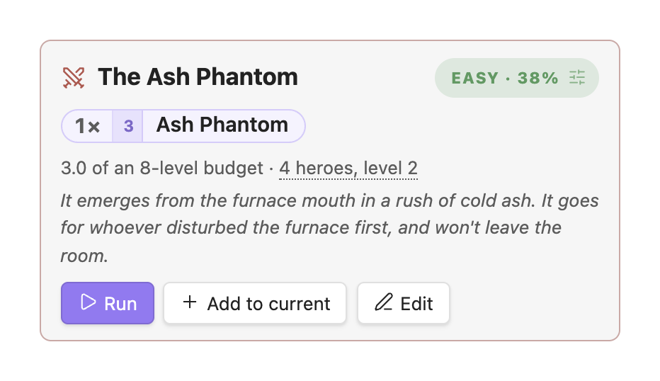

# Getting started

## Install

1. In Obsidian, open **Settings → Community plugins** and turn off Restricted mode if it's on.
2. Select **Browse**, search for **Ember Vault**, then select **Install** and **Enable**.

Four icons appear in the left ribbon:

| Icon | Opens |
|---|---|
| Castle | The **Campaign panel**: chapters, scenes and every folder in the campaign (NPCs, sessions, assets…) |
| Swords | The **encounter tracker** (hidden in a campaign you play in) |
| Book | The **compendium**: every monster, spell, item, class and rule, plus your homebrew |
| Person | Your **character sheet** in the right sidebar ([the Character panel](character-sheets.md#the-character-panel)) |

Everything is also in the command palette (Cmd/Ctrl+P). Type "Ember Vault" to see the commands.

> Want to see it working first? Download the [sample adventure](sample-adventure.md). It's a ready-made vault with a dungeon, a map, NPCs and encounters.

## Your first fight

1. **Add your party.** Open **Settings → Ember Vault → Party** and add each hero's name, class, level, max HP and Defense. Encounters are rated against these heroes.
2. **Write an encounter.** In any note, type `/encounter 3 goblin, 2 wolf` and press Enter. You get an encounter block with its difficulty (Easy to Very Deadly) worked out for your party.

   

3. **Run it.** Select **Run** on the block. The tracker opens with the goblins, the wolves and your heroes.
4. **Play.** Select **Start combat**. Heroes go first, in any order; tick each one off when they've acted. Then the monsters go. Select **Next round** to start again.

To damage a monster, click its HP: a calculator opens on Damage. Enter `12` and apply it, or toggle **Crit** first. The tracker subtracts armor for you, and with a keyboard you can just type `12!` and press Enter. More on the [tracker page](tracker.md).

## Your first campaign

1. Select the castle icon, then **New campaign**. Give it a name, a starting level and the number of heroes.
2. The plugin makes a folder with a home note, a first chapter and an opening scene.
3. Write the scene. Type `/read-aloud` for boxed text, `/encounter` for a fight, `/npc` to link a character.
4. Add more scenes with **+** in the Campaign panel. Every folder has a **+** too, and you can drag notes between them. Use **Next scene** / **Previous scene** (bind them to hotkeys) to step through them at the table.

See [Campaigns](campaigns.md) for how it's laid out, and how to build it by hand. Jobs and rescues get notes of their own in the campaign's Quests folder; see [Quests](quests.md).

## Your first monster

Need something the books don't have? Run **New monster…** from the command palette, name it, pick a level and press **Create now**. You get a stat block with the GM Guide's HP and damage for that level, ready to drop into an encounter. Spells and items work the same way (**New spell…**, **New item…**). See [the builder](builder.md).

## Playing instead of running?

Make a campaign and choose **I play in it**. You get a character sheet, lore cards instead of stat blocks, and notes written from the party's side. See [Playing in a campaign](players.md) and [Character sheets](character-sheets.md).

## Where things are saved

- **In your notes:** encounters, stat blocks, homebrew spells and items, character sheets, quests, maps, boxes, NPC cards. They're plain Markdown code blocks, so they sync, search and back up like any other text.
- **In plugin data** (`.obsidian/plugins/nimble-gm/data.json`): your party, the tracker's current state, map token positions and settings.

Nothing leaves your computer. The plugin makes no network requests. It only writes to the clipboard when you select a **Copy** button.
