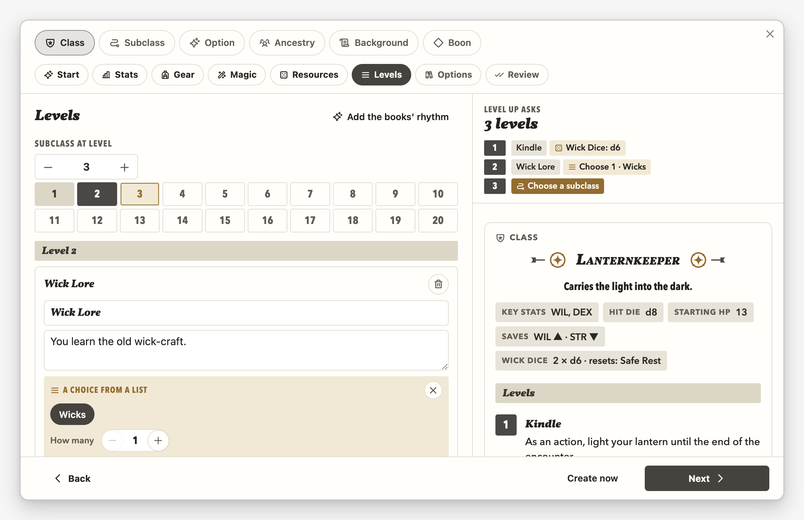
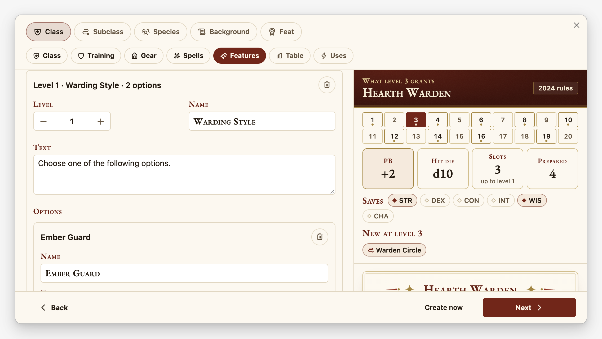

# Your own content

Everything a game ships, you can add yourself: classes, subclasses, a class's options, feats, species and ancestries, backgrounds, boons, rules and conditions. What you add works like the books' own. **New character**, **Level up**, the character sheet, the compendium, references, autocomplete, Spotlight, the "/" menu and the tracker all see it.

Your content lives in the [compendium](compendium.md), not beside your campaign notes. Each entry is a note in your content folder holding one block, written in a few lines of `field: value`.

## Ways in

- **Make it here:** press **+** in the compendium (below). Most kinds open a builder ([Nimble's](#nimbles-builders), [5e's](#5e-builders)); monsters, spells and items open the [builder](builder.md).
- **A content pack:** a JSON file of entries, added with **Import content…**. See [Content packs](content-packs.md).
- **A D&D Beyond character (5e):** importing one brings its class, subclass, species, background, feats, spells and items into the compendium, tagged **Imported**. See [Importing](import.md#what-it-brings-into-your-compendium).

## Make something

1. Open the compendium (the book in the ribbon, or **Open compendium**) and go to the tab it belongs on: Classes, Feats, Origins…
2. Press **+** at the end of the search bar. On a tab with more than one kind (Classes has classes and subclasses), pick which.
3. A kind with a builder opens it (see [Nimble's builders](#nimbles-builders) and [5e builders](#5e-builders)). Any other asks for a name, then Ember Vault writes a note with a starter block and opens it.
4. Fill in the block. In reading view it shows as the compendium's card for it, and anything that still needs fixing is listed under the card.

As soon as the block reads cleanly it's in the compendium, tagged **Homebrew**. Change the block and everything that uses it changes too.

Monsters, spells and items open the [builder](builder.md) instead, as they always have. In Nimble, so do classes, subclasses, a class's options, ancestries, backgrounds and boons: see [Nimble's builders](#nimbles-builders). In 5e, so do classes, subclasses, species, backgrounds and feats: see [5e builders](#5e-builders).

## Nimble's builders

In a Nimble campaign, **+** on the Classes, Features and Origins tabs opens a builder for the kind you picked, so you never type a block. It's the same builder as monsters and spells: steps across the top, **Create now** from any step, and on the right the card as the compendium will show it. What it writes is the block you'd have typed, in a note in your content folder.



**A class** takes eight steps:

1. **Start:** name, tagline, Hit Die and starting HP (left blank, it's the books' for that die), its motif (the scrollwork on its page and its heroes' sheets: plain, or one of the book classes'), and what it's about.
2. **Stats:** the sheet's four stat boxes. Tap two for the key stats, the triangle above one for the ▲ save and below one for the ▼ save. Under them, the Skilled Hero adjustments (+2 Perception, −1 Might).
3. **Gear:** armor and weapons, and starting gear from the compendium (or typed).
4. **Magic:** whether it casts, its mana (`WIL×3+LVL`), the level the mana starts at, its schools, and the level each spell tier comes at. **Every 2 levels** fills in the books' usual ladder.
5. **Resources:** what the class panel keeps. **Dice** have a die, how many it holds, when they come back, whether they're rolled when spent or when gained, which rolls they go into (attack, spell, save, check), how many go into one roll, whether they're kept, a bigger die from a level, and more held from a level (for one subclass if you name it). **Points** (Lay on Hands) have a max and their button's word; **uses** have a max. Then the **states** it switches on (Rage puts Raging on the hero) and **a target** it keeps one of (Hunter's Mark).
6. **Levels:** pick a level from 1 to 20 and give it features. Each feature can grant more with **What it grants**: a choice from one of its lists, a stat increase, spells to learn, uses per Safe Rest, a spell tier, the next tier of a list, things given outright, or a boon. **Subclass at level** moves the subclass choice; **Add the books' rhythm** puts in subclass features at 3, 7, 11 and 15, stat increases from its key stats, and the Epic Boon at 19.
7. **Options:** the lists it chooses from, each with its options (name, cost, requirement, text).
8. **Review:** where it's saved, and anything still missing, each with a button to its step.

Beside the steps, **Level up asks** lists what every level grants, the way Level up will ask it: features, the subclass, "Choose 1 · Wicks", "+1 WIL or DEX", spells, dice that grow.

**A subclass** picks its class (one of the books', a pack's or yours), then its features by level, its own lists, which of its class's lists it gives up, what it chooses instead ("whenever it would choose a Combat Tactic, it chooses an Order"), and which of its lists are companions. The check lists what it brings at each level.

**An option** picks its class (and subclass), its list (or a new one, with its opening words), cost, requirement and text. The check says the levels its class offers it at.

**An ancestry** has a size, a rarity and its traits. **A background** has its category, requirement and what it gives. **A boon** is Epic, Lodging or Other, with its category, requirement and text.

To change one later, point at its block and click the **pencil**: the builder opens on it, and Save writes the block back in place. Fields the builder doesn't show (a class's FAQ, subclasses written inside it) stay as they were.

## 5e builders

In 5e, **+** on the Classes, Origins and Feats tabs opens a builder instead of a starter note: steps across the top, the compendium's card for what you're making beside them, and a summary on top of it. Fill in what you know and press **Create** from any step. It writes the same block you'd type, in the same folder, and it's in the compendium as soon as it's saved. The pencil on the block opens it in the builder again; anything you typed that the builder doesn't show is kept.



The words follow your campaign's rules: a 2014 builder makes a race with subraces, a 2024 one a species with lineages.

### Class

- **Class:** name, hit die, primary ability and saving throws.
- **Training:** armor, weapons and tools, the skills it chooses from and how many, and tools to choose.
- **Gear:** starting equipment as choices: each option's items (`2 Javelin` for two) and gold.
- **Spells:** a spellcasting ability, then full, half, third or pact slots, its own spell list or another class's, and its cantrips and spells known or prepared, either like an SRD class's or your own numbers by level.
- **Features:** each with its level and text. A feature can have options to choose from: how many it gives, and the levels that give one more (or a column of the table that counts them).
- **Table:** what its subclasses are called and the levels they give features, the Ability Score Improvements (and 2024's Epic Boon at 19), and its own columns, such as uses with pips on the sheet.
- **Uses:** limited uses a column doesn't count: how many (a number, an ability's modifier, the proficiency bonus or the class level, at least 1 if you like), from which level, and the rest that brings them back.

The proficiency bonus and spell slots are worked out for every level. The summary shows what any level grants: tap a level along its strip.

### Subclass

Its class (any in the compendium: the SRD's, a pack's or yours), its name and description, then its features. New features come at the class's subclass levels. **Spells** lists spells it always has prepared from a class level, like a domain's or an oath's; New character and Level up add them to the sheet when the level comes.

### Feat

Name, its category in 2024 (origin, general, fighting style or epic boon), prerequisite and whether it's repeatable, then an Ability Score Increase (which abilities can take the +1) and its text.

### Species or race

Size, speed, creature type and darkvision; traits; what it gives and lets you choose (skills, a cantrip from a list, tools, and in 2014 languages); 2014's ability score increases and subraces, or 2024's lineages.

### Background

- **2024:** its three ability scores, its origin feat, two skills, a tool (or a choice of tools), and equipment: option A's items and gold, or option B's gold.
- **2014:** two skills, tools, languages to choose, its feature, and its equipment.

## Where the notes live

New puts each note at `Ember Vault/Content/<game>/<kind>/<name>.md`, for example `Ember Vault/Content/5e/Classes/Hearth Warden.md`. The folder is the **Content folder** setting, the same one [content packs](content-packs.md) use.

Any note anywhere in the content folder counts, so move and rename them as you like. A block in a note outside the content folder still shows its card, with a line saying it isn't in the compendium.

## Our syntax

A block is named for its game and its kind: ```` ```5e-feat ````, ```` ```nimble-ancestry ````. Inside, one field on each line:

- `name: Kindler`: text needs no quotes, unless it has a colon and a space in it (`skillChoice: "Choose 2: Athletics or Insight"`).
- `saves: [STR, WIS]`: a short list on one line, or one item a line, each starting with `- `.
- Longer text goes on the lines under a `|`, indented:

  ```yaml
  desc: |
    You light fires with a word.
    Once a day, you can light one in the rain.
  ```

- Things with several fields of their own (a feature, a trait) are list items with their fields indented under them.

The field names are the ones [content packs](content-packs.md) use, and so are the checks, so any entry in a pack can be copied into a block and back.

| Game | Blocks |
|---|---|
| 5e | `5e-class`, `5e-subclass`, `5e-feat`, `5e-species`, `5e-background` |
| Nimble | `nimble-class`, `nimble-subclass`, `nimble-option`, `nimble-ancestry`, `nimble-background`, `nimble-boon`, `nimble-property`, `nimble-language`, `nimble-rule`, `nimble-condition` |

Monsters, spells and items keep the blocks they've always had: ```` ```5e ````, ```` ```5e-spell ````, ```` ```5e-item ````, ```` ```nimble ````, ```` ```nimble-spell ```` and ```` ```nimble-item ````.

## 5e examples

A class, with its level table (`slots` are spell slots by spell level, `prepared` the spells it prepares):

```5e-class
name: Hearth Warden
hitDie: 10
primary: Wisdom
saves: [STR, WIS]
proficiencies: [Light Armor, Medium Armor, Shields, Simple Weapons, Martial Weapons]
skillChoice: "Choose 2: Athletics, Insight, Medicine, Perception, or Survival"
spellcasting: WIS
spellList: Ranger
resources:
  - name: Hearthfire
    uses: Wisdom modifier
    min: 1
    shortFrom: 5
startingEquipment:
  - label: "(A) Chain Mail, Longsword, Shield and 2 Javelins; or (B) 100 GP"
    options:
      - label: A
        items: [Chain Mail, Longsword, Shield, 2 Javelin]
      - label: B
        gold: 100
toolChoices: { count: 1, from: [Cook's Utensils, Woodcarver's Tools] }
features:
  - level: 1
    name: Hearthfire
    desc: As a Bonus Action, you kindle a warding flame around an ally you can see within 30 feet.
  - level: 1
    name: Warding Style
    desc: Choose one of the following options.
  - level: 1
    name: Ember Guard
    group: Warding Style
    desc: While your flame burns around an ally, attacks against them have disadvantage.
  - level: 1
    name: Ash Step
    group: Warding Style
    desc: You can teleport to an ally your flame warms.
  - level: 3
    name: Warden Circle
    desc: Choose a circle.
levels:
  - { level: 1, pb: 2, features: [Hearthfire, Warding Style] }
  - { level: 2, pb: 2, features: [Spellcasting], slots: [2], prepared: 2 }
  - { level: 3, pb: 2, features: [Warden Circle], slots: [3], prepared: 3 }
```

A subclass, for its class (one of the SRD's, a pack's or yours):

```5e-subclass
name: Circle of Embers
class: Hearth Warden
flavor: Warden Circle
features:
  - level: 3
    name: Banked Coals
    desc: Your Hearthfire lingers for 1 round after it ends.
```

A feat:

```5e-feat
name: Kindler
type: general
prerequisite: Level 4+
desc: You can light a fire with a word, and a creature you set alight takes an extra 1d4 Fire damage.
```

A species (`subspecies` for 2014's subraces):

```5e-species
name: Emberfolk
size: Small
speed: 30
type: Humanoid
traits:
  - name: Warm Blood
    desc: You have Resistance to Cold damage.
  - name: Spark
    desc: You know the Produce Flame cantrip.
```

A background:

```5e-background
name: Lamplighter
abilityScores: [WIS, DEX, CON]
feat: Alert
proficiencies: ["Skill: Perception", "Skill: Stealth", "Tool: Tinker's Tools"]
startingEquipment:
  - options:
      - label: A
        items: [Tinker's Tools, Traveler's Clothes, 2 Oil]
        gold: 10
      - label: B
        gold: 50
```

## Nimble examples

A class, as the class books write one:

```nimble-class
name: Cinderwright
tagline: A smith who hammers fire into the fight.
keyStats: [STR, WIL]
hitDie: 10
startingHp: 17
saves: { adv: STR, dis: DEX }
armor: Mail, Shields
weapons: STR weapons
startingGear: [Club/Mace, Chain Shirt]
resources:
  - name: Forge Dice
    max: 2
    die: d6
    reset: Safe Rest
    dice:
      rolled: spent
      addTo: [attack]
      use: any
levels:
  - level: 1
    features:
      - name: Strike the Anvil
        text: When you hit with a melee attack, spend any number of Forge Dice and add them to the damage.
  - level: 3
    features:
      - name: Subclass
        text: Choose a Cinderwright oath.
```

A subclass:

```nimble-subclass
name: Anvil Oath
class: Cinderwright
levels:
  - level: 3
    features:
      - name: Unbreakable
        text: You can't be knocked prone.
```

One more option for a class's list (a new name makes a new list):

```nimble-option
name: Cleave Through
class: Berserker
group: Savage Arsenal
cost: 1 Action
text: Hit two creatures within Reach with one attack.
```

An ancestry:

```nimble-ancestry
name: Emberkin
size: Small
rarity: uncommon
traits:
  - name: Warm Blood
    text: You're immune to cold weather, and resist cold damage.
```

A background:

```nimble-background
name: Ferryman
text: You know every crossing on the river, and every boatman owes you a favor.
```

A boon (`type` is `epic`, `lodging` or `other`):

```nimble-boon
name: Undying Flame
type: epic
text: Once a day, when you would drop to 0 HP, drop to 1 instead.
```

A weapon property, a language, a rule and a condition:

```nimble-property
name: Brittle
text: On a roll of 1, the weapon breaks.
```

```nimble-language
name: Ashcant
speakers: Smiths and their apprentices.
```

```nimble-rule
name: Lamplight
topic: Travel
text: A lit lantern shows the way 8 spaces ahead at night.
```

```nimble-condition
name: Soot-Blind
text: You can't see anything more than 2 spaces away.
minor: true
```

## Classes: what the sheet and level up read

A class's own words do most of the work, the way the books' do ("Choose 1 Kindling", "+1 STR or DEX"). When the words don't say, the class can:

**5e**

- `resources`: limited-use features the level table doesn't count, with pips on the sheet. `uses` is a number or a formula of ability modifiers, `PB` and `level` (`Charisma modifier`, `2 + WIS`); `min`, the level it starts at, the rest that brings them back (`reset: short`), from which level a short rest does (`shortFrom`), or one back on a short rest (`shortOne`).
- `startingEquipment` and `toolChoices`, for a class or a background (and a background's `tools`). Each choice lists its options; an option has `items` (`2 Javelin` for two), `picks` from a list, and `gold`.
- `group` on a feature: it's one choice of the feature named there, whatever it's called.
- `choose` on a feature with options: how many it gives when gained (each later level that names it in the table gives one more), or `known`: the table column that says how many are known (`invocations_known`).
- `unarmored` on a feature: its AC without armor, `{ base: 10, add: [CON], shield: true }`.
- `subclassTitle` and `subclassLevels`: what its subclasses are called and the levels they give features.
- A subclass's `spells`: always prepared from a class level, `- { level: 3, spells: [Bless, Cure Wounds] }`.
- A feat's `increase` (`[STR, DEX]`: +1 to one of them) and `repeatable`.
- A species, lineage or subrace's `skills`, `skillChoices`, `cantripChoices`, `toolChoices`, and in 2014 `languages`, `languageChoices` and `abilityChoices`; a subrace's `abilityBonuses`. A background's `languages` and `languageChoices`.

**Nimble**

- A resource's `dice.maxSteps`: hold more from a level, for one subclass if it names one: `- { level: 3, add: 1, subclass: Anvil Oath }`.
- `spend`: the word on a number's button (`Heal`).
- `states`: what the class panel switches on and off. `- { name: Forgeheat, condition: Forgeheated }` puts Forgeheated on the hero; dice that are `onWhile` it are rolled when it starts and lost when it ends.
- `target`: what the class panel keeps one of at a time: `{ name: Branded Foe, feature: Brand }`.
- On a feature: `increase` (`{ stats: [STR, WIL] }`, or `count` for several), `learn` (spell schools or Utility Spells: `- { kind: utility, from: [Fire] }`) and `uses` (`WIL`: uses between Safe Rests).
- Also on a feature: `spellTier` (`2`: spells up to tier 2 from this level), `unlock` (`[Greater Wicks]`: the next tier of a list), `knows` (given outright: `{ lists: [Wicks], options: [Blue Wick], utility: [Fire] }`) and `boon` (`epic`: choose an Epic Boon).
- On a subclass: `lose` (`[Savage Arsenal]`: lists it gives up), `instead` (`- { from: Combat Tactics, to: Orders }`) and `companions` (its own lists that are companions; one is chosen with the subclass).
- `motif`: the scrollwork on the class's page and sheet, from a book class (`Mage`). Without it, your class gets a plain one.

## In the compendium

- Everything you make is tagged **Homebrew**. `source:Homebrew` or `is:homebrew` finds it all, and its page has **Open note**.
- What a D&D Beyond character brought in is tagged **Imported** (`is:imported`). It's a note like any other: change it and the change sticks.
- A name you reuse replaces what was there: your note beats a pack, and a pack beats the books.
- A campaign's `packs:` property can leave your homebrew out: it counts as a pack called Homebrew (`packs: [Hearth and Cinder, Homebrew]`). See [Pick packs per campaign](content-packs.md#pick-packs-per-campaign).
- If your content folder is inside a campaign's folder, what's in it is that campaign's alone.
