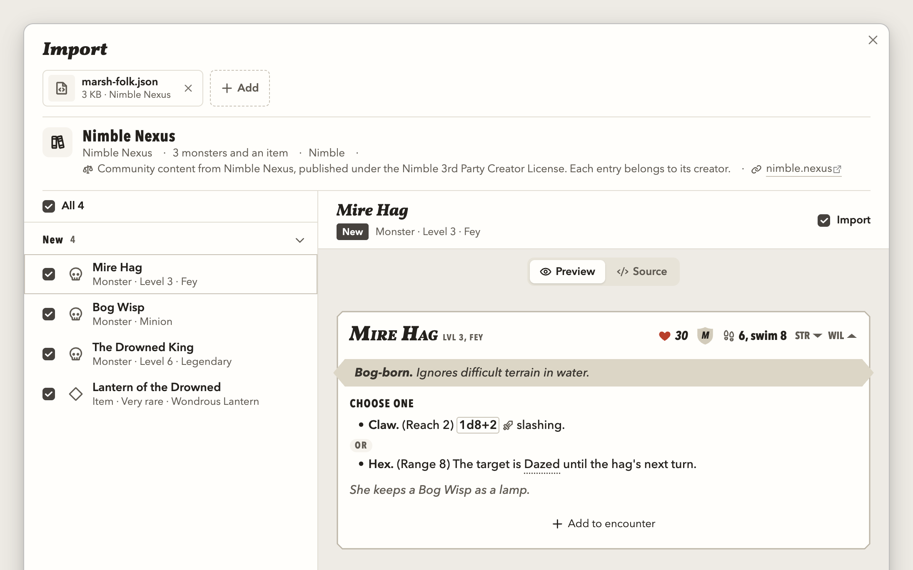
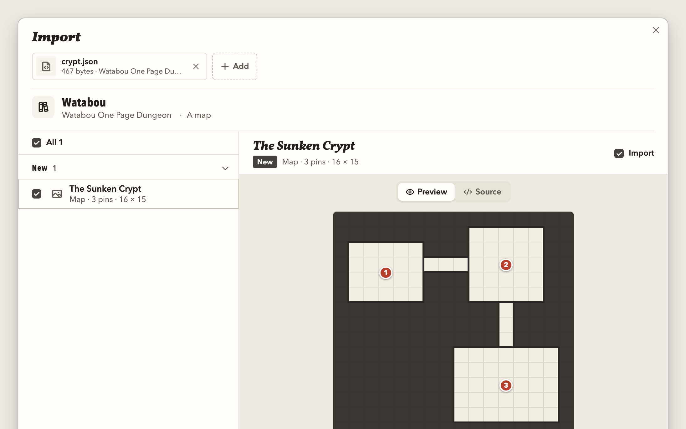
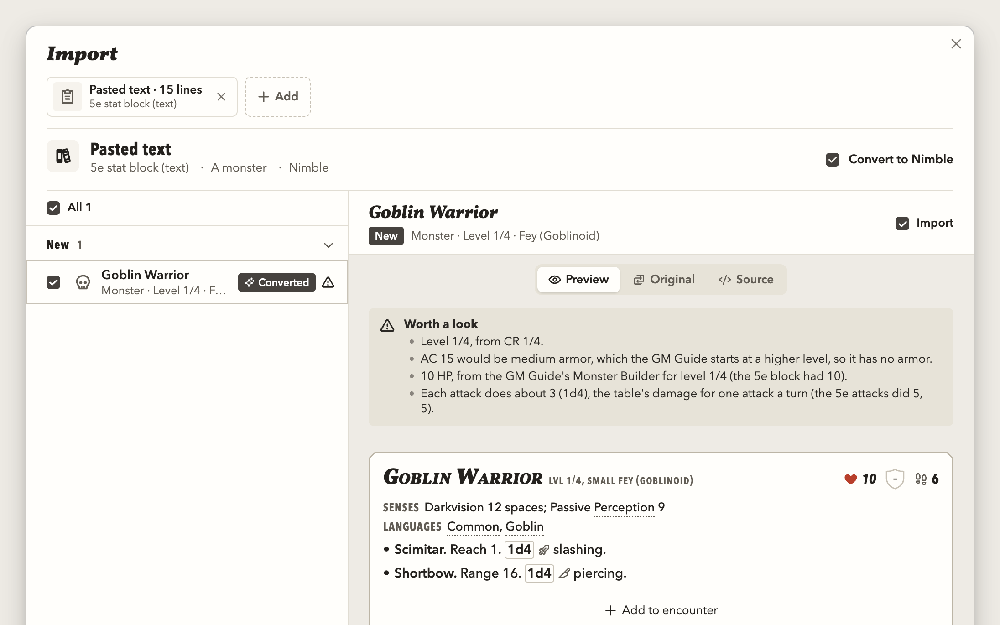

# Importing

**Import…** brings content, NPCs, places and maps into your vault from other tools: a Nimble Nexus monster, a 5etools homebrew file, a Watabou dungeon, a stat block copied out of a PDF. You don't need to say what it is: Import… works it out, shows you everything before it's written, and remembers where each thing came from.

Open it with **Import…** in the command palette (**Ctrl+P**, or **Cmd+P** on a Mac), with `/import` in any note, or with **Import…** in **Settings → Ember Vault → Content packs**.



## Give it something

- **Files.** Drop them anywhere on the window, or choose **Choose files**. Drop several at once: a dungeon's JSON and its picture go together, and files in different formats are each read their own way.
- **Text.** Paste it into the box: a stat block, a JSON export, your own ```` ```nimble ```` or ```` ```5e ```` block.
- **A link.** Paste a Nimble Nexus or Open5e link and choose **Fetch from…**. Nothing is fetched before that (see [What goes online](#what-goes-online)).

Each thing you give shows as a chip at the top, with what it was read as. **×** takes one away; **+ Add** chooses more. If something was read as the wrong format, change **Read as**.

## What it reads

| From | Give it | What you get |
|---|---|---|
| [Nimble Nexus](https://nimble.nexus) | A monster's, item's or collection's link, or a file Nexus exported | Nimble monsters and items |
| Slate (nimble-screen) | Its Nexus or Nimbrew export | Nimble monsters |
| Nimbrew | A monster's Nimbrew JSON | A Nimble monster |
| [5etools homebrew](https://github.com/TheGiddyLimit/homebrew) | A homebrew `.json` file | 5e monsters, spells and magic items |
| [Open5e](https://open5e.com) | A creature's link, or its JSON | A 5e monster |
| [Fantasy Statblocks](#a-fantasy-statblocks-creature) | A ```` ```statblock ```` block, or a bestiary `.json` | 5e monsters |
| [D&D Beyond](#a-dd-beyond-character) | The character's data | A 5e character, and its class, feats, spells and items |
| A stat block as the book prints it | Text copied from a PDF or web page | A Nimble or 5e monster |
| [Watabou One Page Dungeon](https://watabou.github.io/dungeon.html) | Its JSON export (and its PNG, if you like) | A map with a pin on each numbered note |
| [donjon](https://donjon.bin.sh/d20/dungeon/) | Its JSON export (and its picture, if you like) | A map with a pin on each room |
| Dungeondraft, Dungeon Scrawl, Dungeon Alchemist… | A Universal VTT file (`.dd2vtt`, `.uvtt`) | A map with its picture and grid |
| Any picture | A PNG, JPG, WebP or SVG | A map |
| An Ember Vault bundle | Its `.json` ([the format](import-bundle.md)) | Content, NPCs, places, quests and maps |
| A [content pack](content-packs.md) | Its `.json` | The pack, saved in your content folder |

A tool that isn't here can be taught with a [mapping file](mapping-files.md), with no code.

## Check it, then import

Everything it found is listed, grouped by what will happen:

- **New:** ticked. Untick what you don't want.
- **Updates:** you imported it before and it has changed. Ticked. **Changes** shows what changes, field by field; anything else in the note stays as it is.
- **Already imported:** imported before, and unchanged. Left alone.
- **Already yours:** you have your own by that name. It's never changed. Tick **Import as a copy** to add this one beside it, named after where it came from: `Mire Hag (Nimble Nexus)`.
- **Left out:** something it can't use, with the reason: `"hp" should be a number`.

Select any row to see it the way the vault will show it: a monster's stat block, an NPC's card, a place's card, a map with every pin on its picture. **Source** shows what will be written and the file as it was read. **Worth a look** lists anything that didn't come across as written.

Choose **Import 7** (the count is what's ticked). The window then lists every note it wrote, with **Open**. Monsters go in the campaign's **Monsters** folder, NPCs in **NPCs**, places in **Locations**, maps in **Maps**, and spells, items and classes in your content folder, where the compendium finds them.

Each one says where it came from (`imported: Nimble Nexus`, and the source's `importId`). Import the same file again and what changed is offered as an update instead of a second copy, so keep those two properties if you edit the note.

## Maps

A Watabou or donjon dungeon becomes a map note with a pin on each room. What's in each room goes in the map's **Key**, and each pin links to its section. Turn on **A location note for each room** in the map's preview to make a location note for each room instead, with the pin linking to it.



Choose the dungeon's picture along with its JSON (`crypt.json` and `crypt.png`) to use the tool's own art. Without one, Import… draws a plain map from the dungeon's rooms, and the pins sit exactly where they belong. Pins on the tool's own picture are placed from the dungeon's layout; if the picture has a border or a title, use **Move pins** on the map to nudge them.

A Universal VTT file brings its picture and its grid. These files hold walls and lights for virtual tabletops, not room labels, so the map starts without pins: add your own with **Add pin**. See [GM maps](maps.md).

## Paste a stat block

Copy a monster from a PDF or a web page and paste it in. Import… reads:

- **Nimble**, as the books print it: the level header (`lvl 2, large`, `Lvl 3 Legendary Large Owlbear`), the stat line (`[hp]31 [ar]M [mv]8`, or `HP 31 · Armor M · Speed 8`), passives, actions under **Actions** or as bullets, **Bloodied** and **Last Stand**.
- **5e**, in the 2014 layout (`Armor Class 15 (leather armor)`, the `STR DEX CON` table, `Challenge 1/4 (50 XP)`) or the 2024 one (`AC 15 Initiative +2`, the `Str 8 −1 −1` rows, `CR 1/4 (XP 50; PB +2)`).

Lines the PDF broke in the middle are joined back onto the feature they belong to. Several monsters pasted together come in as one each.

## Convert 5e monsters to Nimble

Import 5e monsters into a Nimble campaign and **Convert to Nimble** is on. Each monster is rebuilt on the GM Guide's numbers:

- **Level:** its CR. A monster with legendary actions becomes a solo (legendary) monster.
- **HP and damage:** the Monster Builder table for that level (the legendary table for a solo, with HP per hero and a Last Stand).
- **Armor:** from its AC. 14 to 16 is medium and 17 or more heavy, a step lower where the GM Guide says that armor comes too early for the level.
- **Attacks:** kept by name. Reach and range become spaces (5 feet is 1 space), the dice are remade to the table's damage, and saving throws use the table's DC.
- **Everything else** keeps its words, with distances in spaces.



**Worth a look** lists every change, and **Original** shows the 5e block. The note says `converted: dnd5e`, so you can find converted monsters later. Only monsters convert so far; turn **Convert to Nimble** off to import spells, items and monsters as 5e.

## What goes online

Nothing, unless you paste a link and choose **Fetch from…**. Then Import… asks that one site for that one page's data, and nothing else is sent. It only fetches links it knows how to read (Nimble Nexus and Open5e, and any a [mapping file](mapping-files.md) of yours names). It never connects to D&D Beyond or 5etools: for those, you bring the file.

What you import is yours to use at your table. Content from a site belongs to whoever wrote it, and Import… shows its licence before anything is written.

## A D&D Beyond character

Bring a 5e character from D&D Beyond (and its class, subclass, feats, spells and items, into your compendium). Ember Vault never connects to D&D Beyond: it only reads the text you paste or the file you choose.

### 1. Make the character public

D&D Beyond only shares public characters.

1. Open the character on D&D Beyond.
2. Choose **Manage**, then **Character Settings**.
3. Under **Character Privacy**, choose **Public**.

### 2. Get the character's data

1. In Obsidian, run **Import a D&D Beyond character…** from the command palette (**Ctrl+P**, or **Cmd+P** on a Mac).
2. Paste the character's link (from your browser's address bar, like `https://www.dndbeyond.com/characters/123456789`) into the top box, and choose **Open the character's data**.

3. The page is a wall of text. That's the character. Do one of these:
   - Select all of it (**Ctrl+A**, or **Cmd+A** on a Mac) and copy it (**Ctrl+C** or **Cmd+C**). In Firefox, click **Raw Data** first.
   - Or save the page as a file (**File → Save Page As…**).

If the page says "Unauthorized Access Attempt", the character isn't public yet. Go back to step 1.

### 3. Import it

1. Back in the import window, paste the text into the big box, or choose the file you saved.
2. Check what it found. Under the character is what it brings into your compendium (see below). Untick anything you don't want.
3. Choose **Import**.

You get a character note with a 5e sheet, and a note in your compendium for each entry you kept ticked.

### What comes across

Name, class and level, subclass, species or race, background, ability scores, hit points, skills, spells, gear, coins (as gold) and feats.

The character note holds only names and numbers. The sheet finds each name's text in the compendium: the SRD's, your [content packs](content-packs.md), your own notes, and what the character brought in.

### What it brings into your compendium

A character's data carries the full text of what it plays: its class with its features at each level, its subclass, species, background, feats, spells and items. Import adds those to your compendium, so a class the SRD doesn't have (one from a book you own on D&D Beyond) works like the SRD's: in **New character**, **Level up**, the sheet and the compendium.

The import window lists it all before anything is written:


> Hollowblade (class, levels 1–7 seen), Order of the Quiet Lantern (subclass), Elf (species), Grave Tender (background), 2 feats, 2 spells, 3 items: 4 already in the SRD

- **Ticked:** everything new. Untick what you don't want.
- **Already in the SRD:** left out. The SRD's version is used, so there's one of each name. If D&D Beyond's version is clearly different (homebrew, or another hit die, spell level or rarity), it comes in as its own entry, named `Fireball (D&D Beyond)`, and the character note uses that name.
- **Already imported** (from this character or another): left as it is.
- **Already yours:** a note or pack of yours with that name is never touched.

Each entry is a note in your content folder, under `Ember Vault/Content/5e/`: `Classes/Hollowblade.md`, `Spells/Lantern Lance.md` and so on. The compendium tags them **Imported**, and `source:Imported` or `is:imported` finds them. Each block says where it came from:

```5e-feat
name: Hollow Focus
imported: D&D Beyond
ddbId: 940001
type: general
prerequisite: Level 4+, Hollowblade
desc: |-
  You gain the following benefits.
  **Ringing Blade.** Your Hollow Strike die increases by one size against undead.
```

`ddbId` is how a later import finds it, so keep it if you edit the note. These notes are your own copy of what you own on D&D Beyond, for your own vault.

### Higher levels later

D&D Beyond only includes a class's features up to the levels in the character's data. When levels are missing, the import window says so: "D&D Beyond only gave Hollowblade's features up to level 7."

After the character levels up, import them again. The class shows as ticked, tagged with what it gains ("levels 8–9"), and Import adds those levels to the note you already have. Anything you changed in it stays.

### Only the content

Untick **Make a character note in the party** to add only the character's content to your compendium. When the character is already in the party, it starts unticked, so importing them again only brings in what's new.

A few things to check after importing:

- **Rules.** Ember Vault works out whether the character uses the 2014 or the 2024 rules. If it got it wrong, change `edition` on the note.
- **More than one class.** The sheet shows the first class, at the character's total level. The other classes are listed on the note under `classes`.
- **Feats** show on the sheet, with their text from the compendium.

The import window lists anything else that didn't come across.

A character's data doesn't hold a class's spell list, so **New character** and **Level up** have no spells to offer an imported class that casts. Add spells on the sheet with **Add spell**, or give the class a `spellList` on its note (`spellList: Wizard` casts from the Wizard's). A feature's options (a fighting style's styles) come in as the feature's text.

## A Fantasy Statblocks creature

1. Open the note with the creature's `statblock` block.
2. Copy the block: everything from ```` ```statblock ```` to the closing ```` ``` ````.
3. Run **Import a Fantasy Statblocks creature…** from the command palette.
4. Paste it, or choose a `.json` file of creatures.
5. Choose **Import**.

You get a 5e stat block (```` ```5e ````) that works in encounters and the combat tracker, like any [stat block you write yourself](bestiary.md).

Lair actions, regional effects and mythic actions have no place of their own in a 5e stat block, so they go in its description.
