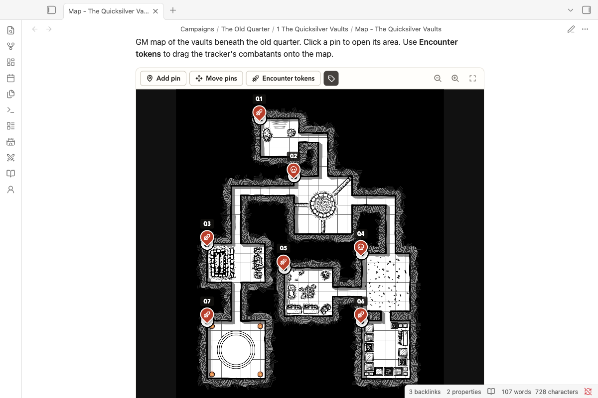

# GM maps



````markdown
```nimble-map
image: [[Cragmaw Hideout.jpg]]
grid: 30x20
pins:
- 40, 78 | 1. Cave Mouth | [[Part 1#1. Cave Mouth]] | area
- 18.3, 35 | 8. Klarg's Cave | [[Part 1#8. Klarg's Cave]] | encounter
```
````

Pins link to notes or headings, with Obsidian's hover preview, and clicking a pin opens its note. **Add pin**, **Move pins** and right-click (long-press on touch) → **Edit** all save back into the block. A map shown inside another note (an embed or a hover preview) is view-only: open its own note to change pins. Scroll or pinch to zoom, drag to pan, double-tap to zoom in, and press `0` to fit. **Encounter tokens** shows the tracker's combatants as tokens you can drag onto the map, kept in plugin data rather than the note. Pin kinds are place, area, encounter, npc, treasure, danger, note, secret and map.

## Adding a map

1. Put the map image in your vault (a campaign's `Assets` folder is a good home).
2. Type `/map` and pick the image. You get a map block.
3. Select **Add pin**, click the map, and choose a label, a kind and a note or heading to link to.

Pin positions are stored as percentages of the image, so you can swap in a bigger or smaller version of the same map later and the pins stay put.

## Grids

A grid is for counting and snapping: how far the party travels, where the party marker lands. Select **Grid** on the map's toolbar to set one up:

1. **Type**: None, Square, Hex (pointy-top, in rows) or Hex (flat, in columns). Pick the type that matches the map first: Detect looks for that kind of grid.
2. **Detect** looks for the grid printed on the map and draws what it found over it, with a note on how sure it is: "Good match", or "Rough guess — adjust below".
3. **Fit to 3 × 3**: drag a box around 3 × 3 squares of the map's own grid (for hexes, 3 hexes in a row, point to point; for flat hexes, 3 in a column). That sets the size and position straight away, and Detect then fine-tunes it. Use it when Detect isn't sure, or when the map's grid is faint.
4. **Size − / +** and the arrows (or the arrow keys) nudge it. Hold Shift for fine steps.
5. **Show grid**: turn it off when the map has a grid printed on it. The grid still snaps and counts, but nothing is drawn over the map. **One cell is** sets the scale, like `6 miles` or `5 ft`.
6. **Save** writes it to the block. **Cancel** leaves the block as it was.

Grid lines stay thin at any zoom. **Grid line strength** in settings makes them stronger or fainter, and a theme or CSS snippet can change their colour with `--nimble-map-grid-color`.

## The party on the map

Select **Place party**, then click the map to put the party marker down. On a grid it snaps to the middle of a cell; hold Alt to put it anywhere. After that, drag it. While you drag, a chip shows how far you've gone: "3 hexes · 18 miles".

The marker shows up to three of the campaign's heroes' portraits (or a shield). Hover over it, or tap it on a phone, to see the party's cards. Right-click (long-press) it to remove it. It's saved in the map block as `party:`, so it stays where you left it, in campaigns you run and ones you play in alike.

## Measuring

**Measure** is a travel ruler for planning a route without moving anyone. Click where you start and at each turn along the way; the chip shows the total in cells and in the map's scale. Double-click or press Enter to finish, and Escape to clear it. Nothing is saved. It needs a grid to count on. It's a ruler only: no cones, circles or other shapes.

## Drawing

Select **Draw** for a small set of tools:

- **Pen**: draw freehand. On a phone one finger draws; two fingers still pan and zoom.
- **Route**: click points along the way, then double-click or press Enter. The route shows its length in cells and miles (or whatever your scale is).
- **Text**: click and type a short label.
- **Eraser**: tap a drawing to delete it.

Pick one of six colours or your theme's accent colour, and one of three widths. Cmd/Ctrl+Z undoes your last drawings while you're on the map, and the **Show drawings** button hides them all. Drawings are saved in the block under `drawings:`, one line each. Freehand strokes are smoothed when you lift the pen, so a long line is a few dozen points rather than thousands.

## Maps inside maps

A **map** pin links to another map: a region on a world map, a building in a town. Pick a map note in the pin's **Links to** picker (map notes are listed first, with a map icon) and the pin becomes a map pin. Clicking it opens that map in the same tab, so you can drill down and use **Back** to return. Cmd/Ctrl-click opens it in a new tab. Each map remembers where you'd panned and zoomed, so Back puts you where you were.

## Everything a map block can hold

````markdown
```nimble-map
image: [[Barlegento.jpg]]
grid: hex
cell: 2.15
offset: 0.4, 0.9
show-grid: no
scale: 6 miles
travel: 1 quarter
party: 41.2, 37.9
pins:
- 52, 30 | Balbom | [[Balbom]] | place
- 12, 70 | The Low Road | [[Low Road map]] | map
drawings:
- route | #ffffff | 3 | 61.2,38.1 62,40.3 63.4,44
```
````

Only `image` is needed. Saving a map never drops a line it doesn't understand, so a block written by a newer version of Ember Vault keeps everything when an older one adds a pin, and lines you didn't change are written back exactly as you typed them.

| Key | What it does |
|---|---|
| `grid` | `none`, `square`, `hex` (pointy-top) or `hex-flat`. The older `30x20` (columns × rows) still works. |
| `cell` | The width of one cell as a % of the image's width. `2.15x2.4` for a cell that's taller than it is wide (both numbers are % of the width). |
| `offset` | Where one cell's centre sits, in % of the image. |
| `show-grid` | `no` when the map has its own grid printed on it: the grid is used for snapping and counting but not drawn. |
| `scale` | What one cell is: `6 miles`, `1 km`, `5 ft`. |
| `travel` | How long crossing one cell takes, in your campaign clock's units: `1 quarter`, `4 hours`, `1 day`. |
| `party` | Where the party marker is. |
| `drawings` | Pen strokes, routes and text on the map, one per line. |

A note with `nimble: map` in its properties, inside a chapter folder, shows up as a map button on that chapter in the Campaign panel.
