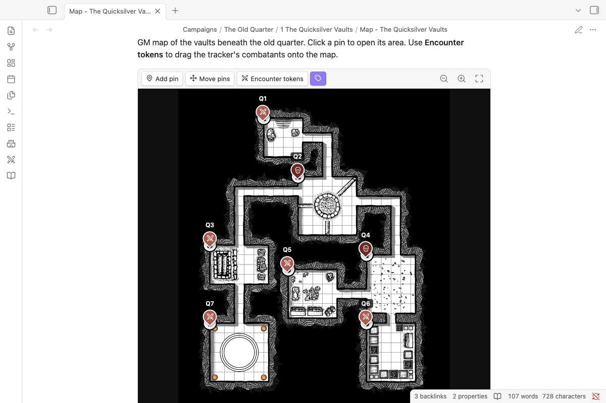

# GM maps



````markdown
```nimble-map
image: [[Cragmaw Hideout.jpg]]
grid: 30x20
pins:
- 40, 78 | 1. Cave Mouth | [[Part 1#1. Cave Mouth]] | area
- 18.3, 35 | 8. Klarg's Cave | [[Part 1#8. Klarg's Cave]] | encounter
```
````

Pins link to notes or headings, with Obsidian's hover preview, and clicking a pin opens its note. **Add pin**, **Move pins** and right-click (long-press on touch) → **Edit** all save back into the block. Scroll or pinch to zoom, drag to pan, double-tap to zoom in, and press `0` to fit. **Encounter tokens** shows the tracker's combatants as tokens you can drag onto the map, kept in plugin data rather than the note. Pin kinds are place, area, encounter, npc, treasure, danger, note and secret.

## Adding a map

1. Put the map image in your vault (a campaign's `Assets` folder is a good home).
2. Type `/map` and pick the image. You get a map block.
3. Select **Add pin**, click the map, and choose a label, a kind and a note or heading to link to.

Pin positions are stored as percentages of the image, so you can swap in a bigger or smaller version of the same map later and the pins stay put.

A note with `nimble: map` in its properties, inside a chapter folder, shows up as a map button on that chapter in the Campaign panel.
