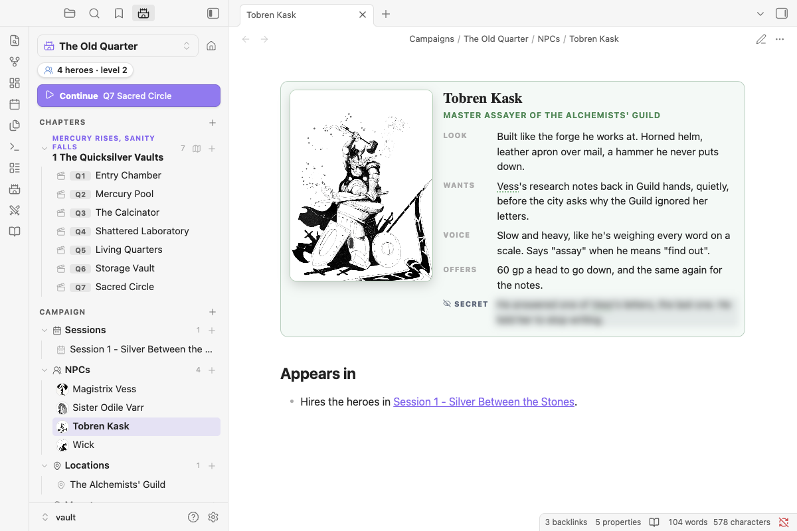

# NPCs

A note is an NPC when its properties say `nimble: npc`, or it's tagged `#npc`. Add `role:` for a one-line description, `aliases:` for other names, and `portrait:` for their art.

```yaml
---
nimble: npc
role: Master assayer of the Alchemists' Guild
aliases:
  - Master Kask
portrait: "[[Tobren Kask.png]]"
---
```

**New NPC** (the **+** next to NPCs in the Campaign panel, or the command palette) makes this note for you, character card included.

## Character cards



A `nimble-npc` block shows the NPC as a card: portrait, name, role, and a few short rows.

````markdown
```nimble-npc
look: Built like the forge he works at. Horned helm, a hammer he never puts down.
wants: Vess's research notes back in Guild hands, quietly.
voice: Slow and heavy, like he's weighing every word on a scale.
secret: He answered one of Vess's letters, the last one. He told her to stop writing.
```
````

- **Rows** are any `Label: text` lines, so add your own (`knows:`, `fears:`, `stats:`). Text can be Markdown, with links, bold and lists. Lines without a label carry on the row above.
- **Secret** rows (`secret:` or `gm:`) are blurred until you click them, which helps when your screen is shared.
- **Name and role** come from the note's title and `role:` property. Put `name:` or `role:` lines in the block to override them.
- Type `/npc-card` to insert a card anywhere. It works in scene notes too, for a minor character who doesn't need their own page.

## Portraits

A card without a portrait shows an empty frame. Click it to:

- **Upload an image…** from your computer, or your photo library on a phone. It's copied into your vault, following your attachment folder setting in **Settings → Files and links**.
- **Choose from vault…** to pick an image you already have.

On desktop you can also drop an image file straight onto the frame.

Once it has a portrait:

- **Click it** to see it large, for a closer look or to turn the screen to your players. On desktop, **Show in its own window** opens it in a pop-out you can drag to a second screen.
- **Hover** over it and use the image button to change or remove it. You can also right-click it.
- The portrait is the NPC's icon in the Campaign panel, and it shows in hover previews of the note.

The portrait is saved in the `portrait` property, as a link like `"[[Tobren Kask.png]]"`, so you can also set it by hand. It can be an `https://` image URL too, although that image is then loaded from the internet. If a face gets cropped, set `portrait-position:` to a CSS position such as `top`, `center 10%` or `40% 30%`.

**Finding art:** art you drew, commissioned or bought for your table is fine for your own game. Before you share a vault with someone else's art in it, check the art's license allows that, and credit the artist.

## Links and mentions

- **Links become chips.** `[[Tobren Kask]]` shows as a green person chip, in reading view and Live Preview. Clicking a chip or a linked mention opens the NPC's note in a quick look over your page, with **Open page** if you want to go there; Cmd/Ctrl-click opens the page directly.
- **Mentions are linked as you read.** The NPC's name or an alias anywhere in that campaign's notes gets a dotted underline and a hover preview. In Live Preview, Cmd/Ctrl-click opens the note. Your files aren't changed. Turn this off with **Link NPC names as you read** in settings.
- **`/npc`** searches the campaign's NPCs and inserts a link. Typing a new name offers **New NPC**, which creates the note in the campaign's NPCs folder.
- **Generic creatures** (a cultist, a zombie) are better as bestiary references (`` `nimble:Cultist` ``). NPCs are the named people with their own pages, and they can carry a stat block too.
