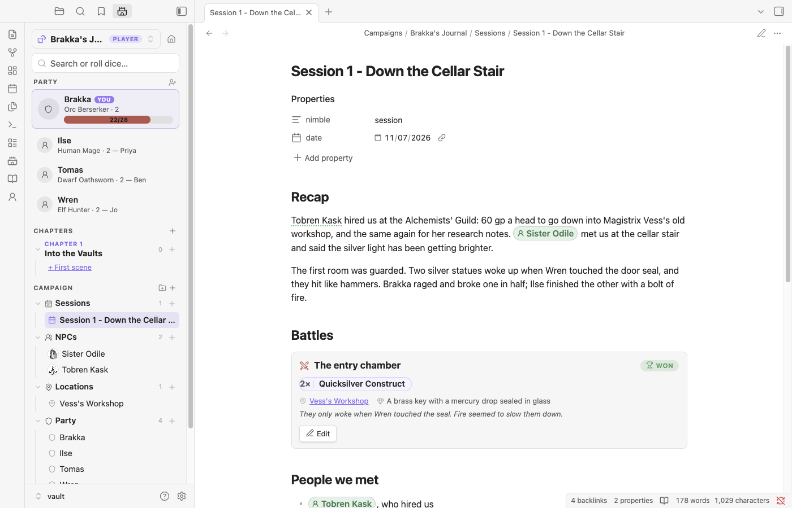
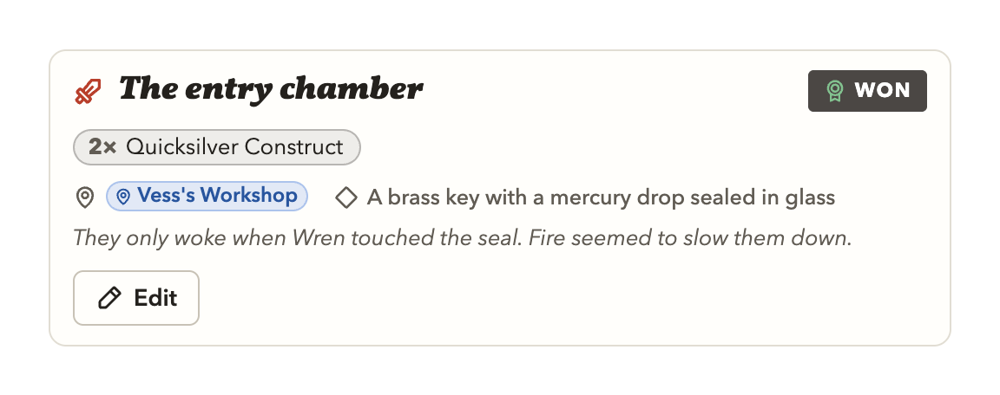
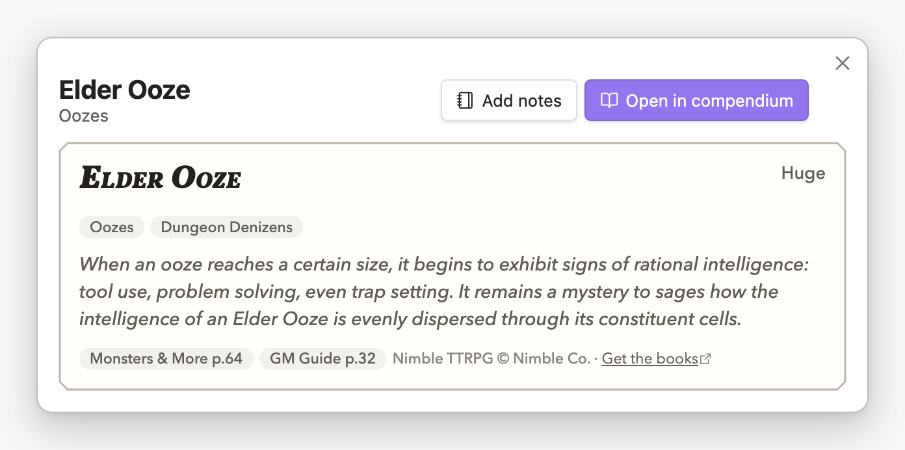

# Playing in a campaign

Ember Vault isn't only for the GM. Make a campaign you **play in** and the plugin switches to a player's toolkit: your character sheet, your party, and notes on the people, places and fights from each session. If you run one game and play in another, keep both in the same vault and switch between them.



## Running it or playing in it

Every campaign is one or the other. **New campaign** asks first:

| | I run it (GM) | I play in it (Player) |
|---|---|---|
| Starter folders | Party, Quests, NPCs, Locations, Sessions, Monsters, Assets | Party, Sessions, Quests, NPCs, Locations, Assets |
| Party | Character sheets, with HP; encounter difficulty and the tracker read from them | Character sheets, yours marked **You** |
| Encounter blocks | Difficulty, Run, the tracker | [Battle notes](#battle-notes) |
| Bestiary and `nimble:` references | Full stat blocks | [Lore cards](#lore-cards): names and what your hero could know |
| Encounter tracker, builder, "Add to encounter" | Yes | Hidden |
| Character sheets | Yes | Yes |

For a player campaign you can name your character as you create it. Their [character sheet](character-sheets.md) goes in the Party folder.

**The campaign switcher is the view switcher.** It lists the campaigns you run under **Running** and the ones you play in under **Playing**, with a GM or Player tag on the active one. Opening any note in a campaign makes it active too, so moving from your GM prep to your player notes switches the plugin over by itself.

**Campaigns don't share.** A monster or NPC written in one campaign's notes is only found from that campaign. In a campaign you play in, `nimble:Goblin` or a battle's foes always mean the book's Goblin (as a lore card), never the Goblin you wrote for a game you run, even in the same vault. Monsters and NPCs in notes outside any campaign count as GM material, so player campaigns don't see them either.

To change sides later, open the switcher and pick **Campaign settings…** (or **Switch to player view** / **Switch to GM view**). It only changes `role:` on the campaign's home note. Nothing else is touched, and switching back loses nothing.

## The party

In a player campaign the top of the Campaign panel shows your party instead of the GM's hero count. Your character comes first, with their HP once the sheet tracks it. Everyone else is listed under them with their ancestry, class, level and the name of the person who plays them.

- **+** next to **Party** adds a party member. It's a short character note in the Party folder, so you can keep notes on the rest of the table's heroes too.
- Click a hero to open their note. Right-click (or long-press) for **This is my character**, which moves the **You** badge.
- A hero is any note with `nimble: character` in the campaign. `mine: true` marks yours.

## Battle notes



In a campaign you play in, an encounter block is a note about a fight you were in: who you fought, how many, how it went, where, and what you found.

Type `/fought` in a note, optionally followed by who was there:

```
/fought 4 goblin, goblin shaman
```

Pick **Fill in the rest…** to open the editor, or insert it as is and fill it in later. The block looks like this in the file:

````
```nimble-encounter
name: Ambush at the ford
outcome: won
where: [[The Ford]]
loot: 40 gp, a silver key
monsters:
- 4 Goblin
- Goblin Shaman
notes: The shaman fled north.
```
````

- **The outcome pill** (Won, Fled, Lost, Parley, Ongoing) changes with a click.
- **Names from the bestiary** open a lore card. Names that aren't in it, like "Mystery Hag", are kept as you typed them.
- **Edit** opens the editor: add foes by name (the bestiary is suggested as you type), change counts, and fill in where, when, loot and notes.

It's the same block the GM uses, so a note you write as a player still makes sense if you later switch that campaign to GM view.

## Lore cards



As a player, monsters show as lore cards rather than stat blocks: the name, size and kind, the family and habitat, and the book's description. HP, armor, attacks and abilities stay hidden. This applies to the bestiary, `nimble:` references, hover previews and quick looks.

The bestiary works the same way. Search covers names, families, habitats and descriptions. Ability text is left out so it can't leak a monster's tricks. The role, armor and level filters are hidden. **Insert reference** (or the @ button on a row) puts `nimble:Name` into the note you were writing.

A creature printed in both Monsters & More and the GM Guide is listed once, with a tag for each book. Its card lists each printing with its page, in the bestiary and everywhere else.

### Your notes on a creature

**Add notes** on a lore card makes a note for that creature in your campaign's `Bestiary` folder, with headings for what you've seen, strengths and weaknesses, and fights. Whatever you write shows under the book's lore wherever the creature's card appears (the bestiary, hover previews and quick looks), and its bestiary row gets a **Notes** tag. Hover previews and quick looks have **Add notes** / **Open notes** too. **My notes** in the bestiary's filters lists the creatures you've written about. The note is plain markdown, so link sessions and NPCs from it like any other page:

```yaml
---
nimble: creature
creature: "Krogg, Goblin King"
---
```

A stat block you wrote yourself, in a ```` ```nimble ```` block in your own campaign, always shows in full. To see full stat blocks everywhere, turn on **Stat blocks in campaigns you play in** under Settings → Campaigns.

## Session notes, quests, NPCs and places

The starters are written for whoever keeps the note:

- **Session log**: recap, battles, people we met, loot, and leads (as a checklist).
- **NPC**: [card](npcs.md) with **Suspicions** instead of **Secret**, then First impressions, What we learned, What they want from us, Promises & debts, and Quotes.
- **Location**: Overview, People here, Points of interest, Factions, Rumors, Connections, History, Our visits.
- **Quest**: the job as it was put to you, then Objectives and Leads (as checklists), What we know, People & places, Questions and Progress. It starts as `status: active`; set it to `completed` or `failed` when it's over and it moves to the bottom of the Quests folder.
- **Handout**: what it says, where we got it, and what we think it means.

Every heading is a prompt you can delete.

## Properties

| Property | On | Meaning |
|---|---|---|
| `role: player` | campaign home note | You play in this campaign. Missing, or `role: gm`, means you run it |
| `gm:` | campaign home note | Who runs it (optional) |
| `nimble: character` | any note | A hero: shown in the party and drawn as a [character sheet](character-sheets.md) |
| `mine: true` | character note | Your hero in this campaign |
| `player:` | character note | Who plays them |
