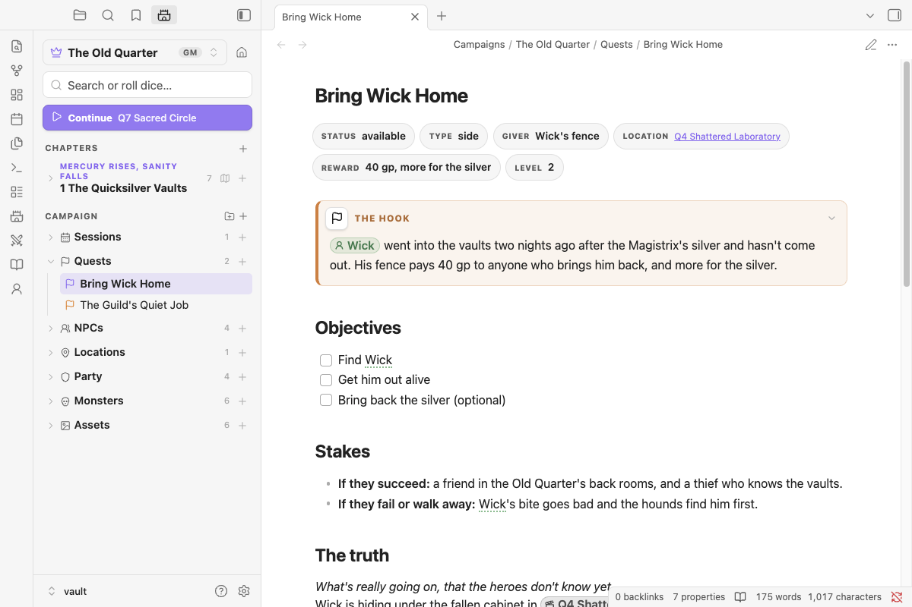
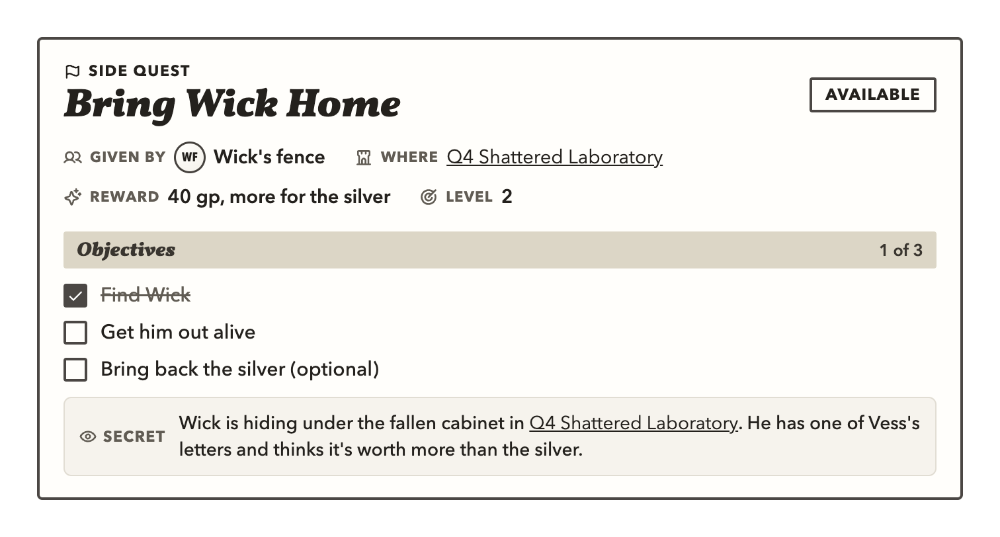
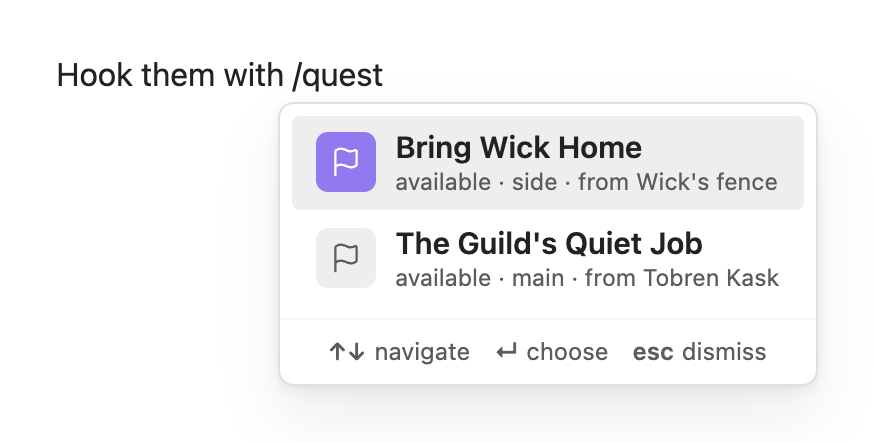
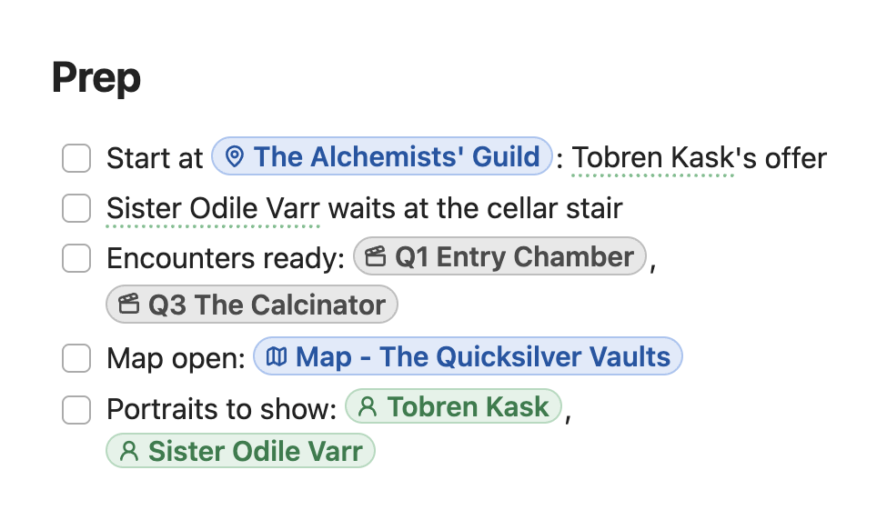

# Quests



Every job, rescue and bounty in your campaign can have a note of its own. Quests live in the campaign's **Quests** folder, link from anywhere with `/quest`, and show where they stand: the open ones are listed near the top of the Campaign panel, and finished ones drop to the bottom of the folder.

## Making a quest

New campaigns come with a **Quests** folder. Make a quest with any of these:

- the **+** on the Quests folder in the [Campaign panel](campaigns.md)
- **New quest** on the **Campaign** heading's **+**
- the **New quest…** command, in the command palette or [Spotlight](spotlight.md)

A quest made from a chapter's **+** is still saved in the Quests folder, so all your quests stay in one list. A folder called Quest log, Missions, Jobs or Bounties works the same way as Quests.

## The quest card



A quest note opens on a card in your campaign's look:

- **The heading:** what kind of quest it is (Main quest, Side quest… from `type:`), the chapter's name if the quest sits in a chapter, and the quest's name. The stamp beside it is its `status:`.
- **Given by**, **Where** and **Reward**, from the properties. Given by shows the person's portrait. The GM also sees **Level**.
- **Objectives**, with how many are done. Tick one on the card and it's ticked in the note too.
- **Secret**, for the GM only: the `secret:` property, or what you wrote under **The truth**.

The card is drawn from what the note already holds. In reading view, the note's title, the Objectives section, The truth and the properties the card shows step aside, so nothing appears twice. Switch to editing to change them.

## What's in a quest note

A new GM quest note starts with the card's block, then the hook in a quest box, a checklist of objectives and headings to fill in or delete. Here's the sample adventure's side quest:

````markdown
---
nimble: quest
status: available
type: side
giver: Wick's fence
location: "[[Q4 Shattered Laboratory]]"
reward: 40 gp, more for the silver
level: 2
---

```nimble-note
```

```box quest title="The hook"
[[Wick]] went into the vaults two nights ago after the Magistrix's silver and hasn't come out. His fence pays 40 gp to anyone who brings him back, and more for the silver.
```

## Objectives
- [ ] Find Wick
- [ ] Get him out alive
- [ ] Bring back the silver (optional)

## Stakes
- **If they succeed:** a friend in the Old Quarter's back rooms, and a thief who knows the vaults.
- **If they fail or walk away:** Wick's bite goes bad and the hounds find him first.

## The truth
Wick is hiding under the fallen cabinet in [[Q4 Shattered Laboratory]]. He has one of Vess's letters and thinks it's worth more than the silver.

## Clues & leads
- Hound tracks with a limp's drag marks lead east from [[Q2 Mercury Pool]].

## Complications
- He's lying on the intact alchemist's kit and won't say so.

## Rewards
- 40 gp from the fence, more for the silver.

## Progress
-
````

The ```` ```nimble-note ```` block is where the card goes; it stays empty. A quest note without it still opens on its card in reading view, and the block shows the card while you edit too.

The headings are prompts. **The truth** is for what the heroes don't know yet; **Progress** is where you note what happened each session. Delete any you don't need. **Goals** works as well as **Objectives**, and **Secret** as well as **The truth**.

## Properties

| Property | Meaning | Example |
|---|---|---|
| `status:` | `available` (not offered yet), `active`, `completed` or `failed`. Anything else counts as still open. The card's stamp shows it | `status: active` |
| `type:` | `main`, `side`, `personal`, or your own word. The card says "Main quest", "Side quest"… | `type: main` |
| `giver:` | Who asked. Link the NPC and the card shows their portrait | `giver: "[[Tobren Kask]]"` |
| `location:` | Where it leads | `location: "[[Vess's Workshop]]"` |
| `reward:` | What it pays | `reward: 60 gp each, half paid` |
| `level:` | The hero level it's meant for (GM quests only) | `level: 2` |
| `secret:` | What only the GM sees on the card. Without it, the card shows **The truth** | `secret: Kask wrote to Vess once.` |

## Open, finished and failed


The Campaign panel lists the campaign's open quests under **Quests**, wherever they're kept, with a dot for each: filled when it's `active`, a ring while it waits. Click one to open it. The Quests folder further down lists every quest, open ones first.

| Set `status:` to | The quest |
|---|---|
| `available`, `active` or anything else | stays in the open quests, at the top of the folder |
| `completed` (or `done`, `finished`) | leaves the open quests, gets a green tick and moves to the bottom of the folder |
| `failed` (or `abandoned`, `lost`) | leaves the open quests, is crossed out and moves to the bottom of the folder |

## Linking a quest



Type `/quest` in any note to link one of the campaign's quests, the way `/npc` links an NPC. On its own it lists every quest, open ones first, with its status and who gave it. Type a few letters to narrow it down: `/quest wick` finds **Bring Wick Home**.

A link to a quest shows as an orange pill with a flag, in reading view and Live Preview. The flag turns into a tick once the quest is `completed` and a cross once it's `failed`, so a session log that mentions a quest shows at a glance whether it's still open:



```markdown
Brakka took [[The Guild's Quiet Job]] from [[Tobren Kask]] and promised Wick's fence
they'd look for him too ([[Bring Wick Home]]).
```

Links to other campaign notes get pills too: locations, maps, party members, monsters, handouts and sessions. See [Links to campaign notes](campaigns.md#links-to-campaign-notes). A session note can also list the quests it moved, for its card; see [Sessions](campaigns.md#sessions).

`/quest` only links quests. Make new ones in the Campaign panel. The styled quest box on its own (for a hook in a scene note) is `/hook`; see [Boxes](boxes.md).

## Quests in a campaign you play in

In a campaign you [play in](players.md), a new quest is written from your side of the table, with no GM secrets: its card has no Secret and no Level. It starts as `status: active`:

````markdown
---
nimble: quest
status: active
type: main
giver: "[[Tobren Kask]]"
location: "[[Vess's Workshop]]"
reward: 60 gp each, half paid
---

```nimble-note
```

```box quest title="The job"
Kask wants us to go under the Old Quarter, find out what happened to Magistrix Vess, and bring back her research notes. 60 gp each, half up front.
```

## Objectives
- [x] Take the job
- [ ] Find out what Vess was making down there
- [ ] Bring Kask her notes

## What we know
- The Guild "lost touch" with her. [[Sister Odile]] says Vess wrote to them for months.

## Leads
- [ ] Ask Odile what the silver light was

## Questions
- Why did he pay half up front without haggling?

## Progress
- [[Session 1 - Down the Cellar Stair]]: took the job and found the stair under the workshop.
````

Set it to `completed` or `failed` when it's over and it leaves the open quests, the same as a GM's.
