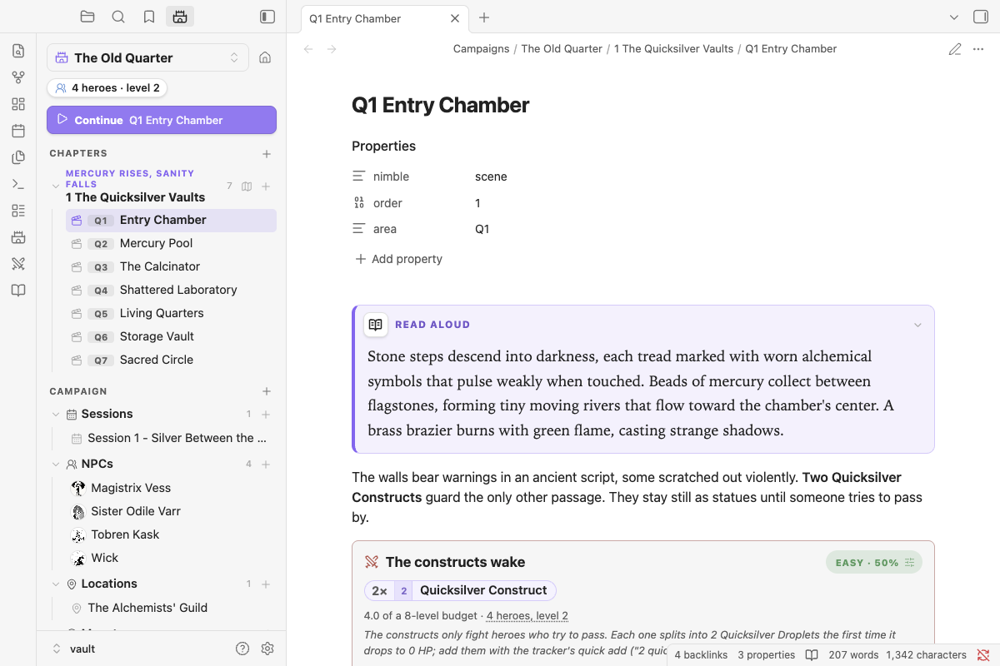

# Sample adventure: The Quicksilver Vaults

The quickest way to learn Nimble GM is to open a vault where everything is already set up. **The Quicksilver Vaults** is a short dungeon for four level 2 heroes, adapted for Nimble from the Mythic Archive adventure by Dakotah Cote, with illustrations by Nagy Sz. Attila.

> *In the Year of Burning Stars, Magistrix Sylvie Vess discovered ancient formulas promising transformation of base metals into philosopher's mercury. Her research consumed her, driving her to construct these vaults beneath the city's oldest quarter.*

## What's in it

- **A campaign, *The Old Quarter*,** with a party of four level 2 heroes already in the Campaign panel.
- **Seven areas,** from the Entry Chamber to the Sacred Circle, with read-aloud boxes, traps, checks, treasure and six encounter blocks.
- **A GM map** with a pin on every area.
- **Four NPCs with portraits:** the Alchemist herself, the Guild's master assayer, a trapped thief and a Guild enforcer.
- **Six custom monsters** written as stat blocks, from Quicksilver Hounds to a Mercury Elemental, plus the Alchemist as a legendary boss.
- **A Start Here note:** a ten-minute tour that touches every feature.

## Open it

1. Download **Nimble-GM-Sample-Vault.zip** from the [latest release](https://github.com/Puddinglord/obsidian-ttrpg-encounter-manager/releases/latest) and unzip it anywhere.
2. In Obsidian, choose **Open another vault → Open folder as vault** and pick the unzipped **Nimble GM Sample Vault** folder.
3. When Obsidian asks whether you trust the vault, choose **Trust author and enable plugins**. Nimble GM is already installed inside it.
4. Open **Start Here**.

The sample vault is separate from your own vaults, so nothing you do in it touches your notes. To use the adventure in your own vault, copy the `Campaigns/The Old Quarter` folder across.

## Credits

The adventure text and art are © their creators and included with permission, for use at your own table. See **Credits** inside the vault.
