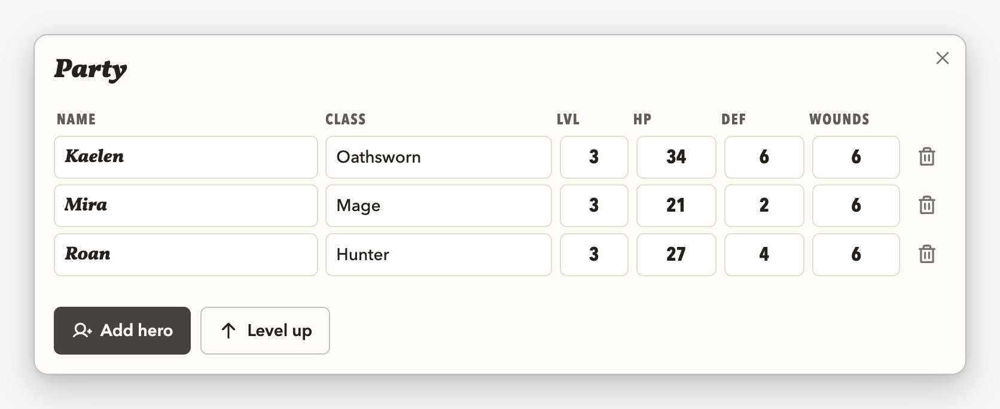

# Settings

Open **Settings → Ember Vault**, or type `/settings` in a note. The settings every game shares come first, then each game's own.

## General

- **Slash commands:** show your game's commands in the `/` menu.
- **Open Spotlight with Cmd/Ctrl+K:** off until you turn it on. [Spotlight](spotlight.md) then shares the key with Obsidian's Insert Markdown link: Spotlight when nothing is selected, a link when text is.
- **Styled tables:** rounded corners, a tinted header and zebra rows for every table in your notes.

## Campaigns

- **Campaigns folder:** where **New campaign** creates its folders.
- **Link NPC names as you read:** underline NPC names and aliases in a campaign's notes, with a hover preview. Your files aren't changed.
- **Stat blocks in campaigns you play in:** off by default, so a [player campaign](players.md) shows lore cards instead of stat blocks. Turn it on if you don't mind spoilers.

## Party

Your heroes: name, class, level, max HP, Defense and max Wounds. This is the party used outside a campaign. Inside one, the campaign's own party is used (edit it from the Campaign panel). In a campaign you run, heroes with character sheets show here read-only, with a button to open their sheet; their sheet keeps them current.

Outside a campaign, **Edit party…** (or `/party`, or the party link on an encounter block) opens the same editor as a dialog, in the game's look. **Level up** raises every hero you entered by hand by one level.

- **Party size when no party is set:** used to rate encounters until you add heroes.

## Content packs

- **Content folder:** where [content packs](content-packs.md) live, with **Import content…** to add one. The list below it shows each pack, its game, and what it adds.

## Dice

- **Clickable dice:** make dice expressions in notes and stat blocks rollable.
- **Class dice:** the colour of Judgment Dice, Fury Dice and the like on the sheet, and their 3D finish.
- **3D dice:** throw physical dice across the screen. Choose finishes and colours for the primary die, the other dice and crit dice, turn on **3D dice on phones** if you want them there too, and use **Test crit** to preview an explosion chain. See [Dice](dice.md).

## Combat

- **Keep the screen on during combat:** for phones and tablets, while combat is running.

## Nimble

These only change Nimble campaigns. **Nimble encounters** is also in the tracker's **⋯** menu, under **Encounter settings…**

- **Nimble bestiary**
  - **Include the Nimble bestiary:** the 525 bundled monsters. Turn it off if you only want your own. A note in your vault with the same name as a bundled monster always replaces it.
  - **Help with stat blocks you write:** a quiet line under a stat block when part of it couldn't be shown as written.
- **Nimble stat blocks**
  - **Stat block style:** Book or Compact.
  - **Nimble attack rolls:** attack dice miss on a 1 and explode on their max.
- **Nimble encounters**
  - **Multiple encounters:** keep several fights in the tracker and switch between them.
  - **Apply monster armor automatically:** subtract Medium (−10) and Heavy (−20) armor from typed damage. Crits ignore armor.
  - **Minion overkill:** one more minion drops for each full die of damage.
  - **Legendary monsters act after each hero:** on by default. **Done** on a hero turns the tracker's card to the legendary monster's turn. Off, tap the monster when you want it. See [Legendary monsters](tracker.md#legendary-monsters).
- **Nimble character sheets**
  - **Ask before rolling:** attacks, spells, saves and checks open the [roll dialog](character-sheets.md#rolling) for advantage, a modifier and class dice. Off rolls straight away, with class dice that are on by default (like Judgment Dice) added.
  - **Include expansion drafts:** the draft classes (Manawright, Hexbinder, Psion, Revenant) and their spells, marked as drafts wherever they show. A hero who already plays a draft class keeps their whole sheet when this is off.
  - **Compendium art folder:** where images you upload for compendium entries are saved.

## 5e

These only change 5e campaigns. They're also in the 5e tracker's **⋯** menu, under **Encounter settings…**

- **Roll monsters' initiative when combat starts:** monsters with no initiative get one when you press **Start combat**.
- **Roll heroes' initiative when combat starts:** turn it off to type in what your players roll. Heroes with no initiative go last until you do.

## Custom conditions

Add your own conditions, with a name and the rules text the tracker shows. Conditions you make in a tracker with **Keep in my conditions** are listed here too, with what they do each turn. They're offered in every game's campaigns.
