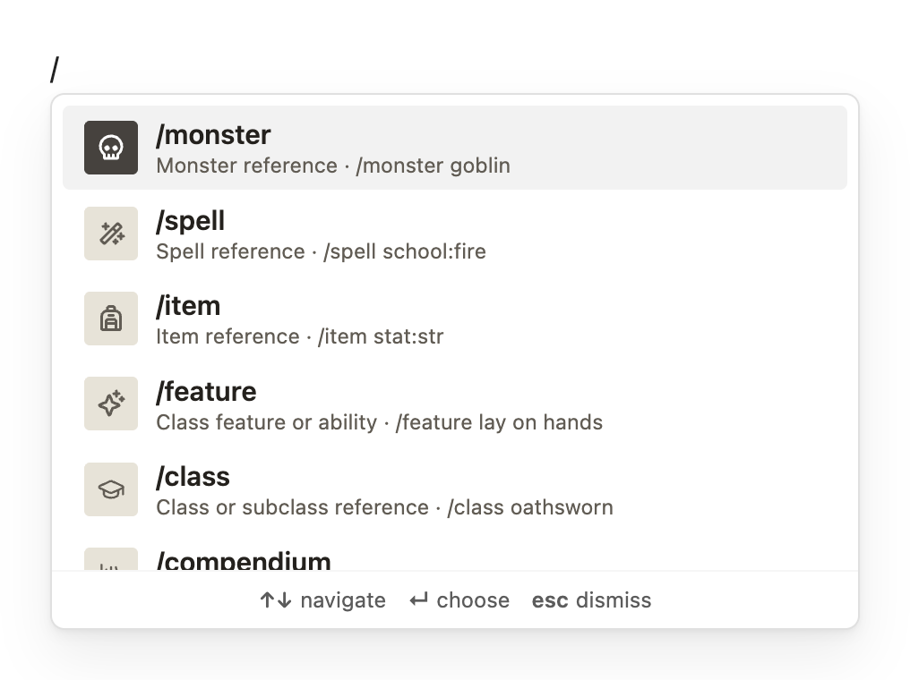

# Slash commands



Type `/` at the start of a line or after a space:

In a campaign you [play in](players.md), the GM-only commands (`/add`, `/encounter`, `/statblock`, `/builder`, `/tracker`, `/new-monster`, the stat block templates and `/summary`) are left out, and `/encounter` means `/fought`.

| Command | Does |
|---|---|
| `/monster` | Opens the [compendium](compendium.md) set to adversaries; Enter writes the reference where you typed and you carry on typing. `/monster goblin` picks from the menu instead |
| `/spell`, `/item`, `/feature`, `/class`, `/companion` | The same for spells, items, class features (`/ability` works too), classes and companions: `` `nimble:spell:Flame Dart` `` |
| `/compendium lay on hands` | A reference to anything in the compendium (also `/ref`) |
| `/add 3 goblin` | Adds 3 goblins to the tracker; nothing is written to the note. `/add` on its own opens the add-monster dialog |
| `/encounter 3 goblin, 2 wolf` | Encounter block with live difficulty (or "Insert and run it now") |
| `/fought 4 goblin, goblin shaman` | [Battle notes](players.md#battle-notes) in a campaign you play in (also `/battle`) |
| `/statblock krogg` | The full stat block, editable in the note (`/statblock` on its own opens the compendium) |
| `/builder` | Opens the encounter builder |
| `/new-monster`, `/new-spell`, `/new-item` | Opens the [builder](builder.md); what you make goes where you typed |
| `/new-class`, `/new-subclass`, `/new-option`, `/new-ancestry`, `/new-background`, `/new-boon` | Opens [Nimble's builder](homebrew.md#nimbles-builders) for it; the block goes where you typed (it joins the compendium from a note in your content folder) |
| `/legendary`, `/minion` | Stat block templates |
| `/condition dazed` | The condition's rules as a callout |
| `/read-aloud`, `/look`, `/treasure`, `/trap`, `/clue`, `/hook`… | Styled boxes (see [Boxes](boxes.md)); `/hook` is the quest box |
| `/npc tobren` | Link an NPC, or create a new one |
| `/quest caravan` | Link a quest from this campaign. `/quest` on its own lists them all, open ones first. Quests are made in the [Campaign panel](quests.md#making-a-quest) |
| `/npc-card` | An NPC card with a portrait slot |
| `/map hideout` | A GM map block for an image in your vault |
| `/roll 2d6+3` | Rolls now and writes the result (plain or as a Nimble attack) |
| `/party`, `/bestiary`, `/tracker`, `/settings` | Jump straight to the party (the Campaign panel in a campaign you run, your sheet in one you play in), the compendium, tracker or settings |
| `/summary`, `/party-table` | The current encounter's summary; a table of your heroes |

## In a 5e campaign

The same menu, with 5e's compendium and rules behind it. Shared commands (`/npc`, `/quest`, the boxes, `/map`, `/condition`, `/party`…) work as above.

| Type | Get |
|---|---|
| `/monster goblin` | `` `5e:Goblin Warrior` ``, from the campaign's edition. Filters work too: `/monster type:undead cr:1-4` |
| `/spell fireball`, `/item`, `/equipment`, `/class`, `/species`, `/background`, `/feat`, `/rule` | A `` `5e:spell:Fireball` ``-style reference. Filters work too: `/spell school:evocation level:3` |
| `/compendium shield` | Anything: monsters first, then the rest |
| `/encounter 4 goblin warrior, ogre` | An encounter block, rated by your edition's rules (or "Insert and run it now") |
| `/add 2 ogre` | Straight into the 5e tracker |
| `/statblock ogre` | The full ```` ```5e ```` stat block, editable in the note |
| `/new-monster`, `/new-spell`, `/new-item` | 5e's [builder](5e.md#make-your-own); what you make goes where you typed |
| `/roll +5` | A d20 check; the menu also offers it with advantage or disadvantage |
| `/party-table` | A table of your heroes, with their AC |
