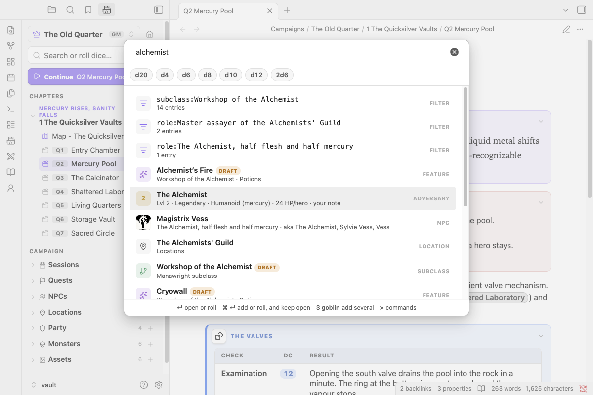

# Spotlight

One box for whatever you need mid-session. Press **Cmd+K** (Mac) or **Ctrl+K** (Windows, Linux), type, and press Enter. The same key closes it. You can also click the search bar at the top of the Campaign panel.

Spotlight wears the look of the campaign you're in, and its rows look like the [compendium](compendium.md#reading-the-list)'s: a monster's level in its box, a spell's tier, and what each row is on the right.

## What you can type

| Type | What you get |
|---|---|
| `goblin` | Adversaries first, then matching NPCs, your campaign's scenes and notes, conditions and commands |
| `3 goblin` | **Add 3 × Goblin** to the encounter |
| `2d6+3`, `d20`, `roll 4d8` | A roll. It goes to the notice, the roll log and the 3D dice like any other roll |
| `lay on hands`, `battleaxe` | Spells, items, class features and the rest of the [compendium](compendium.md); Enter opens the card |
| `school:fire`, `type:undead level:3` | The compendium's filters, as chips in Spotlight's own box, with the same suggestions and keys. With any filter, Spotlight lists the matching compendium entries (monsters, NPCs, spells, rules…); the last row, **Search the compendium for "…"**, opens the compendium with the same chips |
| `> next` | Commands only: Next round, Start combat, New scene… |
| nothing | A short list of what's useful right now, such as **Next round** during a fight |

The row of dice under the search box rolls with one click and keeps Spotlight open, with the result shown beside them.

## What Enter does

| Row | Enter | Cmd/Ctrl+Enter |
|---|---|---|
| Adversary | Quick look at the stat block (roll its attacks from there) | Add one to the encounter and keep Spotlight open for the next |
| "Add 3 × …" | Add them to the encounter | Add them and keep Spotlight open |
| Dice | Roll and close | Roll and keep Spotlight open |
| NPC | Quick look at the NPC's note | Open the note in a new tab |
| Scene, map, location, quest, other notes | Open it | Open it in a new tab |
| Condition | Show its rules text (it's on the row too) | |
| Command | Run it | |

Press Escape in a card or quick look you opened from Spotlight to come back to Spotlight with the same search, ready for the next result. Closing it with × doesn't.

NPCs match on their name and their aliases. Notes come from the active campaign.

In a [5e campaign](5e.md), Spotlight searches the edition's monsters and compendium, and takes the 5e compendium's filters (`school:evocation`, `cr:1/4 type:undead`). Enter on a monster is a quick look, Cmd/Ctrl+Enter adds it to the 5e fight, and `3 goblin warrior` adds three.

## The shortcut

Cmd/Ctrl+K is Obsidian's key for **Insert Markdown link**, so Spotlight shares it and doesn't take it away:

- With **no text selected**, Cmd/Ctrl+K opens Spotlight. (Obsidian would only insert an empty `` there.)
- With **text selected** in a note, Cmd/Ctrl+K turns it into a link, as always.

This is off until you turn it on. The first time you run the plugin after updating it offers **Use ⌘K**; you can change your mind any time with **Open Spotlight with Cmd/Ctrl+K** in the plugin's settings. Your hotkey settings aren't touched.

- To use a different key, set one for **Spotlight: search adversaries, roll dice and more** under **Settings → Hotkeys**. That works whether or not the Cmd/Ctrl+K sharing is on.
- On a phone or tablet without a keyboard, run that command from the command palette, or add it to the mobile toolbar.
- If you've moved Insert Markdown link to another key yourself, Spotlight follows it there. Give the Spotlight command its own key instead.
