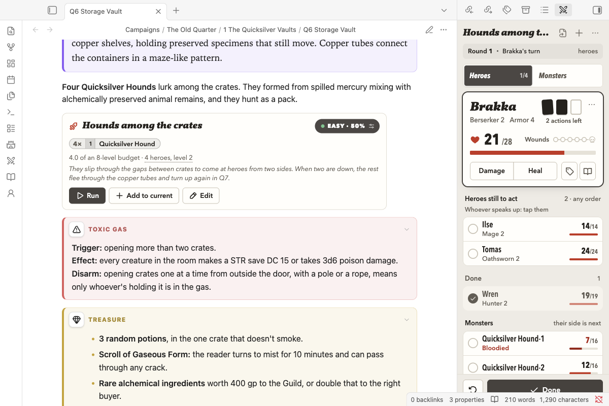
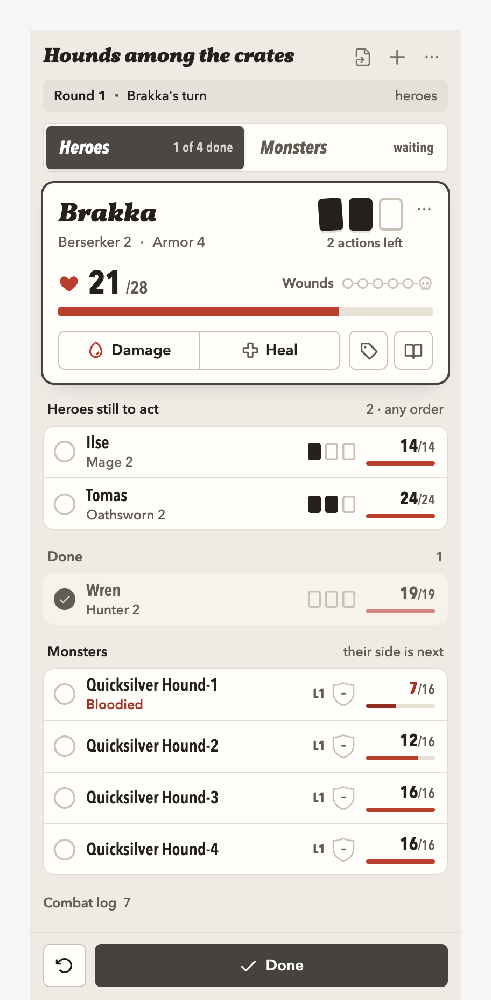
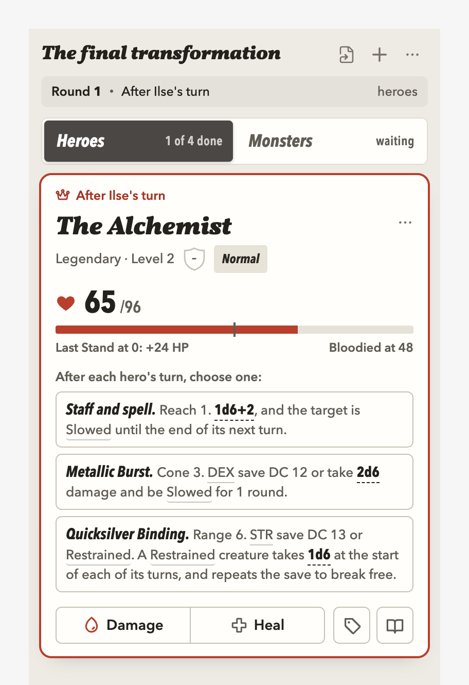
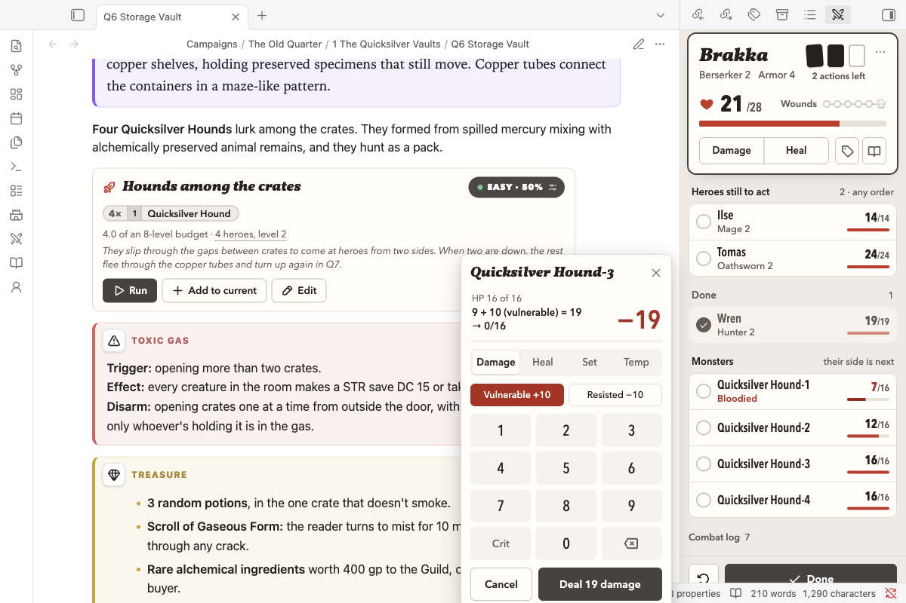
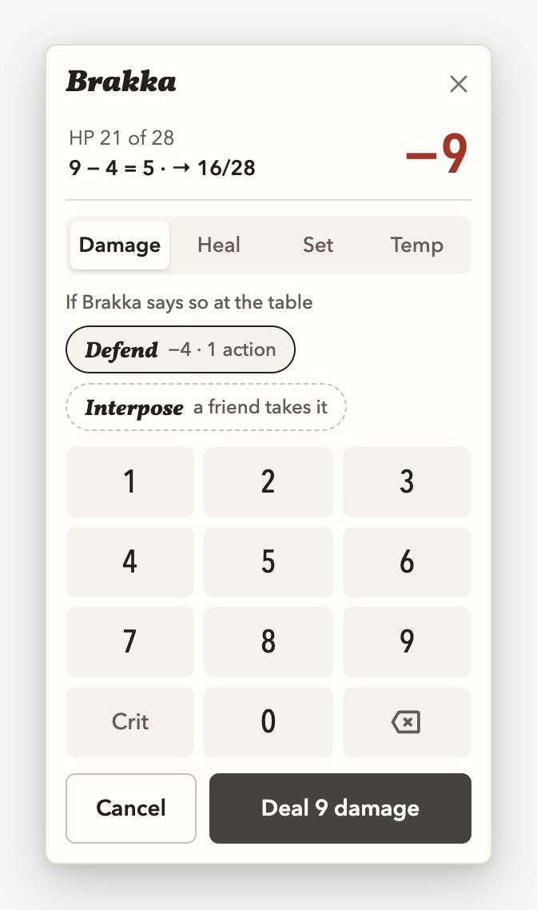
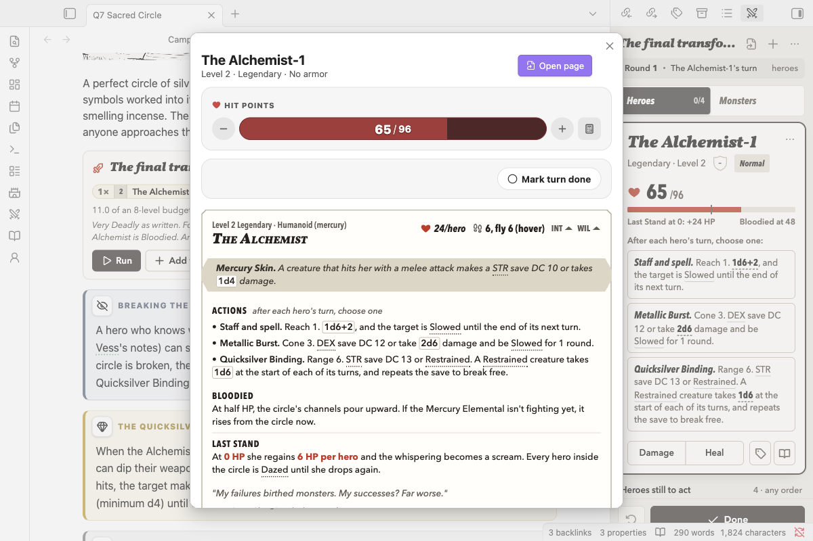

# Combat tracker

Nimble's turn order: the heroes act first, in any order, then the monsters. The tracker shows whoever is acting on a big card, with everyone else in a queue below it.

## Starting a fight

**Run** on an [encounter block](encounters.md) loads its monsters and your party. You can also start from the tracker itself: **+** adds monsters, and the people button adds the party.

Before the fight, the **Initiative** list has a box for each hero. Type what they rolled: it sets their actions on the first turn (1–9: one action, 10–19: two, 20 or more: all three). Everyone has three after that. Leave a box empty for three.

**Heroes go first** starts round 1. (With no heroes in the fight, it's **Start combat**.)

## Running a fight

- **The card** is whoever is acting. It shows their HP, their actions and Wounds (heroes), their armor and actions (monsters), and **Damage** | **Heal**, **Add a condition** and a book button that opens their stat block or character sheet.
- **Heroes go in any order.** Tap whoever speaks up and they're on the card. **Done** at the bottom marks their turn done: they move to **Done**, grey and ticked, with their actions back for next time. When every hero has gone, the monsters' side starts.
- **Monsters** go one after another: **Next: Quicksilver Hound-2** at the bottom names who's next, and after the last one it's **Round 2**. Tap any monster to take it out of order.
- **Heroes** | **Monsters** at the top shows each side and how many have gone. Tap a side to switch to it; nothing is enforced.
- **Back** (the arrow beside the main button) undoes the last step: who was on the card, who had gone, actions and condition counts. HP stays as it is.
- The ring on a row marks that turn done, or undoes it, without putting them on the card. On a desktop, drag a row to change the order.
- **Add monster** (the **+**) opens the compendium set to adversaries: type `3 goblin` and press Enter, or tap a row's **+** (Shift adds two); each row shows how many are already in the fight.

The **⋯** menu has the rest: **Encounter settings…**, the round (**Next round**, **Back to round 1**), **Copy summary**, **Append summary to source note**, **Save fight to a note**, **End combat**, **Restart** and **Clear encounter**.

- **End combat** keeps HP, Wounds and conditions: **Resume round N** picks it back up, and **New fight** starts again at round 1.
- **Save fight to a note** writes the fight to a note in a `Fights` folder next to the note it came from, with where everyone stands and a **Resume fight** button. The encounter block in the original note offers **Resume round N** too, so you can stop mid-fight at the end of a session and carry on next time.

### Keys

With the tracker focused (click anywhere in it), and not while typing in a box:

| Key | What it does |
|---|---|
| ↑ ↓ | Move through the card and the queue |
| Enter (or →) | Put the creature you're on onto the card |
| Space | Press the main button: **Heroes go first**, **Done**, **Next: …** |
| Z | Back a step |

## Legendary monsters

A legendary monster acts after each hero's turn. With one in the fight, the button on a hero's card reads **Done · The Alchemist acts**: pressing it turns the card to the monster, headed "After Ilse's turn", with its actions to pick from. Tap the one it uses, and the card remembers it for next time. **Back to heroes** carries on with the heroes (or **Monsters' turn** once they've all gone).

To bring it in only when you want it, turn off **Legendary monsters act after each hero** in **Encounter settings…** (or Settings → Nimble encounters), and tap its row when it's time.

- Its HP is scaled to the party. The card marks where it's **Bloodied** and what its **Last Stand** does ("Last Stand at 0: +24 HP").
- Bloodied and Last Stand appear as prompts under the card when they happen. **Apply** handles Last Stand HP (regain per hero, or a final damage pool with armor), and **Trigger Last Stand** on the card does it by hand.

## HP: the keypad

Tap a combatant's HP, or **Damage** or **Heal** on the card. The keypad opens beside the tracker (a bottom sheet on phones):

- **Damage**, **Heal**, **Set** or **Temp** HP at the top.
- **Crit** is on the keypad. Monsters also get **Vulnerable +10** and **Resisted −10**.
- Hold the delete key (⌫) to clear.
- The top shows the result before you apply it, armor included: `15 − 10 (Medium armor) = 5 → 19/24`. The big number and the button say the damage that lands: **Deal 5 damage**.
- With a keyboard you can just type: `12` then Enter for damage, `12!` for a crit, `+5` to heal, `=20` to set HP, `t5` for temp HP, and `12v` / `12r` for a monster's vulnerability or resistance. Escape closes it.

### Defend and Interpose

A hero's damage keypad has two quiet chips, for when the player says so: **Defend** takes their Armor off the hit (not a crit's), and **Interpose** has a friend take it instead (pick who). Each costs whoever did it an action, and goes in the combat log. You can use both: Defend then uses the friend's Armor.

## Quick look

The book button on the card (or **View stat block** in a row's ⋯ menu) opens a quick look over the tracker, instead of sending you to the page:

- **Monsters** show their full Nimble stat block, with clickable dice and condition names.
- **Heroes** show their page, if your vault has a note with their name.
- At the top is the fight: the HP bar (tap it for the keypad), actions and Wounds for heroes, **Mark turn done**, and conditions. It stays live as the fight changes.
- **Open page** (or **Open in compendium**) goes to the note when you do want it. Escape closes the quick look.

## Rules it handles

- **Monster armor:** Medium (−10) and Heavy (−20) are subtracted automatically, and crits ignore armor. The card and each row show it on a shield (M, H, or – for none).
- **Heroes:** actions from Initiative on the first turn, three after that. Dropping to 0 HP adds 1 Wound and makes the hero Dying; damage while Dying adds 2 Wounds (3 on a crit).
- **Minions** share one row, with a square for each. Any hit drops one; big hits drop more (one per full die of damage). **Group attack** on the card rolls all of them at once: 1s miss, no crits, and one Defend covers the total.
- **Statuses:** all the 3.3 conditions plus minor statuses and your own custom ones. The condition list says what each one does. Apply one for a set number of rounds or until removed; Empowered and Weakened take a value. Durations count down when that combatant's turn ends. See [Timed statuses](#timed-statuses).
- **Combat log and summary:** the log is folded under the queue. **Copy summary** and **Append summary to source note** are in the ⋯ menu, for your session log.

## Timed statuses

A status can last a number of rounds, end when a save succeeds, and do something at the start or end of its creature's turn: deal damage, call for a save, or remind you of something.

- **Your own:** in the condition list (the tag button on the card), type a name that isn't there and tap **New: …**. Choose how long it lasts (**Until removed**, **Rounds** or **Until saved**) and add what it does each turn: **Damage** (dice, and a type if you like), **Save** (STR, DEX, INT or WIL, a DC, and whether a success ends it) or **Reminder** (a line of text). **Keep in my conditions** keeps it in the list for next time.
- **When it counts down:** at the end of its creature's turn, or the start; on its own turn, or the turn of whoever caused it.
- **Changing one:** tap its chip; changes apply as you make them. Long-press (or right-click) a status in the list to set its timing before you add it.
- **When it fires:** a side's turn starting is the start of every turn on that side; marking a turn done (or the round ending) is its end. A dialog asks for each effect: **Roll 1d6 and apply** or **Skip** for damage (Nimble's armor applies, as if you'd typed it in), **Passed** or **Failed** for a save. Reminders show as a notice.

## Several encounters at once

Turn on **Multiple encounters** in settings to keep more than one fight in the tracker (a running fight and the next room, say) and switch between them.
