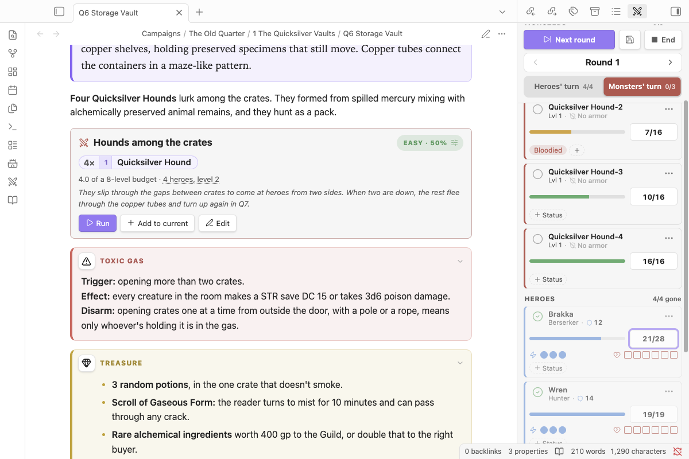
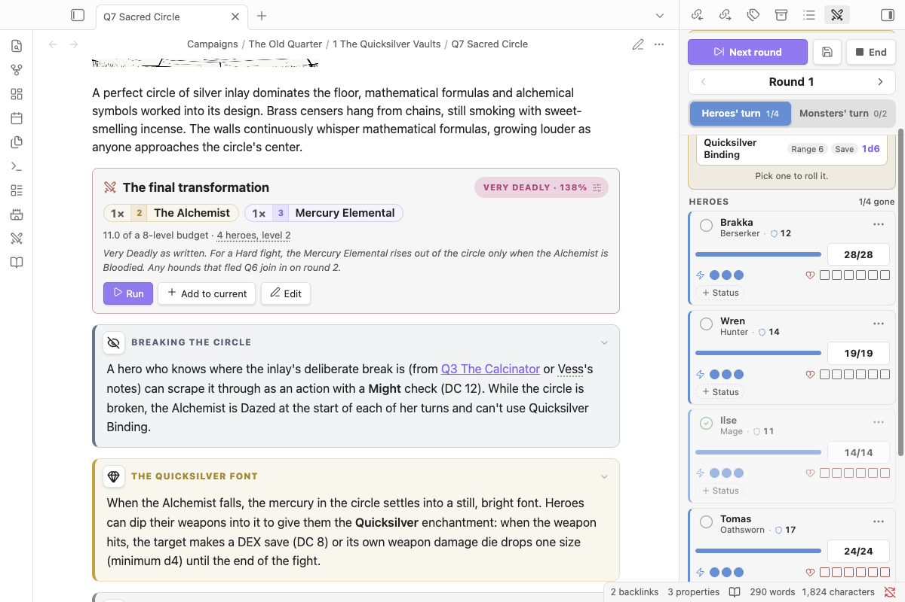
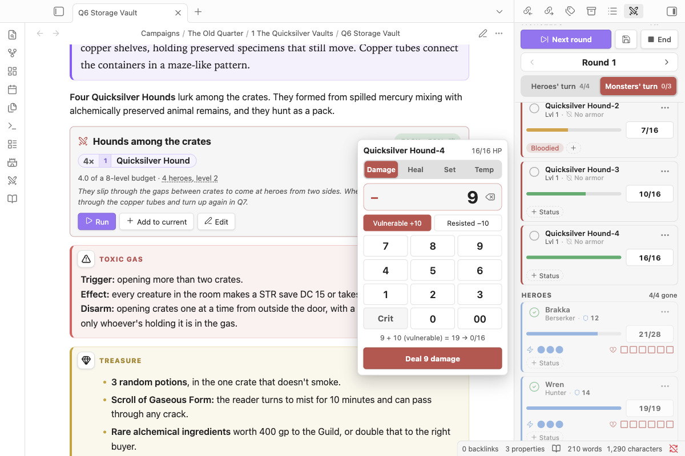

# Combat tracker

Nimble turn order: heroes act first, in any order, then the monsters.

## Running a fight

The controls stay pinned to the top of the tracker while the list scrolls.

- **Start combat** begins round 1 with the heroes' turn. During combat it becomes **Next round**, and **End** stops the fight. HP, Wounds and conditions are kept: **Resume round N** picks it back up, and **New fight** starts again at round 1.
- **Save** (the disk button) writes the fight to a note in a `Fights` folder next to the note it came from. The note has a digest of where everyone stands and a **Resume fight** button. The encounter block in the original note offers **Resume** too, so you can stop mid-fight at the end of a session and carry on next time.
- **Round** steps back and forward if you need to fix the count.
- **Heroes' turn / Monsters' turn** shows whose turn it is and how many have gone (`2/4`), and whoever's turn it is sits at the top of the list. Tick the circle on a card when that combatant has gone. When every hero has gone, it switches to the monsters' turn by itself. **Next round** resets everyone and counts durations down.
- **Add monster** opens a search of the whole bestiary, your own monsters included, with filters for Regular, Minion, Legendary and your own monsters. Each row has a quantity and an **Add** button, and adding from a row keeps the dialog open so you can build a whole fight at once. Typing `3 goblin` starts the quantity at 3; Enter adds the selected row and closes. **Add party** appears until your heroes are in.

## HP: the calculator

Click or tap a combatant's HP. A calculator opens beside the tracker (a bottom sheet on phones):

- It starts on **Damage**. Switch to **Heal**, **Set** or **Temp** HP at the top.
- **Crit** is on the keypad. Monsters also get **Vulnerable +10** and **Resisted −10**. These only apply to damage; the keypad stays the same size in every mode.
- Hold the delete key (⌫) to clear.
- The line above the button shows the result before you apply it, armor included: `15 − 10 (Medium armor) = 5 → 19/24`.
- With a keyboard you can just type: `12` then Enter for damage, `12!` for a crit, `+5` to heal, `=20` to set HP, `t5` for temp HP, `12v` / `12r` for vulnerable / resisted. Escape closes it.

## Quick look

Click anyone's name in the tracker (or **View stat block** in their ⋯ menu) and their sheet opens over the tracker instead of sending you to their page:

- **Monsters** show their full Nimble stat block, with clickable dice and condition names.
- **Heroes** show their page, if your vault has a note with their name.
- At the top is the fight: **Mark turn done**, the HP bar and HP button (tap for the calculator), actions and Wounds for heroes, and statuses. It stays live as the fight changes.
- **Open page** (or **Open in bestiary**) goes to the note when you do want it. Escape closes the quick look.

## Reading a card

Each card shows the name, then a line with the level (or a hero's class and their Defense shield) and the monster's armor: **No armor**, **Medium** (−10 per hit) or **Heavy** (−20). Below that is the HP bar with the HP button beside it.

## Rules it handles

- **Monster armor:** Medium (−10) and Heavy (−20) are subtracted automatically, and crits ignore armor.
- **Heroes:** action pips (set them from Initiative: 1–9 → 1, 10–19 → 2, 20+ → 3) and Wound pips sit on one line under the HP bar. Dropping to 0 HP adds 1 Wound and makes the hero Dying; damage while Dying adds 2 Wounds (3 on a crit).
- **Minions** share one row with a pip each. Any hit drops one; big hits drop more (one per full die of damage). **Group attack** rolls all of them at once: 1s miss, no crits, and one Defend covers the total.
- **Legendary monsters** have HP scaled to the party, and act after each hero's turn: click their name to see their choices, with clickable dice. Bloodied and Last Stand appear as prompts, and **Apply** handles Last Stand HP (regain per hero, or a final damage pool with armor).
- **Statuses:** all the 3.2 conditions plus minor statuses and your own custom ones. Apply one for a set number of rounds or until removed; Empowered and Weakened take a value. Durations count down when that combatant's turn ends.
- **Combat log and summary:** in the ⋯ menu, **Copy summary**, or **Append summary to source note** for your session log.

## Several encounters at once

Turn on **Multiple encounters** in settings to keep more than one fight in the tracker (a running fight and the next room, say) and switch between them.
